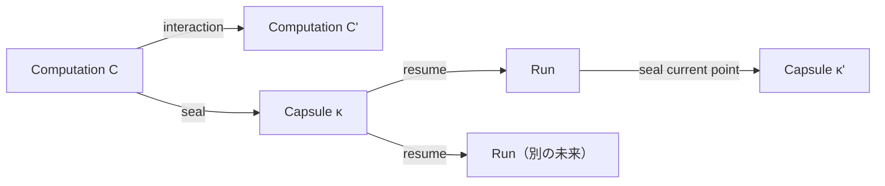
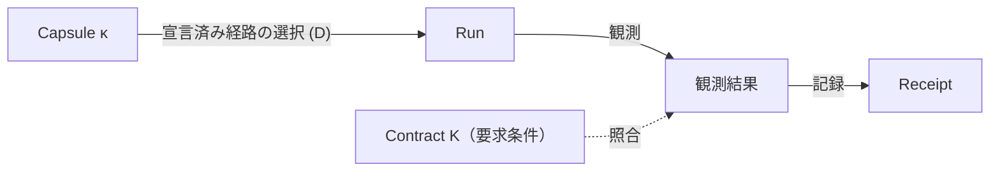

# Ato

**自分の計算機でソフトウェアを動かす。**

Atoは、自分が管理するハードウェア（デスクトップ、自宅サーバー、ワークステーション、クラウドVM）でソフトウェアを動かすためのオープンソースのランタイムです。Atoの計算モデルを使い、**何を維持する必要があるか**と**それをどう実現するか**を分離するため、実装を変えても要求条件が暗黙に変わりません。

このリポジトリはその実行側、すなわち `ato` CLIとローカルランタイム、Adapter、関連ツールを提供します。[ato.run](https://ato.run/) は同じモデルの上に構築された任意のWebサービスです。[About Ato](https://ato.run/about/) · [English](README.md) · [技術ドキュメント](docs/README.md)

## Ato Runnerとは何か

Atoという名前で呼ばれるものが3つあります。これらを分けておくことが重要です。

| 役割 | 内容 | 現在の所在 |
|---|---|---|
| **Ato** | 計算モデルとプロトコル：Computation、Capsule、Run、Contract K、Derivation D、receipt | [概念](docs/concepts/computation.md)、[仕様](docs/specifications/README.md) |
| **Ato Runner** | オープンソースの実行側：自分のハードウェアでソフトウェアを動かし、対応している範囲で継続する | このリポジトリ。ローカルランタイムとCLIは `ato` バイナリで、独立した `ato-runner` 配布物はまだ存在しない |
| **ato.run** | 発見・共有・Runner接続のための任意のWebサービス | 別のプロダクト面。[ato.run](https://ato.run/) |

「Ato Runner」はこのリポジトリが担う役割を指します。CLIの裏に別のランタイムが隠れているわけではなく、ローカル利用にato.runのアカウントは不要です。

## なぜセルフホストか

必要なソフトウェアを動かせる計算機を、すでに持っているかもしれません。

- **自分のハードウェアを使う。** ローカルPC、自宅サーバー、ワークステーション、管理下のリモートマシンで動かせます。
- **データの管理を保つ。** ローカル実行とInstanceはCLIのデータディレクトリ（`ATO_HOME`）配下に書き込みます。外部接続は前提にせず、Bindingとして宣言します。
- **既存のツールを使う。** Docker、Nix、通常のプロセス、VMスナップショットは有効な実現手段です。Atoはそれらを置き換えません。
- **実現の前に条件を記述する。** Contract（K）が満たすべき条件を宣言し、Derivation（D）がその実現方法を宣言します。1つのbundleに複数のDを宣言できます。
- **動いたことを検証する。** 検証器は観測結果をreceiptに記録し、`fully_satisfied` は宣言した全観測が満たされた場合だけtrueになります。

## セルフホスト優先、クラウドは任意

ローカル実行にアカウントも中央サービスも不要です。ato.runへの接続は任意で、現状では発見・共有・Connected Runnerの制御面がato.run経由で提供されます。目的は計算機ごとの違いを隠すことではなく、維持すべき条件を保ちながら実現方法を選べるようにすることです。

現在のツリーに、ato.runを使わないリモート管理の経路はありません。ユーザー所有のConnected Runnerはato.run経由で登録します（[ユーザー所有Runnerの接続](docs/guides/connected-runner-self-host.md)）。

## 何を動かせるか

現在は、少なくとも1つのDerivationを宣言した `.capsule` bundleを実行できます。現行ツリーで実現できるのは次のとおりです。

- 封印されたworkspaceから配信する静的Webアプリケーション
- 固定されたPythonプロセス
- digestで固定したimage、platform、リソース上限を持つOCIコンテナ

このリポジトリのサンプルにはDatasetteやローカルLLMのデモがあります。すべての経路がすべてのホストで動くわけではありません。ランタイム、platform、権限、依存関係はadmissionの判定対象であり、ランタイムの欠如はbundleの破損ではありません。同梱のアプリカタログはなく、発見はato.runの機能です。ソースが現行のauthoring schemaに合う場合は `ato pack` でbundleを作成できます。

## クイックスタート

アカウントは不要です。[rust-toolchain.toml](rust-toolchain.toml) のRustツールチェーンを用意し、リポジトリをcloneしてCLIをビルドし、同梱の静的bundleを実行します。

```sh
git clone https://github.com/ato-run/ato.git
cd ato
cargo build -p ato-cli --bin ato --locked
mkdir -p .tmp/getting-started
target/debug/ato run samples/interop-static.capsule --no-open \
  --verification-receipt .tmp/getting-started/receipt.json
```

このコマンドはbundleの宣言された経路と、取得済みのHTTP観測をこのホスト上で検証し、receiptを書き出します。Python 3で確認できます。

```sh
python3 -c 'import json; r=json.load(open(".tmp/getting-started/receipt.json")); print("fully_satisfied:", r["fully_satisfied"]); [print(o["id"] + ":", o["outcome"]) for o in r["observations"]]'
```

```text
fully_satisfied: True
app-proof: satisfied
source-identity: satisfied
```

`fully_satisfied` は、このContractがこのRunに対して宣言した観測を満たしたことを意味します。一般的なホスト間移植性やプロセスメモリの復元を実証するものではありません。期待される出力、他の経路、失敗時の境界は[Getting started](docs/guides/getting-started.md)を参照してください。公開済みのCLI成果物は[GitHub Releases](https://github.com/ato-run/ato/releases)にあります。

## 仕組み

### CapsuleとRun

**Computation** は、ある地点から継続できる計算であり、ファイルやプロセスそのものではありません。**Capsule** は、封印された、不変で参照可能な継続地点です。Capsuleを再開すると**Run**が開始され、計算を進められます。Runの現在地点は再び新しいCapsuleとして封印でき、同じCapsuleから複数のRunを開始すれば、Capsuleを変更せずに異なる未来へ分岐できます。



### ContractとDerivation

- **Contract K** は、実現が満たすべき条件を宣言します。HTTPのstatusやbody digest、source closureのdigest、上限付きHTTPシナリオ、TLS観測、保存データのsnapshotなどです。必要な条件はアプリケーションごとに異なり、それを明示する点に意味があります。
- **Derivation D** は、Kを実現する一つの方法を宣言します。入力、ランタイム、Port、ステップ、effectsを含みます。呼び出し側が宣言済みDを明示的に選び、「最適なD」の自動選択や暗黙のフォールバックはありません。
- 検証**Receipt** は、選択されたDと各観測を satisfied / deferred / failed として記録します。`fully_satisfied` は、要求された全観測が満たされた場合だけtrueになります。



Kを満たすことは、Runから得られた観測についての判定です。その実現が同じComputationであることや、Capsuleの参照が同一であることを意味しません。computation-rootとportable applicationのprofileは異なる参照root（`ComputationRef` と `ContractRef`）を使い、相互に読み替えられません。詳細は[アプリケーション契約](docs/concepts/application-contracts.md)のprofile対応表と未決事項を参照してください。

### KとDの実際の形式

以下は同梱の静的bundle（[`samples/interop-static.capsule`](samples/interop-static.capsule)）からの抜粋です。キーはJCSの正規順（ダイジェストが対象とする順）で、ハッシュは短縮しています。

```json
{
  "requirements": [
    {"body_digest": "sha256:5ec8...", "id": "app-proof", "method": "GET",
     "path": "/proof.txt", "port": "app.http", "status": 200,
     "verifier": "ato.contract.http@1"},
    {"digest": "sha256:923c...", "id": "source-identity", "input": "workspace",
     "verifier": "ato.contract.workspace@1"}
  ],
  "schema": "ato.contract/1"
}
```

```json
{
  "effects": "pure",
  "inputs": [{"content_ref": "sha256:923c...", "id": "workspace",
              "protocol": "ato.workspace@1"}],
  "ports": [{"from": "site", "id": "app.http", "protocol": "ato.http@1"}],
  "schema": "ato.derivation/1",
  "state": [],
  "steps": [{"entry": "index.html", "id": "site", "op": "serve",
             "protocol": "ato.browser@1", "source": "workspace",
             "spa_fallback": false}]
}
```

`ContractRef` と `DerivationRef` は、これらのオブジェクトの正規化バイト列のSHA-256です。作成時の入力（`capsule.toml`）、対応表、デコード済みの例は[Contract and derivation formats](docs/guides/contract-and-derivation-format.md)と[Sample K and D objects](docs/guides/contract-derivation-samples.md)にあります。

### 検証済みの結果

| 確認項目 | 記録された結果 |
|---|---|
| 同梱の静的bundleが宣言済み観測を満たす | PASS（macOS、レビュー済みcommit） |
| Kを固定し、sourceとDを変更 | PASS：Kは保持され、新しいDerivationとreceiptが `fully_satisfied` |
| Kを固定し、要求された振る舞いを破壊 | REJECT：`k_preserved` はtrue、`fully_satisfied` はfalse |
| 再起動をまたぐ永続状態の継続 | 未検証 |

変換の記録はLinuxの歴史的証拠であり、fixtureと限界を持ちます。このREADMEのために再実行したものではありません。詳細は[Derivation transformation](docs/guides/derivation-transformation.md)と[研究ツアー](docs/guides/research-tour.md)を参照してください。

## ato.runへの接続（任意）

ato.runはソフトウェアの発見・共有・接続を提供します。ユーザー所有のConnected Runnerは、ato.runのSettingsで発行したコードで登録し、`ato-connected-realization-worker` を実行します。この経路にはato.runのアカウントが必要で、ローカル実行には不要です。公開originは任意で、別途認証が必要です。制御面へのoutbound接続だけではリモートWeb UIアクセスは提供されません。

## セキュリティと制限

- NacelleプロバイダはOSネイティブの隔離を適用します：macOSはSeatbelt、LinuxはBubblewrapとLandlockです。開発モードはセキュリティ境界ではなく、コンテナやVMと同等の境界でもありません。
- 未信頼のアプリケーションは、manifestが宣言する最小のfilesystem/networkポリシーで実行してください。機密パスは既定で拒否されますが、明示的に許可した一覧外のパスは設計上許可されます。
- ホスト間の一般的な状態復元、任意のプロセスメモリ復元、Hosted saved-dataのround-trip証明は現在提供していません。
- Contractの一致は、セキュリティ、ライセンス遵守、副作用の安全性を保証しません。
- Atoは実験的です。すべてのアプリケーションがすべてのホストで動くわけではありません。

## ドキュメント

- [Getting started](docs/guides/getting-started.md)と[Formation](docs/guides/formation.md)
- [研究ツアー](docs/guides/research-tour.md)：モデル、同一性、証拠、未解決の問い
- [Contract and derivation formats](docs/guides/contract-and-derivation-format.md)と[サンプル](docs/guides/contract-derivation-samples.md)
- [Research Q&A](docs/guides/research-qa.md)：テストフレームワークとの比較とよくある主張
- [Runnerとホスティング](docs/guides/runner-hosting.md)、[仕様](docs/specifications/README.md)、[ドキュメント目次](docs/README.md)

## 貢献とライセンス

作業は[GitHub Issues](https://github.com/ato-run/ato/issues)で管理し、設計上の質問は[GitHub Discussions](https://github.com/ato-run/ato/discussions)で受け付けます。ブランチ方針、検証、PRの期待は[CONTRIBUTING.md](CONTRIBUTING.md)を参照してください。

プロジェクトが作成したコードは[Mozilla Public License 2.0](LICENSE)（`MPL-2.0`）で提供します。第三者のコード、fixture、テンプレート、独自のライセンス表示がある資料には、それぞれの条件が適用されます。コードのライセンスは、理論文書と仕様文書に新たなライセンスを付与するものではありません。対象ごとの索引は[ライセンス](docs/licensing.md)を参照してください。

<!-- Compatibility anchors from the previous documentation entry. -->
<a id="ato"></a>
<a id="主なユースケース"></a>
<a id="設計原則everything-can-be-a-capsule"></a>
<a id="コアモデル"></a>
<a id="capsule--run--replay--continue"></a>
<a id="core--kernel-と-adapter"></a>
<a id="materialization"></a>
<a id="背景にある計算理論"></a>
<a id="基本ライフサイクル"></a>
<a id="capsuletoml-の例"></a>
<a id="プロジェクトのスコープ"></a>
<a id="現在の実装状態"></a>
<a id="capsule-run-replay-continue"></a>
<a id="core-kernel-と-adapter"></a>
<a id="設計原則：everything-can-be-a-capsule"></a>
<a id="why-ato"></a>
<a id="license"></a>
