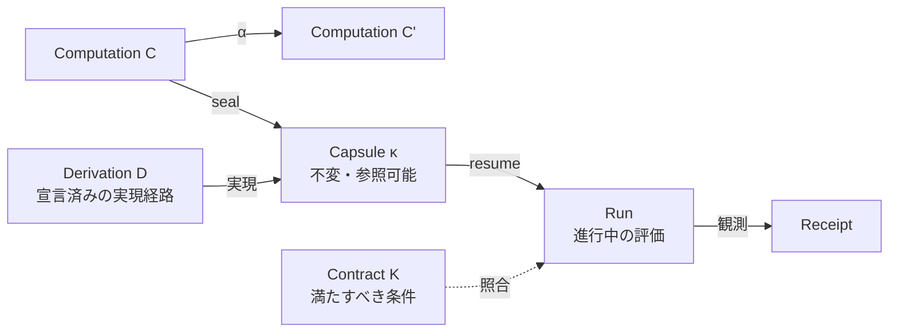

# Ato

Atoは、多様なアプリケーション、データ、作業状態を一つの **Computation** モデルで扱い、保存・共有・実行・継続するための実験的なコンピューティングインターフェースです。中心にあるのは、**何を維持する必要があるか**と**それをどう実現するか**を分離するという考え方です。実現方法を変えても、要求条件が暗黙に変わらないようにします。

- [ato.run](https://ato.run/) — 動作するソフトウェアの発見・試用・保存・共有のためのWebサービス
- [About Ato](https://ato.run/about/) — 背景と意図
- [English](README.md) — 英語版の概要。現在の技術ドキュメントは英語が既定です（[ドキュメント目次](docs/README.md)）

このリポジトリには、計算モデル、ランタイム、CLI、Adapter、関連ツールが含まれます。

## 多様なソフトウェアを、一つのモデルで扱う

テキストエディタはドキュメントを保存し、開発環境はソースと依存関係を管理します。ゲームには進行状態があり、AIアプリケーションにはモデルや処理途中のデータ、外部サービスがあります。Atoは、これらを用途ごとに別々の管理対象として固定しません。

**Computation** は、ある地点から継続できる計算です。ファイルやプロセスそのものではありません。その地点を封印すると、不変で参照可能な **Capsule** になり、再開すると進行中の**Run**になります。Runは分岐でき、次の地点を再びCapsuleとして保存できます。ファイル、アプリケーション、実行状態、操作履歴を、実現方法から独立した一つのライフサイクルで扱います。



これは概念図であり、内部データ構造ではありません。Capsuleの同一性は実現方法に依存せず、Kを満たすことはRunについての判定であって、2つの参照が同一であることの証明ではありません。

## 環境を保存しても、仕事の続きは残らない

身近な人が自分のために作った小さな道具があるとします。その道具を自分のデータで使い、一か所だけ変更し、作者が離れた後も来週別のマシンで開きたい。引き継ぎたいのはソースだけではありません。振る舞い、データと作業状態、外部サービスとの接続、それまでの履歴、そして続きから作業できることが含まれます。ソフトウェアが継続的に生成・変更されるほど、何を変更してよく、何を維持すべきかという問いは、より早く、より頻繁に生じます。

ソースツリーやイメージ、環境を再構築すれば、開始地点は再現できるかもしれません。しかし、その作業を使い続けられた理由まで保存されるとは限りません。**ソフトウェアを再び起動できることと、以前の仕事を継続できることは違います。**

## 実行環境の再現から、Computationの継続へ

クラウドネイティブな実践には、実行環境を準備する手段がすでにあります。Dockerはアプリケーションと依存関係をまとめ、Nixはビルドや環境構築の再現性を高め、VMやスナップショットはより広い実行状態を保持します。Atoはこれらを置き換えるものではありません。

残る問いは、実現方法が変わったときに何が維持されていなければならないかです。Atoが抽象化するのは、ハードウェアやランタイムの違いそのものではなく、実現方法を越えて維持すべき条件です。

## 例：同じ作業を、異なる方法で引き継ぐ

ホワイトボードアプリで図を描き、別のコンピュータで編集を続けたいとします。作業地点を復元する候補は複数あります。

| 候補 | 復元するもの |
|---|---|
| Replay | 初期状態から描画・編集操作を再実行する |
| 保存済みリビジョン | 特定のリビジョンから保存済みドキュメントを取得して開く（Gitベースのソース取得など） |
| Snapshot | 保存されたファイルシステムや実行状態から復元する |

保存するものも復元方法も異なります。必要なのが「青い四角形と赤い矢印が指定された位置にあり、その後も個別に編集できること」であれば、いずれも条件を満たす実現の候補になります。同じ見た目のPNGを生成するだけでは、図形を個別に編集できる状態にはなりません。Undo履歴が必要なら、それも要求条件に含め、対応する復元・検証の経路が必要です。

これらは概念上の候補であり、すべてのアプリケーションについて実装済みという意味ではありません。現在の状態は[検証済みの結果](#研究と証拠)と[Materialization](docs/concepts/materialization.md)を参照してください。

## ContractとDerivation、そして「同一性」の意味

Atoは、条件と実現手段を分離します。

- **Contract K** は、実現が満たすべき条件を宣言します。HTTP応答やデータのダイジェストから、「項目リストがこの順序でこれらの項目を含む」といった意味的な条件まで含みます。
- **Derivation D** は、Kを実現する一つの具体的な経路を宣言します。どの入力を使用し、どのランタイムとPortを必要とし、どう実行するかを含みます。
- 検証**Receipt** は、Runで観測された内容、選択されたD、満たされなかった条件を記録します。

重要なのは、Kを固定したままDを変え、同じ条件で検証することです。これにより、実現方法の変更と要求そのものの変更を区別できます。実現が以前とバイト単位で同一である必要はなく、Kは観測していない状態まで記述するものではありません。

ただし、**同じKを満たすことは、同じComputationであることを意味しません。** Atoは次の3つを区別します。

| 概念 | 意味 |
|---|---|
| `ComputationRef` | Computationを根とする参照同一性（computation-root profile） |
| `ContractRef` | 宣言されたContractを根とする同一性（portable application profile） |
| Contract充足 | ある実現がKを満たすという判定 |

Kを満たすことは、その実現が同じComputationであることや、Capsuleの参照が同一であることを主張しません。2つの参照ドメインは相互に読み替えられません。詳細は[アプリケーション契約](docs/concepts/application-contracts.md)のprofile対応表と未決事項を参照してください。

## 記録済みの例：同じK、異なるソース

アーカイブ済みの transformation v0 実験は、上記のルールを確かめる最小の具体例です。Linux CI で実行されたもので、すべてのプラットフォームで動くという意味ではなく、このREADMEのために再実行したものでもありません。

前提：bubblewrap と Python 3.12.7（`/opt/ato/toolchains/python/3.12.7`、CIのfixture）を持つLinuxと、このリポジトリでビルドしたCLI。

```sh
cargo build -p ato-cli --bin ato --locked
mkdir -p .tmp/transformation-v0
target/debug/ato pack apps/cli/tests/fixtures/transformation-v0/source-a \
  -o .tmp/transformation-v0/bundle-a.capsule
target/debug/ato run .tmp/transformation-v0/bundle-a.capsule --no-open \
  --verification-receipt .tmp/transformation-v0/receipt-a.json
target/debug/ato reform .tmp/transformation-v0/bundle-a.capsule \
  apps/cli/tests/fixtures/transformation-v0/source-b \
  --out .tmp/transformation-v0/candidate
```

記録済みの証拠から期待される結果：

- `.tmp/transformation-v0/candidate/report.json` は `k_preserved: true` と `fully_satisfied: true` を持ち、`frozen_contract_ref` はbaselineのreceiptの `contract_ref` と一致する。
- `.tmp/transformation-v0/candidate/receipt.json` は異なる `derivation_ref` とsource closureを持ち、`fully_satisfied: true` である。
- `candidate.capsule` はfrozen `ContractRef` をrootにし、transport hashは変わる。baselineのbundleとreceiptはbyte-identicalのまま残る。

同じ記録には負例も含まれます。`source-b-broken` は `degraded` なbodyを返し、`reform` は `k_preserved: true`、`fully_satisfied: false` で拒否します（[証拠](docs/archive/2026/ops/contract-preserving-transformation-v0.md)）。これが示すのは、Kを凍結したままソースと実現方法を変えられたことです。再起動後の永続化、hosted実行、安全なロールアウトを示すものではありません。コマンド全体と非主張は[Derivation transformation](docs/guides/derivation-transformation.md)を参照してください。

## 異種Runnerでの実行と、宣言済みのDerivation

Atoは、異なるOS、ランタイム、ハードウェアを持つRunner上でComputationを実現することを目指します。このネットワークの役割は、すべてのRunnerを一つのマシンのように見せることではありません。各Runnerの能力が許す範囲で、**宣言済みの**Derivationを実行し、実行環境と条件を分離しておくことです。

現在の設計では選択は明示的です。呼び出し側が宣言済みのDを選び、Runnerが広告する能力はadmissionの判定に使います。「最適なD」の自動選択や能力の推測、暗黙のフォールバックはありません。ホスト間の一般的な状態復元や異種Runner間のスケジューリングは、研究・開発段階です。[Runnerとホスティング](docs/guides/runner-hosting.md)を参照してください。

**実行環境はComputationを実現する手段であり、Computationの同一性そのものではありません。**

## 現在の状況

Atoは実験的なプロジェクトです。現在のツリーには、Computation/Capsuleのオブジェクト、ライフサイクルコマンド、Adapter、ポータブルbundleの処理、限定的な静的検証の経路、宣言済みDerivationの明示的な選択が含まれます。

次の項目は研究・開発段階であり、完成した保証ではありません。

- 異なるホスト間での一般的な状態復元
- 任意のプロセスメモリの復元
- 異種の実現方法にわたる一般的な状態継続の保証
- AIによる自律的なFormation
- 異種Runner間の一般的な自動選択・最適化

Python、OCI、GPU、永続状態、外部サービスには、それぞれ宣言された経路とホストでの実行許可が必要です。コードの存在はato.run本番での利用可能性を意味しません。Contractの一致だけでは、状態の継続や副作用の安全性は保証されません。[互換性](docs/concepts/compatibility.md)と[状態の継続性](docs/concepts/state-continuity.md)を参照してください。

## クイックスタート

### ローカルCLIを試す（アカウント不要）

[rust-toolchain.toml](rust-toolchain.toml)で指定されたRustツールチェーンをインストールし、リポジトリをcloneしてCLIをビルドし、同梱の静的アプリケーションbundleを実行します。

```sh
git clone https://github.com/ato-run/ato.git
cd ato
cargo build -p ato-cli --bin ato --locked
mkdir -p .tmp/getting-started
target/debug/ato run samples/interop-static.capsule --no-open \
  --verification-receipt .tmp/getting-started/receipt.json
```

この例は、同梱bundleの宣言された経路と、取得済みのHTTP観測をこのホスト上で検証し、receiptを書き出します。Python 3で確認できます。

```sh
python3 -c 'import json; r=json.load(open(".tmp/getting-started/receipt.json")); print("fully_satisfied:", r["fully_satisfied"]); [print(o["id"] + ":", o["outcome"]) for o in r["observations"]]'
```

```text
fully_satisfied: True
app-proof: satisfied
source-identity: satisfied
```

`fully_satisfied` は、このContractが宣言した観測がこのRunで満たされたことを意味します。一般的なホスト間移植性、プロセスメモリの復元、利用者データの継続を実証するものではありません。期待される出力、他の経路、失敗時の境界は[Getting started](docs/guides/getting-started.md)を参照してください。公開済みのCLI成果物は[GitHub Releases](https://github.com/ato-run/ato/releases)にあります。

### ato.runを試す（任意）

ブラウザで[ato.run](https://ato.run/)の公開ソフトウェアを探すか、[2048を試せます](https://ato.run/?view=discover&detail=discover%3Adiscover-2048)。ato.runは別のプロダクト面であり、上記のローカル例に必要ではありません。

## 概念

| 概念 | 意味 |
|---|---|
| **Computation** | ある地点から継続可能な計算 |
| **Capsule** | 封印された、不変で参照可能な継続地点 |
| **Run** | Capsuleから開始され、計算を進める進行中の評価 |
| **Contract（K）** | 実現が満たすべき条件 |
| **Derivation（D）** | Contractを実現する一つの宣言済み経路 |
| **Receipt** | Runで観測された内容と検証結果の記録 |
| **Port / Binding** | 型付きの相互作用境界と、実行時の物理リソースへの対応付け |

詳細は[Computation](docs/concepts/computation.md)と[用語集](docs/glossary-reference.md)を参照してください。

## 研究と証拠

- [研究ツアー](docs/guides/research-tour.md)：問題、モデル、同一性のprofile、データの同一性、検証済みの結果、独立性、未解決の問い。
- アーカイブされた実験：[contract-preserving transformation v0](docs/archive/2026/ops/contract-preserving-transformation-v0.md)と[stateful transformation v1](docs/archive/2026/ops/stateful-transformation-v1.md)。Linuxローカルの証拠とfixture、限界を記録したもので、この概要のために再測定したものではありません。
- [状態の継続性](docs/guides/research-tour.md#10-state-continuity-recorded-evidence-and-the-next-experiment)：記録済みのstatefulシナリオが示すことと、まだ未証明の再起動・export実験。
- [仕様](docs/specifications/README.md)：acceptedのcomputation-root RFCと、portable applicationの実装トラック。

## ドキュメント

一般的な利用者向けドキュメントは[ato.runのドキュメント](https://ato.run/docs/)が所有します。このリポジトリはランタイム、CLI、仕様、運用の技術ドキュメントを所有します（[ドキュメント目次](docs/README.md)）。

- [Getting started](docs/guides/getting-started.md)と[Formation](docs/guides/formation.md)
- [アプリケーション契約](docs/concepts/application-contracts.md)（profile対応表を含む）と[状態の継続性](docs/concepts/state-continuity.md)
- [Runnerとホスティング](docs/guides/runner-hosting.md)と[運用](docs/operations/README.md)
- [理論ドラフト](docs/theory/capsule-process-model.md)と[アーキテクチャ](docs/architecture/README.md)

## 貢献

作業は[GitHub Issues](https://github.com/ato-run/ato/issues)で管理し、設計上の質問は[GitHub Discussions](https://github.com/ato-run/ato/discussions)で受け付けます。ブランチ方針、検証、PRの期待は[CONTRIBUTING.md](CONTRIBUTING.md)を参照してください。このリポジトリにMarkdownのロードマップは置きません。[アーカイブ済みのロードマップ](docs/archive/2026/legacy/OPEN_ISSUES_ROADMAP.md)は履歴として残した資料です。

## ライセンス

プロジェクトが作成したコードは[Mozilla Public License 2.0](LICENSE)（`MPL-2.0`）で提供します。第三者のコード、fixture、テンプレート、独自のライセンス表示がある資料には、それぞれの条件が適用されます。コードのライセンスは、理論文書と仕様文書に新たなライセンスを付与するものではありません。対象ごとの索引は[ライセンス](docs/licensing.md)を参照してください。

<!-- Compatibility anchors from the previous documentation entry. -->
<a id="ato"></a>
<a id="主なユースケース"></a>
<a id="設計原則everything-can-be-a-capsule"></a>
<a id="コアモデル"></a>
<a id="capsule--run--replay--continue"></a>
<a id="core--kernel-と-adapter"></a>
<a id="materialization"></a>
<a id="背景にある計算理論"></a>
<a id="基本ライフサイクル"></a>
<a id="capsuletoml-の例"></a>
<a id="プロジェクトのスコープ"></a>
<a id="現在の実装状態"></a>
<a id="capsule-run-replay-continue"></a>
<a id="core-kernel-と-adapter"></a>
<a id="設計原則：everything-can-be-a-capsule"></a>
<a id="why-ato"></a>
<a id="license"></a>
