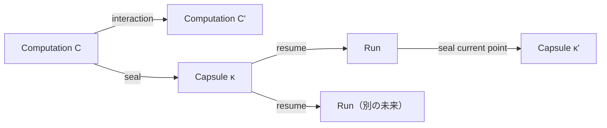
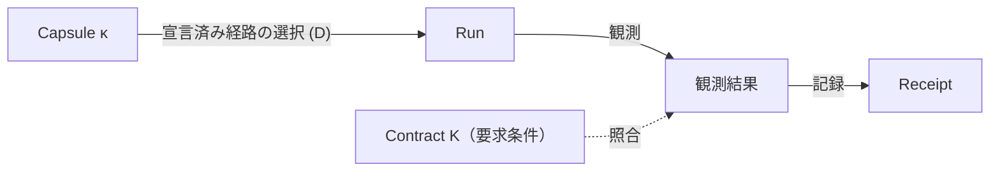

# Ato

ソフトウェアは変わります。実装が変わっても、その上に積み重ねた仕事は失われるべきではありません。

ソフトウェアを生成・書き換えることは容易になりつつあります。一方で、その仕事を使い続けられるようにするデータ、状態、振る舞いを引き継ぐ仕組みは、依然としてアプリケーションごとに異なります。

Atoは、多様なアプリケーション、データ、作業状態を一つの **Computation** モデルで扱い、保存・共有・実行・継続するための実験的なコンピューティングインターフェースです。**何を維持する必要があるか**と**それをどう実現するか**を分離し、実装を変えても要求条件が暗黙に変わらないようにします。

[ato.run](https://ato.run/) · [About Ato](https://ato.run/about/) · [English](README.md) · [技術ドキュメント](docs/README.md)

## なぜ：環境を再構築できても、仕事を継続できるとは限らない

身近な人が自分のために作った小さな道具があるとします。その道具を自分のデータで使い、一か所だけ変更し、作者が離れた後も来週別のマシンで開きたい。引き継ぎたいのはソースだけではありません。振る舞い、データと作業状態、外部サービスとの接続、それまでの履歴、そして続きから作業できることが含まれます。

ソースツリーやイメージ、実行環境を再構築すれば、開始地点は再現できます。しかし、蓄積したデータ、外部資源との接続、作業途中の状態、要求された振る舞いまで復元・検証できるとは限りません。**ソフトウェアを再び起動できることと、以前の仕事を継続できることは違います。**

## 多様なソフトウェアを、一つのモデルで扱う

テキストエディタはドキュメントを保存し、開発環境はソースと依存関係を管理します。ゲームには進行状態があり、AIアプリケーションにはモデルや処理途中のデータ、外部サービスがあります。Atoは、これらを用途ごとに別々の管理対象として固定しません。

**Computation** は、ある地点から継続できる計算です。ファイルやプロセスそのものではありません。**Capsule** は、封印された、不変で参照可能な継続地点です。Capsuleを再開すると**Run**が開始され、計算を進められます。Runの現在地点は再び新しいCapsuleとして封印でき、同じCapsuleから複数のRunを開始すれば、Capsuleを変更せずに異なる未来へ分岐できます。



この図は継続のライフサイクルだけを表します。Contractの検証は別の関係であり、次に示します。

## 概念

| 概念 | 意味 |
|---|---|
| **Computation** | ある地点から継続可能な計算 |
| **Capsule** | 封印された、不変で参照可能な継続地点 |
| **Run** | Capsuleから開始され、計算を進める進行中の評価 |
| **Contract（K）** | 実現が満たすべき条件 |
| **Derivation（D）** | Contractを実現する一つの宣言済み経路 |
| **Receipt** | Runで観測された内容と検証結果の記録 |
| **Port / Binding** | 型付きの相互作用境界と、Runごとの物理リソースへの対応付け。権限やadmissionはその対応付けとは別 |

詳細は[Computation](docs/concepts/computation.md)と[用語集](docs/glossary-reference.md)を参照してください。

## ContractとDerivation：何を再現するか、どう実現するか

再現性に必要な条件は、アプリケーションや用途によって異なります。バイト単位の一致が必要な処理もあれば、同じ振る舞いで十分な処理もあります。編集作業を引き継ぐ場合は、データに加えて編集可能な状態の維持が必要です。Atoでは、こうした要求を実装の暗黙の性質ではなくContractとして明示します。

- **Contract K** は、実現が満たすべき条件を宣言します。HTTP応答、データのダイジェスト、「項目リストがこの順序でこれらの項目を含む」といった意味的条件、編集可能な状態の要件などを含みます。
- **Derivation D** は、Kを実現する一つの具体的な経路を宣言します。どの入力を使用し、どのランタイムとPortが必要で、どう実行するかを含みます。bundleは複数のDを宣言でき、呼び出し側が一つを明示的に選びます。
- 検証**Receipt** は、選択されたDと各観測を satisfied / deferred / failed として記録します。`fully_satisfied` は、要求されたすべての観測が満たされた場合だけ true になります。deferred は、指定されたゲートが後で判定することを意味します。



### KとDの実際の形式

KとDは正規化されたJSONオブジェクトです。同梱の静的bundle（[`samples/interop-static.capsule`](samples/interop-static.capsule)）から抜粋します（ハッシュは短縮）。

キーはJCSの正規順（ダイジェストが対象とする順）で、ハッシュは短縮しています。

```json
{
  "requirements": [
    {"body_digest": "sha256:5ec8...", "id": "app-proof", "method": "GET",
     "path": "/proof.txt", "port": "app.http", "status": 200,
     "verifier": "ato.contract.http@1"},
    {"digest": "sha256:923c...", "id": "source-identity", "input": "workspace",
     "verifier": "ato.contract.workspace@1"}
  ],
  "schema": "ato.contract/1"
}
```

```json
{
  "effects": "pure",
  "inputs": [{"content_ref": "sha256:923c...", "id": "workspace",
              "protocol": "ato.workspace@1"}],
  "ports": [{"from": "site", "id": "app.http", "protocol": "ato.http@1"}],
  "schema": "ato.derivation/1",
  "state": [],
  "steps": [{"entry": "index.html", "id": "site", "op": "serve",
             "protocol": "ato.browser@1", "source": "workspace",
             "spa_fallback": false}]
}
```

`ContractRef` と `DerivationRef` は、これらのオブジェクトの正規化バイト列のSHA-256です。このbundleでは `sha256:b565…`（416バイト）が `root_contract_ref`、`sha256:87a0…`（397バイト）が `derivations` の先頭です。作成時の入力（`capsule.toml`）、authoringから正規形への対応表、process route、receiptは[Contract and derivation formats](docs/guides/contract-and-derivation-format.md)にあり、
同梱bundleからデコードした例は[Sample K and D objects](docs/guides/contract-derivation-samples.md)にあります。

Kが保証するのは宣言した観測だけであり、部分的です。`ContractRef` の一致は正規化されたKのバイト列の一致を意味し、振る舞いの等価性ではありません。Kを満たしても、2つのRunが同じComputationになるわけではありません。検証器の一覧、同一性保証の内容と限界は形式ガイドにあります。

重要なルールは、Kを固定したままDを変え、同じ条件で検証することです。これにより、実現方法の変更と要求そのものの変更を区別できます。実現が以前とバイト単位で同一である必要はなく、Kは観測していない状態まで記述するものではありません。

Kを満たすことは、Runから得られた観測についての判定です。その実現が同じComputationであることや、Capsuleの参照が同一であることを意味しません。computation-rootとportable applicationのprofileは異なる参照root（`ComputationRef` と `ContractRef`）を使い、相互に読み替えられません。境界の詳細は[研究ツアー](docs/guides/research-tour.md)と[アプリケーション契約](docs/concepts/application-contracts.md)を参照してください。

## 異種Runnerでの実行

Atoは、異なる能力を持つRunner上でComputationを実現することを目指します。Runnerはそれぞれ利用可能な実行環境や資源を持ち、宣言済みDerivationの実行に必要な条件を照合します。

実行経路の選択は明示的です。呼び出し側が宣言済みのDを選び、一般的な自動最適化や暗黙のフォールバックは提供しません。RunnerはComputationを実現するための資源であり、Computationの同一性を定義するものではありません。[Runnerとホスティング](docs/guides/runner-hosting.md)を参照してください。

## 例：同じ作業を、異なる方法で引き継ぐ

ホワイトボードアプリで図を描き、別のコンピュータで編集を続けたいとします。状態を再構成する候補は複数あります。

| 実現方法 | 状態の再構成 |
|---|---|
| 操作のReplay | 保存された操作を初期状態に適用する |
| 保存済みデータの読み込み | Gitなどで管理された特定リビジョンのデータを取得して開く |
| Snapshotの復元 | 保存された実行環境や状態を復元する |

必要なのが「青い四角形と赤い矢印が指定された位置にあり、その後も個別に編集できること」であれば、いずれも条件を満たす実現の候補になります。同じ見た目のPNGを生成するだけでは、図形を個別に編集できる状態にはなりません。Undo履歴が必要なら、それも要求条件に含め、対応する復元・検証の経路が必要です。

これらは概念上の候補であり、すべてのアプリケーションについて実装済みという意味ではありません。現在の状態は[Materialization](docs/concepts/materialization.md)を参照してください。

## 検証済みの結果：Contractを固定した変換

アーカイブ済みの transformation v0 実験は、上記のルールを確かめる最小の具体例です。Linux CI の記録済みfixtureで実行されたもので、このREADMEのために再実行したものではありません。

| 確認項目 | 記録された結果 |
|---|---|
| Kを固定し、ソースとDを変更 | PASS：Kは保持され、新しいDerivationとsource closure、receiptは `fully_satisfied` |
| Kを固定し、要求された振る舞いを破壊 | REJECT：`k_preserved` は true、`fully_satisfied` は false |
| 再起動をまたぐ永続状態の継続 | この実験では未検証 |

これが示すのは、Kを凍結したままソースと実現方法を変えられたことです。再起動後の永続化、hosted実行、安全なロールアウトを示すものではありません。コマンド、fixture、receipt、前提条件、非主張は[Derivation transformation](docs/guides/derivation-transformation.md)に、元の記録は[アーカイブ済みの証拠](docs/archive/2026/ops/contract-preserving-transformation-v0.md)にあります。

## クイックスタート

### ローカルCLIを試す（アカウント不要）

[rust-toolchain.toml](rust-toolchain.toml)で指定されたRustツールチェーンをインストールし、リポジトリをcloneしてCLIをビルドし、同梱の静的アプリケーションbundleを実行します。

```sh
git clone https://github.com/ato-run/ato.git
cd ato
cargo build -p ato-cli --bin ato --locked
mkdir -p .tmp/getting-started
target/debug/ato run samples/interop-static.capsule --no-open \
  --verification-receipt .tmp/getting-started/receipt.json
```

この例は、同梱bundleの宣言された経路と、取得済みのHTTP観測をこのホスト上で検証し、receiptを書き出します。Python 3で確認できます。

```sh
python3 -c 'import json; r=json.load(open(".tmp/getting-started/receipt.json")); print("fully_satisfied:", r["fully_satisfied"]); [print(o["id"] + ":", o["outcome"]) for o in r["observations"]]'
```

```text
fully_satisfied: True
app-proof: satisfied
source-identity: satisfied
```

`fully_satisfied` は、このContractがこのRunに対して宣言した観測を満たしたことを意味します。一般的なホスト間移植性、プロセスメモリの復元、利用者データの継続を実証するものではありません。期待される出力、他の経路、失敗時の境界は[Getting started](docs/guides/getting-started.md)を参照してください。公開済みのCLI成果物は[GitHub Releases](https://github.com/ato-run/ato/releases)にあります。

### ato.runを試す（任意）

ブラウザで[ato.run](https://ato.run/)の公開ソフトウェアを探すか、[2048を試せます](https://ato.run/?view=discover&detail=discover%3Adiscover-2048)。ato.runは別のプロダクト面であり、上記のローカル例に必要ではありません。

## 現在の状況

Atoは実験的なプロジェクトです。現在のツリーには、Computation/Capsuleのオブジェクト、ライフサイクルコマンド、Adapter、ポータブルbundleの処理、限定的な静的検証の経路、宣言済みDerivationの明示的な選択が含まれます。

次の項目は研究・開発段階であり、完成した保証ではありません。

- 異なるホスト間での一般的な状態復元
- 任意のプロセスメモリの復元
- 異種の実現方法にわたる一般的な状態継続の保証
- AIによる自律的なFormation

Python、OCI、GPU、永続状態、外部サービスには、それぞれ宣言された経路とホストでの実行許可が必要です。コードの存在はato.run本番での利用可能性を意味しません。Contractの一致だけでは、状態の継続や副作用の安全性は保証されません。[互換性](docs/concepts/compatibility.md)と[状態の継続性](docs/concepts/state-continuity.md)を参照してください。

## 研究と証拠

- [研究ツアー](docs/guides/research-tour.md)：問題、モデル、同一性のprofile、データの同一性、検証済みの結果、独立性、未解決の問い。
- [状態の継続性](docs/guides/research-tour.md#10-state-continuity-recorded-evidence-and-the-next-experiment)：記録済みのstatefulシナリオが示すことと、まだ未証明の再起動・export実験。
- アーカイブされた実験：[contract-preserving transformation v0](docs/archive/2026/ops/contract-preserving-transformation-v0.md)と[stateful transformation v1](docs/archive/2026/ops/stateful-transformation-v1.md)。Linuxローカルの証拠とfixture、限界を記録したもので、この概要のために再測定したものではありません。
- [Research Q&A](docs/guides/research-qa.md)：Playwrightとの違い、ビルド失敗、Dのスタック、LLMによる調整、Kの限界。
- [仕様](docs/specifications/README.md)：acceptedのcomputation-root RFCと、portable applicationの実装トラック。

## ドキュメント

一般的な利用者向けドキュメントは[ato.runのドキュメント](https://ato.run/docs/)が所有します。このリポジトリはランタイム、CLI、仕様、運用の技術ドキュメントを所有します（[ドキュメント目次](docs/README.md)）。

- [Getting started](docs/guides/getting-started.md)と[Formation](docs/guides/formation.md)
- [アプリケーション契約](docs/concepts/application-contracts.md)（profile対応表を含む）と[状態の継続性](docs/concepts/state-continuity.md)
- [Runnerとホスティング](docs/guides/runner-hosting.md)と[運用](docs/operations/README.md)
- [理論ドラフト](docs/theory/capsule-process-model.md)と[アーキテクチャ](docs/architecture/README.md)

## 貢献

作業は[GitHub Issues](https://github.com/ato-run/ato/issues)で管理し、設計上の質問は[GitHub Discussions](https://github.com/ato-run/ato/discussions)で受け付けます。ブランチ方針、検証、PRの期待は[CONTRIBUTING.md](CONTRIBUTING.md)を参照してください。このリポジトリにMarkdownのロードマップは置きません。[アーカイブ済みのロードマップ](docs/archive/2026/legacy/OPEN_ISSUES_ROADMAP.md)は履歴として残した資料です。

## ライセンス

プロジェクトが作成したコードは[Mozilla Public License 2.0](LICENSE)（`MPL-2.0`）で提供します。第三者のコード、fixture、テンプレート、独自のライセンス表示がある資料には、それぞれの条件が適用されます。コードのライセンスは、理論文書と仕様文書に新たなライセンスを付与するものではありません。対象ごとの索引は[ライセンス](docs/licensing.md)を参照してください。

<!-- Compatibility anchors from the previous documentation entry. -->
<a id="ato"></a>
<a id="主なユースケース"></a>
<a id="設計原則everything-can-be-a-capsule"></a>
<a id="コアモデル"></a>
<a id="capsule--run--replay--continue"></a>
<a id="core--kernel-と-adapter"></a>
<a id="materialization"></a>
<a id="背景にある計算理論"></a>
<a id="基本ライフサイクル"></a>
<a id="capsuletoml-の例"></a>
<a id="プロジェクトのスコープ"></a>
<a id="現在の実装状態"></a>
<a id="capsule-run-replay-continue"></a>
<a id="core-kernel-と-adapter"></a>
<a id="設計原則：everything-can-be-a-capsule"></a>
<a id="why-ato"></a>
<a id="license"></a>
