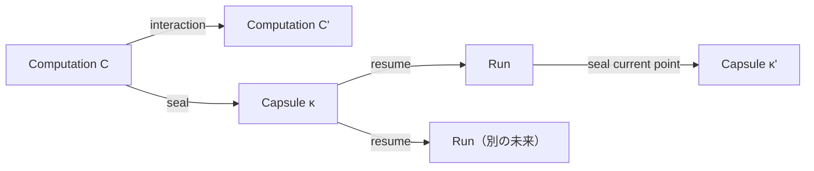

# Ato

**選んだインフラ上で、計算を実行し、保存し、共有する。**

Atoは、自分が管理するハードウェア（デスクトップ、自宅サーバー、ワークステーション、クラウドVM）でソフトウェアを動かし、その作業を封印された参照可能な地点として引き継ぐためのオープンソースのコンピューティングインターフェースです。計算モデルと、ランタイム・CLI・Adapterを組み合わせています。

このリポジトリはオープンソースの中核です。[ato.run](https://ato.run/) は同じモデルの上に構築された公式マネージドサービスで、ソフトウェアの発見、capsuleの共有、自分のハードウェアまたは公式のハードウェアでの実行を提供します。[About Ato](https://ato.run/about/) · [English](README.md) · [技術ドキュメント](docs/README.md)

## 2つの層

Atoとato.runは責務が異なります。オープンソースの中核がサービスなしで使えることを前提に、境界を引いています。

| | **Ato**（このリポジトリ、OSS） | **ato.run**（公式マネージドサービス） |
|---|---|---|
| 計算モデル | Computation、Capsule、Contract K、Derivation D を定義 | モデルを利用 |
| CLI・Runner | `ato` CLIとローカルランタイムを提供 | 公式Runnerを運用 |
| セルフホスト | 対応 | 接続・管理を任意で支援 |
| Capsuleレジストリ | プロトコルとサーバーは**未実装** | 公式レジストリ面 |
| Capsuleの配布 | `.capsule` ファイル。プロトコル実装後は任意のレジストリ | `ato.run/capsules` |
| アプリの発見 | 必須ではない | Discoverを提供 |
| 実行 | ユーザー所有のハードウェア | マネージドクラウドも提供 |
| 課金 | なし | 計算資源・保管・管理サービス |

ローカル実行とローカルInstanceにato.runのアカウントは不要です。レジストリ、発見、マネージド実行は利便性の層であり、モデルの要件ではありません。この表は意図と現状を示すもので、OSSレジストリやato.runなしのリモート経路が実装済みという主張ではありません。境界は[OSS/サービス境界のドラフト](docs/rfcs/draft/ATO_OSS_SERVICE_BOUNDARY.md)に記録しています。

## 実行し、保存し、共有する

- **実行する。** 自分のマシンで `.capsule` bundleを実行します。現行ツリーは静的Webアプリケーション、固定されたPythonプロセス、OCIコンテナを実現できます。
- **保存する。** Capsuleは封印された、不変で参照可能な継続地点です。durableなローカルInstanceはアプリケーションと保存データをRun間で保持できます。ホスト間の一般的な状態復元は提供していません。
- **共有する。** `.capsule` ファイルはbundleのtransportです。現状はファイルの受け渡しが可能で、レジストリのプロトコルと `ato.run/capsules` での公式配備は今後の作業です。

## なぜセルフホストか

必要なソフトウェアを動かせる計算機を、すでに持っているかもしれません。

- **自分のハードウェアを使う。** ローカルPC、自宅サーバー、ワークステーション、管理下のリモートマシンで動かせます。
- **データの管理を保つ。** ローカル実行とInstanceはCLIのデータディレクトリ（`ATO_HOME`）配下に書き込みます。外部接続はBindingとして宣言します。
- **既存のツールを使う。** Docker、Nix、通常のプロセス、VMスナップショットは有効な実現手段です。Atoはそれらを置き換えません。
- **実現の前に条件を記述する。** Contractが満たすべき条件を宣言し、Derivationがその実現方法を宣言します。1つのbundleに複数のDerivationを宣言できます。
- **動いたことを検証する。** 検証器は観測結果をreceiptに記録し、`fully_satisfied` は宣言した全観測が満たされた場合だけtrueになります。

## 何を動かせるか

現在は、少なくとも1つのDerivationを宣言した `.capsule` bundleを実行できます。現行ツリーで実現できるのは、封印されたworkspaceから配信する静的Webアプリケーション、固定されたPythonプロセス、digestで固定したimage・platform・リソース上限を持つOCIコンテナです。サンプルにはDatasetteやローカルLLMのデモがあります。

すべての経路がすべてのホストで動くわけではありません。ランタイム、platform、権限、依存関係はadmissionの判定対象です。同梱のアプリカタログはなく、発見はato.runの機能です。ソースが現行のauthoring schemaに合う場合は `ato pack` でbundleを作成できます。

## クイックスタート

アカウントは不要です。[rust-toolchain.toml](rust-toolchain.toml) のRustツールチェーンを用意し、リポジトリをcloneしてCLIをビルドし、同梱の静的bundleを実行します。

```sh
git clone https://github.com/ato-run/ato.git
cd ato
cargo build -p ato-cli --bin ato --locked
mkdir -p .tmp/getting-started
target/debug/ato run samples/interop-static.capsule --no-open \
  --verification-receipt .tmp/getting-started/receipt.json
```

このコマンドはbundleの宣言された経路と、取得済みのHTTP観測をこのホスト上で検証し、receiptを書き出します。Python 3で確認できます。

```sh
python3 -c 'import json; r=json.load(open(".tmp/getting-started/receipt.json")); print("fully_satisfied:", r["fully_satisfied"]); [print(o["id"] + ":", o["outcome"]) for o in r["observations"]]'
```

```text
fully_satisfied: True
app-proof: satisfied
source-identity: satisfied
```

`fully_satisfied` は、このContractがこのRunに対して宣言した観測を満たしたことを意味します。一般的なホスト間移植性やプロセスメモリの復元を実証するものではありません。期待される出力、他の経路、失敗時の境界は[Getting started](docs/guides/getting-started.md)を参照してください。公開済みのCLI成果物は[GitHub Releases](https://github.com/ato-run/ato/releases)にあります。

## 仕組み

**Computation** は、ある地点から継続できる計算であり、ファイルやプロセスそのものではありません。**Capsule** は、封印された、不変で参照可能な継続地点です。Capsuleを再開すると**Run**が開始され、計算を進められます。Runの現在地点は再び新しいCapsuleとして封印でき、同じCapsuleから複数のRunを開始すれば、Capsuleを変更せずに分岐できます。



- **Contract K** は、実現が満たすべき観測を宣言します。HTTPのstatusやbody digest、source closureのdigest、上限付きHTTPシナリオ、TLS観測、保存データのsnapshotなどです。
- **Derivation D** は、Kを実現する一つの方法を宣言します。入力、ランタイム、Port、ステップ、effectsを含みます。呼び出し側が宣言済みDを明示的に選び、「最適なD」の自動選択や暗黙のフォールバックはありません。
- **Receipt** は、選択されたDと各観測を satisfied / deferred / failed として記録します。`fully_satisfied` は、要求された全観測が満たされた場合だけtrueになります。

Kを満たすことは、Runから得られた観測についての判定です。その実現が同じComputationであることや、Capsuleの参照が同一であることを意味しません。computation-rootとportable applicationのprofileは異なる参照root（`ComputationRef` と `ContractRef`）を使い、相互に読み替えられません。詳細は[アプリケーション契約](docs/concepts/application-contracts.md)のprofile対応表と未決事項を参照してください。

## Atoとato.runの境界

標準とサービスは分離します。

- Atoの形式やwire文書は、ato.runのアカウント、tenant ID、サービスURLを要求しません。
- レジストリの場所は配備の選択です。公式レジストリだけが唯一のレジストリではなく、モデルは `ato.run` を権威として埋め込みません。
- セルフホストのRunnerは、ローカル作業の実行にato.runの資格情報を要求しません。Connected Runnerの登録経路は任意の橋渡しです。
- 課金、Discoverの審査、モデレーションはサービスの関心事であり、計算モデルには含めません。
- ato.runがなくなっても、既存のcapsuleとこのリポジトリは使える状態を保ちます。

これらは現状の説明であると同時に、今後の作業への制約です。[OSS/サービス境界のドラフト](docs/rfcs/draft/ATO_OSS_SERVICE_BOUNDARY.md)を参照してください。

## ato.runへの接続（任意）

ato.runは発見・共有・Runner接続を提供します。ユーザー所有のConnected Runnerは、ato.runのSettingsで発行したコードで登録し、`ato-connected-realization-worker` を実行します。この経路にはato.runのアカウントが必要で、ローカル実行には不要です。公開originは任意で、別途認証が必要です。制御面へのoutbound接続だけではリモートWeb UIアクセスは提供されません。現在のツリーに、ato.runを使わないリモート管理の経路はありません。

## セキュリティと制限

- NacelleはOSネイティブの隔離を適用します：macOSはSeatbelt、LinuxはBubblewrapとLandlockです。開発モードはセキュリティ境界ではなく、コンテナやVMと同等の境界でもありません。
- 未信頼のアプリケーションは、manifestが宣言する最小のfilesystem/networkポリシーで実行してください。機密パスは既定で拒否されますが、明示的に許可した一覧外のパスは設計上許可されます。
- ホスト間の一般的な状態復元、任意のプロセスメモリ復元、Hosted saved-dataのround-trip証明は現在提供していません。
- Contractの一致は、セキュリティ、ライセンス遵守、副作用の安全性を保証しません。
- Atoは実験的です。すべてのアプリケーションがすべてのホストで動くわけではありません。

## ドキュメント

- [Getting started](docs/guides/getting-started.md)と[Formation](docs/guides/formation.md)
- [Computation](docs/concepts/computation.md)、[アプリケーション契約](docs/concepts/application-contracts.md)、[状態の継続性](docs/concepts/state-continuity.md)
- [Runnerとホスティング](docs/guides/runner-hosting.md)と[ユーザー所有Runnerの接続](docs/guides/connected-runner-self-host.md)
- [仕様](docs/specifications/README.md)、[理論ドラフト](docs/theory/capsule-process-model.md)、[ドキュメント目次](docs/README.md)

## 貢献とライセンス

作業は[GitHub Issues](https://github.com/ato-run/ato/issues)で管理し、設計上の質問は[GitHub Discussions](https://github.com/ato-run/ato/discussions)で受け付けます。ブランチ方針、検証、PRの期待は[CONTRIBUTING.md](CONTRIBUTING.md)を参照してください。

プロジェクトが作成したコードは[Mozilla Public License 2.0](LICENSE)（`MPL-2.0`）で提供します。CLIの[Apache-2.0本文](apps/cli/LICENSE-APACHE)はWiXテンプレートおよび過去に配布されたビルドのために保持します。第三者のコード、fixture、テンプレートにはそれぞれの条件が適用されます。コードのライセンスは、理論文書と仕様文書に新たなライセンスを付与するものではありません。

<!-- Compatibility anchors from the previous documentation entry. -->
<a id="ato"></a>
<a id="主なユースケース"></a>
<a id="設計原則everything-can-be-a-capsule"></a>
<a id="コアモデル"></a>
<a id="capsule--run--replay--continue"></a>
<a id="core--kernel-と-adapter"></a>
<a id="materialization"></a>
<a id="背景にある計算理論"></a>
<a id="基本ライフサイクル"></a>
<a id="capsuletoml-の例"></a>
<a id="プロジェクトのスコープ"></a>
<a id="現在の実装状態"></a>
<a id="capsule-run-replay-continue"></a>
<a id="core-kernel-と-adapter"></a>
<a id="設計原則：everything-can-be-a-capsule"></a>
<a id="why-ato"></a>
<a id="license"></a>
