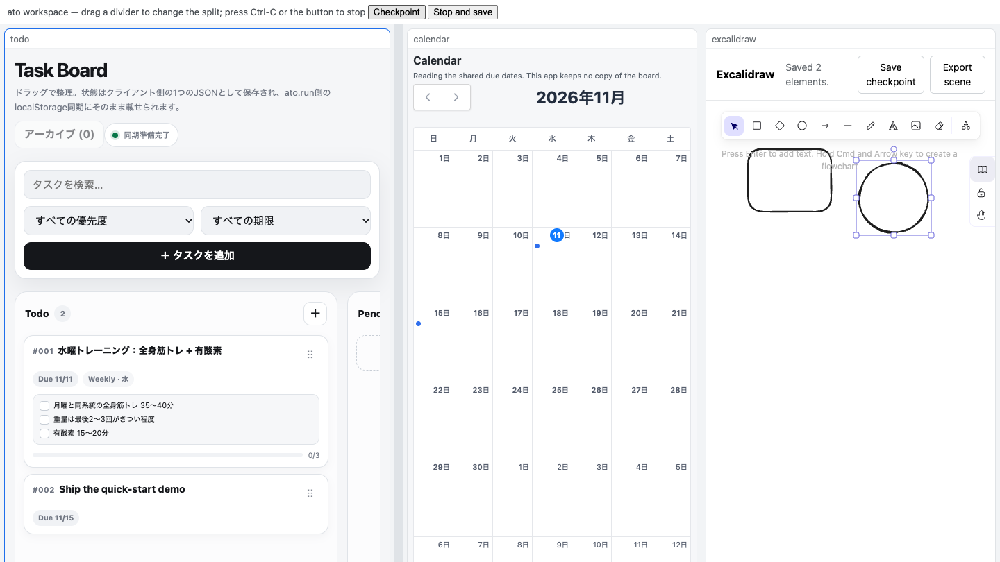

# Ato

**Pick up your work on another computer. — 別のコンピュータで、続きから。**

Atoは、動作中のアプリ一式とそのデータをポータブルなCapsuleとして保存します。ここで作業を保存し、別のマシンで同じタスクと同じレイアウトを開けます。アプリはそれぞれ独立したままで、Workspaceはそれらを構成し、データは宣言されたoperationを通じて流れます。

[76秒のデモを見る](https://ato-run.github.io/ato-samples/media/ato-quick-start-demo-v0.9.1.mp4)
· [クイックスタート](#クイックスタート) · [English](README.md) · [ato.run](https://ato.run/)

[](https://ato-run.github.io/ato-samples/media/ato-quick-start-demo-v0.9.1.mp4)

## デモ

下記の流れを76秒・音声なし・英語字幕で収録したものです。ホワイトボードを編集し、期限付きのタスクを追加し、FullCalendarの月表示が期限のprojectionだけを読むことを確認し、Checkpointして停止し、同じシーン・データ・分割レイアウトでResumeします。公開済みの`ato 0.9.1` CLIと公開v0.9.1 bundleをmacOS arm64で使用して収録しました。同じコマンドとbundleは、[ドキュメント](#ドキュメント)のmacOS/Linux/Windows受入証跡でも扱っています。動画は[`ato-samples` v0.9.1リリース](https://github.com/ato-run/ato-samples/releases/tag/v0.9.1)にもダウンロード用に添付しています（SHA-256 `27a6c6a94825d1c2ae4ea5f259febe0d5c5ee4670d6a6c99321b7bea382b37c6`）。

## クイックスタート

インストールするのはCLIだけです。Rustツールチェーンも`npm`もアカウントも不要です。

### 1. CLIのインストール

- macOS/Linux（Homebrew）: `brew install ato-run/ato/ato`
- Homebrewを使わないLinux/macOS:
  `curl -fsSL https://github.com/ato-run/ato/releases/download/v0.9.1/ato-cli-installer.sh | sh`
- Windows x86_64: リリース資産の
  [`ato-cli-x86_64-pc-windows-msvc.msi`](https://github.com/ato-run/ato/releases/download/v0.9.1/ato-cli-x86_64-pc-windows-msvc.msi)
  を実行

```sh
ato --version    # 0.9.1
```

### 2. サンプルWorkspaceの取得

リリースにはビルド済みbundle（3つのcapsuleと、SHA-256を固定した`workspace.toml`）が添付されています。ビルド作業はありません。

```sh
curl -LO https://github.com/ato-run/ato-samples/releases/download/v0.9.1/ato-oss-quick-start-v0.9.1.tar.gz
curl -LO https://github.com/ato-run/ato-samples/releases/download/v0.9.1/ato-oss-quick-start-v0.9.1.tar.gz.sha256
shasum -a 256 -c ato-oss-quick-start-v0.9.1.tar.gz.sha256
tar xzf ato-oss-quick-start-v0.9.1.tar.gz
cd ato-oss-quick-start-v0.9.1
```

### 3. Workspaceを開く

```sh
ato workspace open workspace.toml --local-data --checkpoint-out workspace.checkpoint.toml
```

CLIがローカルCoordinatorを起動し、3つのアプリを横並びで配信して、ブラウザでshellを開きます。カレンダーが読むのは宣言された期限のprojectionだけで、タスクボードのdocumentそのものは受け取りません。

### 4. 編集・Checkpoint・停止

ペインで編集したあと、**Checkpoint**（または**Ctrl-S**）で動作を続けたまま保存し、**Stop and save**で保存して停止します。

### 5. Resume

```sh
ato workspace open workspace.toml --checkpoint workspace.checkpoint.toml \
  --local-data --checkpoint-out workspace.checkpoint.toml
```

保存したデータと分割レイアウトが戻ります。復元できないペインがある場合、空の状態で黙って開始せず、Resume自体が失敗します。

## 別のコンピュータで続ける

`workspace.toml`、capsule一式、checkpoint（`.state/`ディレクトリを含む）を別ホストへコピーし、そこでResumeコマンドを実行します。capsuleはmacOS/Linux/Windowsのビルド間でバイト同一なので、digestを変更する必要はありません。2台を同時に動かす場合は、1つのCoordinator（`--coordinator`/`--token`）を共有します。leaseが2人目のlive writerを拒否し、引き継ぎ時にepochを進めます。checkpointのコピーはファイル一式の継続であり、writer権限のライブ移転ではありません。

## 基本概念

- **Computation** — 現在地点から継続できる計算・作業。
- **Capsule** — 封印された不変で参照可能な継続地点。実現手段が同一性を決めません。
- **Run** — Capsuleを再開して計算を進める実行。
- **Contract / Derivation / receipt** — ポータブルアプリケーションの観測可能な要件、実現方法の宣言、Runの観測記録。

モデルの詳細は[Computation](docs/concepts/computation.md)と[アプリケーション契約](docs/concepts/application-contracts.md)を参照してください。

## 現在の制約

- Workspace shellが扱うのは**Static Webペインのみ**です。native/processペインは名前付きで拒否され、surface hostが必要です（本リリースの範囲外）。
- Checkpointが復元するのはペインのデータ、分割、アクティブペインです。アプリ内のスクロール位置やテキスト選択は復元されません。
- Excalidrawのシーンは、ペイン内の**Save checkpoint**ボタンで保存します。その後のshellのCheckpointが、他のペインとレイアウトと一緒にそのシーンを取り込みます。未保存のシーンは含まれません。
- サンプルのTask Boardには小さなlegacy local-state移行が残っています。ウォークスルーで意味を持つデータとレイアウトは、宣言されたoperation側です。
- live writerの引き継ぎには共有Coordinatorが必要です。checkpointを別ホストへコピーするのは、オフラインでの継続という別の操作です。
- このウォークスルーに本番サービスは不要で、GitHubのリリースダウンロード以外の外部接続はありません。

## ドキュメント

- [クイックスタートのウォークスルー](docs/guides/quick-start-first-workspace.md)
- [Getting started / ソースからのビルド](docs/guides/getting-started.md)
- [3 OSの受入証跡と実測値](docs/ops/oss-quick-start-local-e2e-20261110.md)
- [サンプルcapsuleのソースとbundle](https://github.com/ato-run/ato-samples)
- [コンセプト](docs/concepts/) · [RFC](docs/rfcs/)

## コントリビュート

IssueとPull Requestを歓迎します。リポジトリの流れは`feature branch → dev → stg → main`です。ローカルの確認方法は上記のガイドを参照してください。
