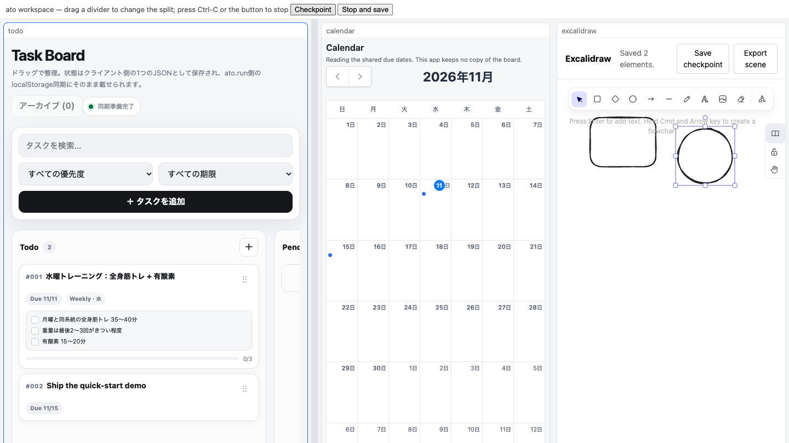

# Ato

**世界には、まだ触ったことのないソフトウェアがたくさんある。動かしてみよう。**

古いマシンから救い出されたゲーム。週末に作られた小さな道具。READMEのスクリーンショットだけで終わらせるには惜しいオープンソースのアプリ。

それを試して、自分のコンピュータで動くようにして、次の人へ渡す。毎回ゼロからやり直さずに、そうできたらどうでしょう。

**Atoは、ソフトウェアを実行環境をまたいで動かし、保存し、続けるためのオープンソースの仕組みです。** アプリケーションに「何が必要か」のポータブルな記述と、それを満たす方法と、実際に何が動いたかの記録を与えます。独立したアプリをWorkspaceに並べ、明示的に許可したデータだけをやり取りさせ、作業の続きから再開できます。

私たちが作りたいのは、ランタイム以上のものです。**人がお互いのためにソフトウェアを動くようにする場所**です。

[**76秒のデモを見る**](https://ato-run.github.io/ato-samples/media/ato-quick-start-demo-v0.9.1.mp4) · [今のリリースを動かす](#今すぐatoを試す) · [次に作るもの](#次の実験capsule-hub) · [English](README.md) · [ato.run](https://ato.run/)

[](https://ato-run.github.io/ato-samples/media/ato-quick-start-demo-v0.9.1.mp4)

## ひとつの仕組みに、思いがけない使い方がたくさん

エミュレーターを蘇らせたい人もいるでしょう。自分のノートPCでしか動かないアプリを持っている人も。すばらしいオープンソースを見つけたのに、手順書を読むほうが使うより長くかかる人も。

私たちは、面白いのは**誰かが動かせた後**だと考えています。

- **動かす。** 役に立つもの、変なもの、美しいもの、ただ楽しいものを試す。
- **新しい場所で動くようにする。** 別のOS、別のマシン、自分のサーバーで。
- **動かし方を共有する。** 次の人が同じパズルを解き直さなくていいように。
- **その上に積み上げる。** ソフトウェアを作った人と、動くようにした人の両方をクレジットする。

目的は、すべてのアプリをAtoのアプリに作り変えることではありません。**既存のソフトウェアをそのままに、動かす・組み合わせる・共有するのを簡単にすることです。**

## 今すぐAtoを試す

**v0.9.1で使えること:** 3つの独立したアプリでできた既製のWorkspaceを起動し、実際のデータを編集し、Checkpointして停止し、同じWorkspaceを再開します。Rustツールチェーンも`npm`もアカウントも不要です。

### 1. CLIをインストールする

**macOS / Linux（Homebrew）**

```sh
brew install ato-run/ato/ato
```

**Linux / macOS（Homebrewなし）**

```sh
curl -fsSL https://github.com/ato-run/ato/releases/download/v0.9.1/ato-cli-installer.sh | sh
```

**Windows x86_64:** [v0.9.1のMSI](https://github.com/ato-run/ato/releases/download/v0.9.1/ato-cli-x86_64-pc-windows-msvc.msi)をインストールします。

```sh
ato --version # 0.9.1
```

### 2. 誰かが作ったWorkspaceを取ってくる

リリースには、ビルド済みのCapsule 3つと、そのSHA-256 digestを固定した`workspace.toml`が入っています。コンパイルは不要です。

```sh
curl -LO https://github.com/ato-run/ato-samples/releases/download/v0.9.1/ato-oss-quick-start-v0.9.1.tar.gz
curl -LO https://github.com/ato-run/ato-samples/releases/download/v0.9.1/ato-oss-quick-start-v0.9.1.tar.gz.sha256
shasum -a 256 -c ato-oss-quick-start-v0.9.1.tar.gz.sha256
tar xzf ato-oss-quick-start-v0.9.1.tar.gz
cd ato-oss-quick-start-v0.9.1
```

### 3. 自分のものにする

```sh
ato workspace open workspace.toml --local-data --checkpoint-out workspace.checkpoint.toml
```

AtoがローカルCoordinatorを起動し、ブラウザでWorkspaceを開きます。**タスクボード＋カレンダー＋ホワイトボード**が横に並びます。

何か描いてみてください。期限付きのタスクを追加すると、カレンダーに表示されます。アプリは独立したままです。カレンダーが見るのは宣言された期限のprojectionだけで、タスクボードのdocument全体は見ません。

作業中は**Checkpoint**（または**Ctrl-S**）を押し、終わったら**Stop and save**を押します。

### 4. 続きから再開する

```sh
ato workspace open workspace.toml --checkpoint workspace.checkpoint.toml \
  --local-data --checkpoint-out workspace.checkpoint.toml
```

データと分割レイアウトが戻ります。復元できないペインがある場合、空のペインを黙って出すのではなく、Atoは再開自体を失敗させます。

**別のコンピュータで続けるには？** `workspace.toml`、Capsule一式、checkpoint（**`.state/`を含む**）をコピーし、同じ再開コマンドを実行します。Capsuleのバイト列は、テストしたmacOS・Linux・Windowsのビルド間で同一です。2台で同じデータを同時に使うには、`--coordinator`と`--token`で同じCoordinatorにつなぎます。そのleaseが2人目の同時writerを防ぎ、引き継ぎ時にepochを進めます。checkpointをオフラインでコピーしても、live writerの権限は移りません。

### 76秒で全体を見る

[字幕付き・音声なしのデモを見る](https://ato-run.github.io/ato-samples/media/ato-quick-start-demo-v0.9.1.mp4): 描く、タスクを作る、その期限がカレンダーに出る、Checkpointする、停止する、再開する。

公開済みの`ato 0.9.1` CLIとv0.9.1のサンプルbundleを使い、macOS arm64で収録しました。同じコマンドとbundleは[macOS / Linux / Windowsの受入証跡](docs/ops/oss-quick-start-local-e2e-20261110.md)でも確認しています。[サンプルのリリースをダウンロード](https://github.com/ato-run/ato-samples/releases/tag/v0.9.1)（デモのSHA-256: `27a6c6a94825d1c2ae4ea5f259febe0d5c5ee4670d6a6c99321b7bea382b37c6`）。

## 次の実験：Capsule Hub

**これは私たちが目指している方向であり、v0.9.1の機能ではありません。**

面白そうなものを見つけて、こう打つところを想像してください。

```sh
# 構想中の体験 — v0.9.1ではまだ使えないコマンド
ato run capsules/game-sample
```

正しいアーカイブを探し回る必要も、10ステップのセットアップ手順もありません。ただ、**これ何をするんだろう。動かしてみよう。**

もし自分のマシンで動かなかったら？ どのコンピュータも同じふりをする代わりに、Atoは互換性のある**Derivation**を探したり、同じ**Contract**を満たす新しいDerivationを作る手助けをしたりできるかもしれません。誰かがやり方を見つけたら、その経路は次の人のために公開できるものになります。

それが**Capsule Hub**の考え方です。動かせるソフトウェア、共有された環境、そしてそれを動かすための様々な方法が集まるコミュニティのレジストリです。

- **Capsuleを公開する。** 他の人が見つけて試せるように。
- **Derivationを提供する。** 元の作品の所有権を取らずに、別のマシンや環境向けに。
- **検証済みの経路と実験を区別する。** 信頼、権限、実行の証拠を明示して。
- **クレジットを付けたままにする。** 元の作者、パッケージした人、移植した人、その後の貢献者へ。

私たちが欲しいのは、*動くかもしれない*ソフトウェアのディレクトリではありません。**動くようにすること**、そしてその発見を共有することに夢中になれるコミュニティです。持続するエコシステムには、ソフトウェアを作り、移植し、保守する人がそれを続ける理由も必要です。貢献と報酬の仕組みは、これからコミュニティと一緒に設計します。

**変なプロジェクトを持ってきてください。役に立つものも。ここで動くとは誰も思わなかったものも。**

## Atoはソフトウェアをどう捉えるか

1コマンドで動かすという遊び心のある目標の下には、厳密なモデルがあります。

| 概念 | 意味 |
| --- | --- |
| **Computation** | 今いる地点から続けられる作業。 |
| **Capsule** | 封印された、不変で参照可能な継続地点。物理的な実現手段からは独立している。 |
| **Run** | Capsuleを再開し、計算を進めること。 |
| **Contract (K)** | 互換な実現として観測上成り立つべきこと。 |
| **Derivation (D)** | ある環境でそのContractを実現する、宣言された方法。 |
| **Receipt** | Runで実際に起きたことの観測記録。 |

この区別が大切です。**1つのContractは、異なるDerivationを持てます。** ポータビリティとは違いがないふりをすることではなく、その違いを人が取り組み、共有できるものにすることです。

[Computation](docs/concepts/computation.md)と[アプリケーション契約](docs/concepts/application-contracts.md)を参照してください。

## できていること、まだ先のこと

魔法を約束するより、正直なプロトタイプを見せたいと考えています。

**v0.9.1では:**

- Workspace shellが扱うのは**Static Webペインのみ**です。native/processペインは明示的に拒否されます。surface hostは本リリースに含まれません。
- Checkpointはペインのデータ、分割レイアウト、アクティブペインを復元します。ペイン内のスクロール位置やテキスト選択は復元しません。
- Excalidrawは、shellのCheckpointの前に、自身の**Save checkpoint**操作が必要です。未保存の編集は取り込まれません。
- サンプルのTask Boardには小さなlegacy local-state移行が含まれます。ウォークスルーで重要なデータのやり取りは、宣言されたoperationを使います。
- live writerの引き継ぎには共有Coordinatorが必要です。checkpointのコピーはオフラインでの継続です。
- ローカルのウォークスルーに本番サービスは不要で、GitHubからのリリース資産のダウンロード以外に外部接続はありません。

**このリリースにまだ含まれないもの:** Capsule Hubでの公開・発見、構想中の`ato run capsules/...`ショートカット、非対応ホストでの自動的な再Formation、Workspace shellのnative/processペイン。

## 面白いところを一緒に作ろう

意外な場所で動かしてみたいソフトウェアがありますか？ 共有したいDerivationは？ 1行のコマンドで済むべき問題は？

**Issueを開いてください。実験を共有してください。動かせたものを見せてください。** 元の作者の仕事も、ソフトウェアをポータブルにする人の仕事も、目に見える形でクレジットされるべきです。

IssueとPull Requestを歓迎します。リポジトリの流れは`feature branch → dev → stg → main`です。ローカルの確認方法はガイドを参照してください。

**さらに見る:** [クイックスタートのウォークスルー](docs/guides/quick-start-first-workspace.md) · [ソースからビルド](docs/guides/getting-started.md) · [3 OSのテスト証跡](docs/ops/oss-quick-start-local-e2e-20261110.md) · [サンプルのソース](https://github.com/ato-run/ato-samples) · [コンセプト](docs/concepts/) · [RFC](docs/rfcs/)

---

**ソフトウェアは、実際に動かせるともっと面白い。**
