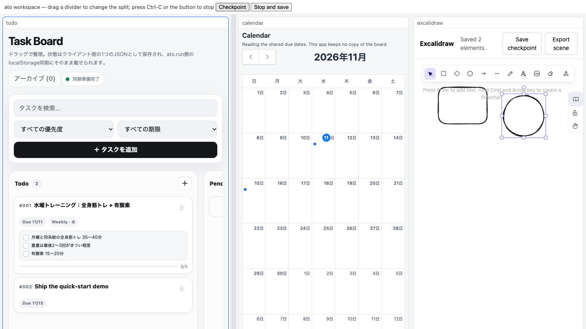

# Ato

**There's a whole world of software out there. Let's run it.**

A game someone rescued from an old machine. A tiny tool built over a weekend. An open-source app that deserves more than a screenshot in a README.

What if you could try it, make it work on your computer, and pass it on—without starting from scratch every time?

**Ato is an open-source way to run, save, and continue software across computing environments.** It gives applications a portable description of what they need, ways to realize those requirements, and a record of what actually ran. You can compose independent apps into a workspace, let them exchange only explicitly permitted data, and pick up where you left off.

We want to make something bigger than a runtime: **a place where people make software runnable for one another.**

[**Try the 76-second demo**](https://ato-run.github.io/ato-samples/media/ato-quick-start-demo-v0.9.1.mp4) · [Run the current release](#try-ato-today) · [What's next](#the-next-experiment-capsule-hub) · [日本語](README.ja.md) · [ato.run](https://ato.run/)

[](https://ato-run.github.io/ato-samples/media/ato-quick-start-demo-v0.9.1.mp4)

## One idea, a thousand unexpected uses

Maybe you want to revive an emulator. Maybe you have an app that only runs on your laptop. Maybe you found a brilliant piece of open-source software, but the instructions take longer than actually using it.

We think the interesting part starts **after** somebody gets it working.

- **Run it.** Try something useful, strange, beautiful, or just plain fun.
- **Make it work somewhere new.** A different OS, a different machine, your own server.
- **Share the way you made it work.** Someone else shouldn't have to solve the same puzzle again.
- **Keep building on it.** Credit the people who created the software and the people who made it runnable.

The goal isn't to turn every app into an Ato app. **It's to let existing software remain itself—and make it easier to run, combine, and share.**

## Try Ato today

**Available in v0.9.1:** launch a ready-made workspace of three independent apps, edit real data, checkpoint it, stop, and resume the same workspace. No Rust toolchain, no `npm`, no account.

### 1. Install the CLI

**macOS / Linux (Homebrew)**

```sh
brew install ato-run/ato/ato
```

**Linux / macOS (without Homebrew)**

```sh
curl -fsSL https://github.com/ato-run/ato/releases/download/v0.9.1/ato-cli-installer.sh | sh
```

**Windows x86_64:** install the [v0.9.1 MSI](https://github.com/ato-run/ato/releases/download/v0.9.1/ato-cli-x86_64-pc-windows-msvc.msi).

```sh
ato --version # 0.9.1
```

### 2. Grab a workspace somebody already made

The release includes three prebuilt Capsules and a `workspace.toml` that pins their SHA-256 digests. Nothing to compile.

```sh
curl -LO https://github.com/ato-run/ato-samples/releases/download/v0.9.1/ato-oss-quick-start-v0.9.1.tar.gz
curl -LO https://github.com/ato-run/ato-samples/releases/download/v0.9.1/ato-oss-quick-start-v0.9.1.tar.gz.sha256
shasum -a 256 -c ato-oss-quick-start-v0.9.1.tar.gz.sha256
tar xzf ato-oss-quick-start-v0.9.1.tar.gz
cd ato-oss-quick-start-v0.9.1
```

### 3. Make it yours

```sh
ato workspace open workspace.toml --local-data --checkpoint-out workspace.checkpoint.toml
```

Ato starts a local Coordinator and opens a workspace in your browser: **task board + calendar + whiteboard**, side by side.

Draw something. Add a task with a due date. Watch the calendar pick it up. The apps stay independent: the calendar sees only the declared due-date projection, not the task board's whole document.

Press **Checkpoint** (or **Ctrl-S**) while working, then **Stop and save** when you're done.

### 4. Pick up where you left off

```sh
ato workspace open workspace.toml --checkpoint workspace.checkpoint.toml \
  --local-data --checkpoint-out workspace.checkpoint.toml
```

Your data and split layout come back. If a pane cannot be restored, Ato fails the resume instead of silently giving you an empty one.

**Another computer?** Copy `workspace.toml`, the Capsules, and the checkpoint **including `.state/`**, then run that same resume command. The Capsule bytes are identical across the tested macOS, Linux, and Windows builds. To use both computers live against shared data, connect to the same Coordinator with `--coordinator` and `--token`; its lease prevents a second simultaneous writer and advances the epoch on hand-over. An offline checkpoint copy doesn't transfer live writer authority.

### See the whole thing in 76 seconds

[Watch the captioned, silent demo](https://ato-run.github.io/ato-samples/media/ato-quick-start-demo-v0.9.1.mp4): draw, create a task, see its due date on the calendar, checkpoint, stop, and resume.

Recorded on macOS arm64 with the published `ato 0.9.1` CLI and v0.9.1 sample bundle. The commands and bundle are also covered by [macOS / Linux / Windows acceptance evidence](docs/ops/oss-quick-start-local-e2e-20261110.md). [Download the sample release](https://github.com/ato-run/ato-samples/releases/tag/v0.9.1) (demo SHA-256: `27a6c6a94825d1c2ae4ea5f259febe0d5c5ee4670d6a6c99321b7bea382b37c6`).

## The next experiment: Capsule Hub

**This is the direction we're building toward—not a feature of v0.9.1.**

Imagine finding something interesting and typing:

```sh
# Proposed experience — NOT yet an available v0.9.1 command
ato run capsules/game-sample
```

No hunting for the right archive. No ten-step setup guide. Just: **I wonder what this does. Let's find out.**

And if it doesn't work on your machine? Instead of pretending every computer is the same, Ato could look for a compatible **Derivation**—or help form a new one that satisfies the same **Contract**. When somebody figures it out, that route becomes something they can publish for the next person.

That's the idea behind **Capsule Hub**: a community registry of runnable software, shared environments, and the many ways people make them work.

- **Publish a Capsule** that others can discover and try.
- **Contribute a Derivation** for another machine or environment, without taking ownership of the original work.
- **Distinguish verified routes from experiments**, with explicit trust, permissions, and run evidence.
- **Keep attribution attached** to the original authors, packagers, porters, and subsequent contributors.

We don't want a directory of software that *might* run. We want a community that gets excited about **making it run**, then sharing that discovery. A sustainable ecosystem must also give the people who create, adapt, and maintain software reasons to keep doing it. The contribution and reward mechanisms are still to be designed with that community.

**Bring the weird projects. Bring the useful ones. Bring the ones nobody thought would run here.**

## How Ato thinks about software

Underneath the playful one-command ambition is a precise model:

| Concept | What it means |
| --- | --- |
| **Computation** | Work that can continue from where it is. |
| **Capsule** | A sealed, immutable, addressable continuation point, independent of its physical realization. |
| **Run** | Resume a Capsule and advance the computation. |
| **Contract (K)** | What must be observably true for a compatible realization. |
| **Derivation (D)** | A declared way to realize that Contract in an environment. |
| **Receipt** | Recorded observations of what actually happened during a Run. |

The distinction matters: **one Contract can have different Derivations**. Portability isn't pretending differences don't exist; it's making those differences something people can work on and share.

Read [Computation](docs/concepts/computation.md) and [Application contracts](docs/concepts/application-contracts.md).

## What's real, and what's still ahead

We'd rather show you an honest prototype than promise magic.

**In v0.9.1:**

- The workspace shell supports **Static Web panes only**. Native and process panes are explicitly refused; a surface host is not part of this release.
- Checkpoints restore pane data, split layout, and active pane, but not in-pane scroll positions or text selections.
- Excalidraw requires its own **Save checkpoint** action before the shell checkpoint; unsaved edits are not captured.
- The sample Task Board includes a small legacy local-state migration. The walkthrough's important data exchange uses declared operations.
- Live writer hand-over requires a shared Coordinator; copying a checkpoint is an offline continuation.
- The local walkthrough needs no production services and contacts none beyond downloading the release assets from GitHub.

**Not yet shipped in this release:** Capsule Hub publishing/discovery, the proposed `ato run capsules/...` shortcut, automatic re-Formation on an unsupported host, and native/process panes in the workspace shell.

## Come build the interesting part

Have a piece of software you'd love to run somewhere unexpected? A derivation to share? A problem that should be a one-line command?

**Open an issue. Share the experiment. Show us what you got running.** Original authorship and the work of people who make software portable both deserve visible credit.

Issues and pull requests are welcome. The repository flow is `feature branch → dev → stg → main`; see the guides for local checks.

**More to explore:** [Quick-start walkthrough](docs/guides/quick-start-first-workspace.md) · [Build from source](docs/guides/getting-started.md) · [Three-OS test evidence](docs/ops/oss-quick-start-local-e2e-20261110.md) · [Sample sources](https://github.com/ato-run/ato-samples) · [Concepts](docs/concepts/) · [RFCs](docs/rfcs/)

---

**Software is more fun when we can actually run it.**
