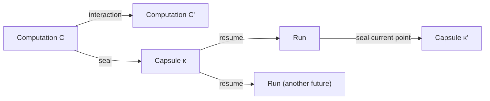
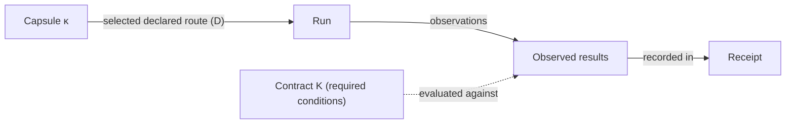

# Ato

**Run software on your own computer.**

Ato is an open-source runtime for running software on hardware you control: a
desktop, home server, workstation or cloud VM. It uses Ato's computation model
to separate what must be maintained from how it is realized, so a change of
implementation does not silently change the requirements.

This repository ships that execution side: the `ato` CLI and local runtime,
adapters and supporting tools. [ato.run](https://ato.run/) is an optional web
service built on the same model. [About Ato](https://ato.run/about/) ·
[日本語](README.ja.md) · [Technical documentation](docs/README.md)

## What is Ato Runner?

Three things share the name Ato. Keeping them separate matters:

| Role | What it is | Where it is today |
|---|---|---|
| **Ato** | The computation model and protocol: Computation, Capsule, Run, Contract K, Derivation D, receipts | [concepts](docs/concepts/computation.md), [specifications](docs/specifications/README.md) |
| **Ato Runner** | The open-source execution side: running and, where supported, continuing software on hardware you control | This repository. The local runtime and CLI are the `ato` binary; a separate `ato-runner` distribution does not exist yet |
| **ato.run** | An optional web service for discovery, sharing and connecting runners | A separate product surface; see [ato.run](https://ato.run/) |

"Ato Runner" describes the role this repository plays. It is not a second
runtime hidden behind the CLI, and using it locally does not require an ato.run
account.

## Why self-host?

You may already have a computer capable of running the software you need.

- **Use your own hardware.** Run applications on a local PC, home server,
  workstation or a remote machine you control.
- **Keep control of your data.** Local runs and Instances write under the CLI
  data directory (`ATO_HOME`). External connections are declared as Bindings
  instead of being assumed.
- **Use existing tools.** Docker, Nix, plain processes and VM snapshots remain
  valid realizations. Ato does not replace them.
- **Describe before realizing.** A Contract (K) states what must hold; a
  Derivation (D) states one way to realize it. A bundle can declare several Ds.
- **Verify what runs.** The verifier records observations in a receipt, and
  `fully_satisfied` is true only when every declared observation holds.

## Self-host first, cloud optional

Local execution needs no account and no central service. Connecting to ato.run
is optional: today it is how discovery, sharing and the Connected Runner control
plane work. The goal is not to hide every difference between computers, but to
let you choose how software is realized while preserving the conditions that
matter.

There is no ato.run-free remote management path in the current tree. A
user-owned Connected Runner is enrolled through ato.run; see
[Connect a user-owned Runner](docs/guides/connected-runner-self-host.md).

## What can I run?

Today: a `.capsule` bundle that declares at least one Derivation. The current
tree can realize:

- static web applications served from a sealed workspace;
- pinned Python processes;
- OCI containers with a pinned image, platform and resource limits.

Samples in this repository include Datasette and local LLM demos. Not every
route runs on every host: runtimes, platforms, permissions and dependencies are
admission checks, and a missing runtime is not bundle corruption. There is no
bundled application catalogue; discovery is an ato.run feature, and a bundle
can be built from source with `ato pack` when the source matches the current
authoring schema.

## Quick start

No account is required. Install the Rust toolchain declared in
[rust-toolchain.toml](rust-toolchain.toml), clone the repository, build the CLI,
and run the supplied static bundle:

```sh
git clone https://github.com/ato-run/ato.git
cd ato
cargo build -p ato-cli --bin ato --locked
mkdir -p .tmp/getting-started
target/debug/ato run samples/interop-static.capsule --no-open \
  --verification-receipt .tmp/getting-started/receipt.json
```

This verifies the bundle's declared route and its captured HTTP observation on
this host, then writes a receipt. Inspect it with Python 3:

```sh
python3 -c 'import json; r=json.load(open(".tmp/getting-started/receipt.json")); print("fully_satisfied:", r["fully_satisfied"]); [print(o["id"] + ":", o["outcome"]) for o in r["observations"]]'
```

```text
fully_satisfied: True
app-proof: satisfied
source-identity: satisfied
```

`fully_satisfied` covers the observations declared by this Contract for this
Run. It does not demonstrate general cross-host portability or restoration of
process memory. See [Getting started](docs/guides/getting-started.md) for the
expected output, other routes and failure boundaries. Published CLI artifacts
are listed in [GitHub Releases](https://github.com/ato-run/ato/releases).

## How it works

### Capsule and Run

A **Computation** is the work that can continue from a point, not a file or a
process. A **Capsule** is a sealed, immutable, addressable continuation point.
Resuming a Capsule starts a **Run**; the Run advances the computation, and its
current point can be sealed again as a new Capsule. Starting several Runs from
the same Capsule lets work branch into different futures without mutating the
Capsule.



### Contract and Derivation

- **Contract K** declares what a realization must satisfy: an HTTP status or
  body digest, a source-closure digest, a bounded HTTP scenario, a TLS
  observation, or a saved-data snapshot. The conditions differ per application;
  that is the point of making them explicit.
- **Derivation D** declares one way to realize K: inputs, runtime, Ports,
  steps and effects. The caller selects a declared D explicitly; there is no
  automatic best-D optimizer or implicit fallback.
- A verification **receipt** records the selected D and each observation as
  satisfied, deferred or failed. `fully_satisfied` requires every required
  observation to be satisfied.



Satisfying K is a judgment about observations from a Run. It does not mean the
realization is the same Computation, or that two Capsule references are
identical. The computation-root and portable-application profiles use different
reference roots (`ComputationRef` and `ContractRef`) and must not be read as
each other; [application contracts](docs/concepts/application-contracts.md) has
the profile map and the open decisions.

### What K and D look like

The examples below are abbreviated from the supplied static bundle
([`samples/interop-static.capsule`](samples/interop-static.capsule)); keys are in
JCS canonical order (the order the digest covers) and hashes are shortened.

```json
{
  "requirements": [
    {"body_digest": "sha256:5ec8...", "id": "app-proof", "method": "GET",
     "path": "/proof.txt", "port": "app.http", "status": 200,
     "verifier": "ato.contract.http@1"},
    {"digest": "sha256:923c...", "id": "source-identity", "input": "workspace",
     "verifier": "ato.contract.workspace@1"}
  ],
  "schema": "ato.contract/1"
}
```

```json
{
  "effects": "pure",
  "inputs": [{"content_ref": "sha256:923c...", "id": "workspace",
              "protocol": "ato.workspace@1"}],
  "ports": [{"from": "site", "id": "app.http", "protocol": "ato.http@1"}],
  "schema": "ato.derivation/1",
  "state": [],
  "steps": [{"entry": "index.html", "id": "site", "op": "serve",
             "protocol": "ato.browser@1", "source": "workspace",
             "spa_fallback": false}]
}
```

`ContractRef` and `DerivationRef` are the SHA-256 digests of the canonical
bytes of these objects. The authoring input (`capsule.toml`), the field map and
more decoded examples are in
[Contract and derivation formats](docs/guides/contract-and-derivation-format.md)
and [Sample K and D objects](docs/guides/contract-derivation-samples.md).

### Verified results

| Check | Recorded result |
|---|---|
| Supplied static bundle verifies its declared observations | PASS (macOS, reviewed commit) |
| Frozen K, different source and D | PASS: K preserved, new Derivation and receipt `fully_satisfied` |
| Frozen K, required behavior broken | REJECT: `k_preserved` true, `fully_satisfied` false |
| Continuation of persisted state across a restart | Not tested |

The transformation records are historical Linux evidence with fixtures and
limits; they were not re-executed for this README. Details are in
[Derivation transformation](docs/guides/derivation-transformation.md) and the
[research tour](docs/guides/research-tour.md).

## Connect to ato.run (optional)

ato.run can discover, share and connect software. A user-owned Connected Runner
is enrolled with a code from ato.run Settings and runs
`ato-connected-realization-worker`. This path requires an ato.run account and
is not needed for local execution. A public origin is optional and separately
authenticated; outbound control alone does not provide remote Web UI access.

## Security and limitations

- The Nacelle provider applies OS-native isolation: Seatbelt on macOS,
  Bubblewrap with Landlock on Linux. Development mode is not a security
  boundary, and this is not equivalent to a container or VM boundary.
- Untrusted applications should run with the narrowest filesystem and network
  policy their manifest declares. Sensitive paths are denied by default, but a
  path outside that list that you explicitly grant is granted by design.
- General state restoration across hosts, arbitrary process-memory restore and
  a proven Hosted saved-data round-trip are not provided today.
- A matching Contract does not certify security, license compliance or the
  safety of side effects.
- Ato is experimental. Not every application runs on every host.

## Documentation

- [Getting started](docs/guides/getting-started.md) and [Formation](docs/guides/formation.md)
- [Research tour](docs/guides/research-tour.md): model, identity, evidence and open questions
- [Contract and derivation formats](docs/guides/contract-and-derivation-format.md) and [samples](docs/guides/contract-derivation-samples.md)
- [Research Q&A](docs/guides/research-qa.md): comparisons with test frameworks and common claims
- [Runner and hosting](docs/guides/runner-hosting.md), [specifications](docs/specifications/README.md), and the [documentation index](docs/README.md)

## Contributing and license

Work is tracked in [GitHub Issues](https://github.com/ato-run/ato/issues) and
design questions are welcome in
[GitHub Discussions](https://github.com/ato-run/ato/discussions). See
[Contributing](CONTRIBUTING.md) for branch policy, checks and PR expectations.

Project-authored code is licensed under the
[Mozilla Public License 2.0](LICENSE) (`MPL-2.0`). Third-party code,
fixtures, templates and materials with their own notices retain their
respective terms. The code license does not establish a new license for the
theory and specification documents. See [Licensing](docs/licensing.md).

<!-- Compatibility anchors from the previous documentation entry. -->
<a id="main-use-cases"></a><a id="design-principle-everything-can-be-a-capsule"></a>
<a id="core-model"></a><a id="capsule--run--replay--continue"></a>
<a id="core--kernel-and-adapter"></a><a id="materialization"></a>
<a id="the-computation-theory-behind-it"></a><a id="basic-lifecycle"></a>
<a id="capsuletoml-example"></a><a id="project-scope"></a><a id="current-implementation-status"></a>
<a id="capsule-run-replay-continue"></a><a id="core-kernel-and-adapter"></a>
<a id="why-ato"></a><a id="try-atorun"></a><a id="license"></a>
