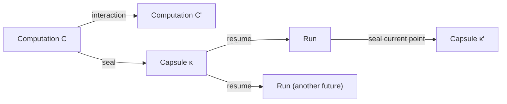

# Ato

**Run, preserve, and share computations on infrastructure you choose.**

Ato is an open-source computing interface for running software on hardware you
control — a desktop, home server, workstation or cloud VM — and for carrying
the work forward as a sealed, addressable point. It combines a computation
model with a runtime, CLI and adapters.

This repository is the open-source core. [ato.run](https://ato.run/) is the
official managed service built on the same model: discover software, share
capsules, and run them on your hardware or ours.
[About Ato](https://ato.run/about/) · [日本語](README.ja.md) ·
[Technical documentation](docs/README.md)

## Two layers

Ato and ato.run have different responsibilities. The boundary is deliberate:
the open-source core must be usable without the service.

| | **Ato** (this repository, OSS) | **ato.run** (official managed service) |
|---|---|---|
| Computation model | Defines Computation, Capsule, Contract K and Derivation D | Uses the model |
| CLI and runner | Provides the `ato` CLI and local runtime | Operates official runners |
| Self-hosting | Supported | Optional connection and management |
| Capsule registry | Protocol and server are **not implemented yet** | Official registry surface |
| Capsule distribution | Any `.capsule` file; any registry once the protocol exists | `ato.run/capsules` |
| Application discovery | Not required | Provides Discover |
| Execution | User-owned hardware | Managed cloud is also available |
| Billing | None | Compute, storage and management services |

Local runs and local Instances need no ato.run account. Registry, discovery and
managed execution are convenience layers; they are not requirements of the
model. This table describes intent and current status, not a claim that the
OSS registry or an ato.run-free remote path is already implemented. The
boundary is recorded in
[the OSS/service boundary draft](docs/rfcs/draft/ATO_OSS_SERVICE_BOUNDARY.md).

## Run, preserve, and share

- **Run.** Execute a `.capsule` bundle on your machine. The current tree
  realizes static web applications, pinned Python processes and OCI containers.
- **Preserve.** A Capsule is a sealed, immutable, addressable continuation
  point. A durable local Instance can keep its application and saved data
  across Runs. General cross-host state restoration is not provided.
- **Share.** A `.capsule` file is transport for a bundle. Sharing can be a file
  handoff today; a registry protocol, and its official deployment at
  `ato.run/capsules`, are future work.

## Why self-host?

You may already have a computer capable of running the software you need.

- **Use your own hardware.** Run on a local PC, home server, workstation or a
  remote machine you control.
- **Keep control of your data.** Ato-managed local Instance metadata and saved
  data are kept under the CLI data directory (`ATO_HOME`) by default. Explicit
  outputs (for example a `--verification-receipt` path) and writes through
  declared external Bindings are separate.
- **Use existing tools.** Docker, Nix, plain processes and VM snapshots remain
  valid realizations. Ato does not replace them.
- **Describe before realizing.** A Contract states what must hold; a Derivation
  states one way to realize it. A bundle can declare several Derivations.
- **Verify what runs.** The verifier records observations in a receipt, and
  `fully_satisfied` is true only when every declared observation holds.

## What can I run?

Today: a `.capsule` bundle that declares at least one Derivation. The current
tree can realize static web applications served from a sealed workspace,
pinned Python processes, and OCI containers with a pinned image, platform and
resource limits. Samples include Datasette and local LLM demos.

Not every route runs on every host: runtimes, platforms, permissions and
dependencies are admission checks. There is no bundled application catalogue;
discovery is an ato.run feature. A bundle can be built with `ato pack` when the
source matches the current authoring schema.

## Quick start

No account is required. Install the Rust toolchain declared in
[rust-toolchain.toml](rust-toolchain.toml), clone the repository, build the CLI,
and run the supplied static bundle:

```sh
git clone https://github.com/ato-run/ato.git
cd ato
cargo build -p ato-cli --bin ato --locked
mkdir -p .tmp/getting-started
target/debug/ato run samples/interop-static.capsule --no-open \
  --verification-receipt .tmp/getting-started/receipt.json
```

This verifies the bundle's declared route and its captured HTTP observation on
this host, then writes a receipt. Inspect it with Python 3:

```sh
python3 -c 'import json; r=json.load(open(".tmp/getting-started/receipt.json")); print("fully_satisfied:", r["fully_satisfied"]); [print(o["id"] + ":", o["outcome"]) for o in r["observations"]]'
```

```text
fully_satisfied: True
app-proof: satisfied
source-identity: satisfied
```

`fully_satisfied` covers the observations declared by this Contract for this
Run. It does not demonstrate general cross-host portability or restoration of
process memory. See [Getting started](docs/guides/getting-started.md) for the
expected output, other routes and failure boundaries. Published CLI artifacts
are listed in [GitHub Releases](https://github.com/ato-run/ato/releases).

## How it works

A **Computation** is the work that can continue from a point, not a file or a
process. A **Capsule** is a sealed, immutable, addressable continuation point.
Resuming a Capsule starts a **Run**; the Run advances the computation, and its
current point can be sealed again as a new Capsule. Starting several Runs from
the same Capsule lets work branch without mutating the Capsule.

This is the concept model. In the current CLI the resealing lifecycle
(`init` / `resume` / `stop` / `encap`) is implemented in the computation-root
profile. A portable-application `ato run` is an ephemeral Run, and a durable
local Instance keeps its data through the Instance lifecycle rather than
sealing a new Capsule.



- **Contract K** declares the observations a realization must satisfy: an HTTP
  status or body digest, a source-closure digest, a bounded HTTP scenario, a TLS
  observation, or a saved-data snapshot.
- **Derivation D** declares one way to realize K: inputs, runtime, Ports, steps
  and effects. The caller selects a declared D explicitly; there is no automatic
  best-D optimizer or implicit fallback.
- A **receipt** records the selected D and each observation as satisfied,
  deferred or failed. `fully_satisfied` requires every required observation to
  be satisfied.

Satisfying K is a judgment about observations from a Run. It does not mean the
realization is the same Computation, or that two Capsule references are
identical. The computation-root and portable-application profiles use different
reference roots (`ComputationRef` and `ContractRef`) and must not be read as
each other. See
[application contracts](docs/concepts/application-contracts.md) for the profile
map and the decisions that remain open.

## Ato and ato.run boundary

The standard and the service are kept separate:

- Ato's formats and wire documents do not require an ato.run account, tenant ID
  or service URL.
- A registry location is a deployment choice; the official registry is not the
  only registry, and the model does not embed `ato.run` as an authority.
- A self-hosted runner does not require ato.run credentials to execute local
  work. The Connected Runner enrollment path is the optional bridge.
- Billing, Discover review and moderation remain service concerns; they are not
  part of the computation model.
- If ato.run disappeared, existing capsules and this repository would remain
  usable.

These are constraints on future work as much as descriptions of today. See the
[OSS/service boundary draft](docs/rfcs/draft/ATO_OSS_SERVICE_BOUNDARY.md).

## Connect to ato.run (optional)

ato.run provides discovery, sharing and runner connection. A user-owned
Connected Runner is enrolled with a code from ato.run Settings and runs
`ato-connected-realization-worker`. This path requires an ato.run account and
is not needed for local execution. A public origin is optional and separately
authenticated; outbound control alone does not provide remote Web UI access.
There is no ato.run-free remote management path in the current tree.

## Security and limitations

- The `ato` CLI, local runtime and connected worker apply OS-native process
  isolation through the in-tree `ato-sandbox` implementation: Landlock on
  Linux (kernel 5.13+) and Seatbelt on macOS, with Bubblewrap containment where
  the launch path provides it. Development mode skips enforcement and is not a
  security boundary. This is not equivalent to a container or VM boundary.
- Untrusted applications should run with the narrowest filesystem and network
  policy their manifest declares. Sensitive paths are denied by default, but a
  path outside that list that you explicitly grant is granted by design.
- General state restoration across hosts, arbitrary process-memory restore and
  a proven Hosted saved-data round-trip are not provided today.
- A matching Contract does not certify security, license compliance or the
  safety of side effects.
- Ato is experimental. Not every application runs on every host.

## Documentation

- [Getting started](docs/guides/getting-started.md) and [Formation](docs/guides/formation.md)
- [Computation](docs/concepts/computation.md), [application contracts](docs/concepts/application-contracts.md) and [state continuity](docs/concepts/state-continuity.md)
- [Runner and hosting](docs/guides/runner-hosting.md) and [Connect a user-owned Runner](docs/guides/connected-runner-self-host.md)
- [Specifications](docs/specifications/README.md), [theory draft](docs/theory/capsule-process-model.md) and the [documentation index](docs/README.md)

## Contributing and license

Work is tracked in [GitHub Issues](https://github.com/ato-run/ato/issues) and
design questions are welcome in
[GitHub Discussions](https://github.com/ato-run/ato/discussions). See
[Contributing](CONTRIBUTING.md) for branch policy, checks and PR expectations.

Project-authored code is licensed under the
[Mozilla Public License 2.0](LICENSE) (`MPL-2.0`). The CLI retains the
[Apache-2.0 text](apps/cli/LICENSE-APACHE) for the WiX template and previously
distributed builds. Third-party code, fixtures and templates retain their own
terms; the code license does not establish a new license for the theory and
specification documents.

<!-- Compatibility anchors from the previous documentation entry. -->
<a id="main-use-cases"></a><a id="design-principle-everything-can-be-a-capsule"></a>
<a id="core-model"></a><a id="capsule--run--replay--continue"></a>
<a id="core--kernel-and-adapter"></a><a id="materialization"></a>
<a id="the-computation-theory-behind-it"></a><a id="basic-lifecycle"></a>
<a id="capsuletoml-example"></a><a id="project-scope"></a><a id="current-implementation-status"></a>
<a id="capsule-run-replay-continue"></a><a id="core-kernel-and-adapter"></a>
<a id="why-ato"></a><a id="try-atorun"></a><a id="license"></a>
