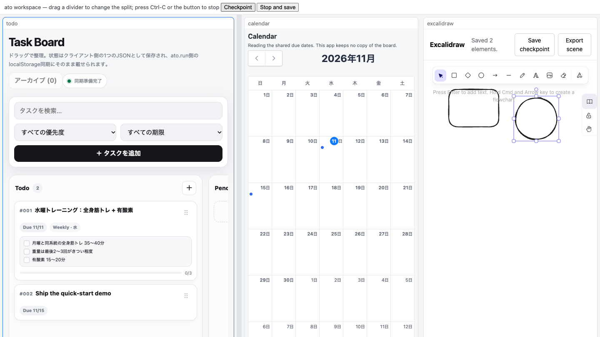

# Ato

**Pick up your work on another computer.**

Ato keeps a running set of apps and their data as a portable Capsule: save the
workspace here, open the same task and layout on a different machine. The apps
stay independent applications; the workspace only composes them and the
data flows through declared operations.

[Watch the 76-second demo](https://ato-run.github.io/ato-samples/media/ato-quick-start-demo-v0.9.1.mp4)
· [Quick start](#quick-start) · [日本語](README.ja.md) · [ato.run](https://ato.run/)

[](https://ato-run.github.io/ato-samples/media/ato-quick-start-demo-v0.9.1.mp4)

## Demo

A 76-second, no-audio, captioned recording of the flow below: edit the
whiteboard, add a task with a due date, let the FullCalendar month view read the
due-date projection, checkpoint, stop, and resume with the same scene, data and
split layout.
It was recorded with the published `ato 0.9.1` CLI and the published v0.9.1
bundle on macOS arm64; the same commands and bundle are covered by the
macOS/Linux/Windows acceptance evidence linked under
[Documentation](#documentation). The video is also attached to the
[`ato-samples` v0.9.1 release](https://github.com/ato-run/ato-samples/releases/tag/v0.9.1)
for download (SHA-256 `27a6c6a94825d1c2ae4ea5f259febe0d5c5ee4670d6a6c99321b7bea382b37c6`).

## Quick start

You install only the CLI. No Rust toolchain, no `npm`, no account.

### 1. Install the CLI

- macOS/Linux (Homebrew): `brew install ato-run/ato/ato`
- Linux/macOS without Homebrew:
  `curl -fsSL https://github.com/ato-run/ato/releases/download/v0.9.1/ato-cli-installer.sh | sh`
- Windows x86_64: run the
  [`ato-cli-x86_64-pc-windows-msvc.msi`](https://github.com/ato-run/ato/releases/download/v0.9.1/ato-cli-x86_64-pc-windows-msvc.msi)
  release asset

```sh
ato --version    # 0.9.1
```

### 2. Get the sample workspace

The release carries a prebuilt bundle (three capsules plus a `workspace.toml`
that pins their SHA-256 digests); there is nothing to build:

```sh
curl -LO https://github.com/ato-run/ato-samples/releases/download/v0.9.1/ato-oss-quick-start-v0.9.1.tar.gz
curl -LO https://github.com/ato-run/ato-samples/releases/download/v0.9.1/ato-oss-quick-start-v0.9.1.tar.gz.sha256
shasum -a 256 -c ato-oss-quick-start-v0.9.1.tar.gz.sha256
tar xzf ato-oss-quick-start-v0.9.1.tar.gz
cd ato-oss-quick-start-v0.9.1
```

### 3. Open the workspace

```sh
ato workspace open workspace.toml --local-data --checkpoint-out workspace.checkpoint.toml
```

The CLI starts a local Coordinator, serves the three apps side by side and
opens the shell in your browser. The calendar reads only the declared due-date
projection, never the task board document.

### 4. Edit, checkpoint, stop

Edit in the panes, then press **Checkpoint** (or **Ctrl-S**) to save while the
workspace keeps running, and **Stop and save** to checkpoint and stop.

### 5. Resume

```sh
ato workspace open workspace.toml --checkpoint workspace.checkpoint.toml \
  --local-data --checkpoint-out workspace.checkpoint.toml
```

The saved data and the split layout come back. A pane that cannot be restored
fails the resume instead of silently starting empty.

## Continue on another computer

Copy `workspace.toml`, the capsules and the checkpoint (including its
`.state/` directory) to the other host and run the resume command there; the
capsules are byte-identical across the macOS/Linux/Windows builds, so no
digests need to change. To keep both machines live at once, point them at one
Coordinator (`--coordinator`/`--token`); its lease refuses a second live writer
and increments the epoch on hand-over. A copied checkpoint is a continuation
of the file set, not a live transfer of writer authority.

## Core concepts

- **Computation** — the work that can continue from its current point.
- **Capsule** — a sealed, immutable, addressable continuation point; the
  physical way it is realized does not define its identity.
- **Run** — resumes a Capsule and advances the computation.
- **Contract / Derivation / receipt** — for portable applications, the
  observable requirements, a declared way to realize them, and the recorded
  observations of a Run.

See [Computation](docs/concepts/computation.md) and
[application contracts](docs/concepts/application-contracts.md) for the model.

## Current limitations

- The workspace shell serves **Static Web panes only**; native/process panes
  are refused by name and need a surface host (not part of this release).
- The checkpoint restores the pane data, the split and the active pane; in-pane
  scroll or text selection inside an app is not restored.
- Excalidraw saves its scene through its own **Save checkpoint** button; the
  shell Checkpoint then captures that scene with the other panes and the layout.
  An unsaved scene is not included.
- The sample Task Board still carries a small legacy local-state migration; the
  data and layout that matter for the walkthrough are the declared operations.
- A live writer hand-over needs a shared Coordinator; copying a checkpoint to
  another host is a separate, offline continuation.
- No production services are needed for this walkthrough, and none are
  contacted beyond the GitHub release download.

## Documentation

- [Quick start walkthrough](docs/guides/quick-start-first-workspace.md)
- [Getting started / build from source](docs/guides/getting-started.md)
- [3-OS acceptance evidence and measured timings](docs/ops/oss-quick-start-local-e2e-20261110.md)
- [Sample capsule sources and bundle](https://github.com/ato-run/ato-samples)
- [Concepts](docs/concepts/) · [RFCs](docs/rfcs/)

## Contributing

Issues and pull requests are welcome. The repository flow is
`feature branch → dev → stg → main`; see the guides above for the local checks.
