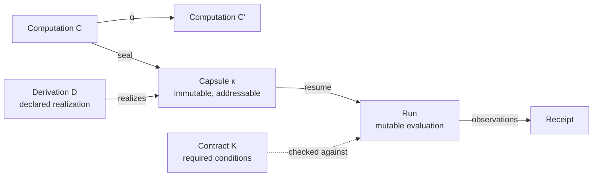

# Ato

Ato is an experimental computing interface for treating diverse applications,
data and work state through one **Computation** model: preserving, sharing,
running and continuing them. The central idea is to separate *what must be
maintained* from *how it is realized*, so that changing an implementation does
not silently change the requirements.

- [ato.run](https://ato.run/) is the web service built on Ato for discovering,
  trying, saving and sharing runnable software.
- [About Ato](https://ato.run/about/) describes the background and the intent.
- [日本語](README.ja.md) is the Japanese overview; this repository's current
  technical documentation is in English ([documentation index](docs/README.md)).

This repository contains the computation model, runtime, CLI, adapters and
supporting tools.

## One model for different kinds of software

A text editor saves a document. A development environment manages source and
dependencies. A game has progress. An AI application has models, intermediate
data and external services. Ato does not fix each of these as a separate kind
with its own lifecycle.

A **Computation** is the work that can continue from a point, not a file or a
process. Sealing that point yields an immutable, addressable **Capsule**;
resuming it yields a mutable **Run**. Runs can diverge, and saving the next
point again yields a Capsule. Files, applications, runtime state and operation
history are handled within that one lifecycle, with the physical realization
kept separate from the point's identity.



The diagram is a concept map, not an internal data structure. A Capsule's
identity does not depend on the realization, and satisfying K is a judgment
about a Run, not a proof that two references are the same.

## What is lost when only the environment is preserved

Someone you know made a small tool for their own use. You want to use it with
your data, change one thing about it, and still open it next week, on another
machine, after the original author has moved on. What should be handed over is
not only the source: it is the behavior, the data and work state, the
connections to external services, the history so far, and the ability to
continue from there. Software is increasingly generated and modified
continuously, so the question of what may change and what must be preserved
comes up sooner and more often.

Rebuilding a source tree, image or environment can reproduce a starting point,
but it does not necessarily preserve what made the work usable. **Being able to
start the software again is not the same as being able to continue the work.**

## From environment reproducibility to computation continuity

Cloud-native practice already provides many ways to prepare an execution
environment. Docker packages an application and its dependencies; Nix improves
the reproducibility of builds and environments; VMs and snapshots preserve
broader execution state. Ato does not replace them.

The remaining question is what must be preserved when the realization changes.
Ato abstracts the conditions that have to survive a realization, not the
hardware or runtime differences themselves.

## Example: handing off the same work in different ways

Suppose you draw a diagram in a whiteboard application and want to continue
editing it on another computer. There are several candidate ways to restore the
work:

| Candidate | What it restores |
|---|---|
| Replay | Re-execute the drawing and editing operations from an initial state |
| Stored revision | Fetch the saved document at a specific revision — for example through a Git-based source fetch — and open it |
| Snapshot | Restore saved filesystem or execution state |

These store different material and restore it differently. If the requirement
is "the blue rectangle and the red arrow are at these positions and remain
individually editable", any of them can be a candidate realization. Generating
a PNG with the same appearance is not enough: the shapes could no longer be
edited individually. If undo history is required, it has to be part of the
requirement and needs a matching restore and verification path.

These are concept-level candidates, not a claim that every one is implemented
for every application. See [what has been verified](#research-and-evidence) and
[Materialization](docs/concepts/materialization.md) for the current status.

## Contracts and derivations, and what identity means

Ato separates the conditions from the means of realization:

- **Contract K** declares what a realization must satisfy. It can range from an
  HTTP observation and a data digest to a semantic condition such as "the item
  list contains these entries in this order".
- **Derivation D** declares one concrete way to realize K: what input is used,
  which runtime and Ports it needs, and how the execution is carried out.
- A verification **receipt** records what was observed for the Run, which D
  was selected, and what was not satisfied.

The important rule is to freeze K and change D, then verify against the same
conditions. That distinguishes changing the realization from changing the
requirements. A realization does not need to be byte-identical to the previous
one, and K does not describe unobserved state.

This does **not** mean that the same K implies the same Computation. Ato keeps
three different notions apart:

| Notion | Meaning |
|---|---|
| `ComputationRef` | The reference identity of a computation, in the computation-root profile |
| `ContractRef` | The identity rooted at a declared Contract, in the portable-application profile |
| Contract satisfaction | The judgment that one realization satisfies K |

Satisfying K is a judgment about an observation of a realization. It does not
assert that the realization is the same Computation, or that either Capsule
reference is identical. The two reference domains are not interchangeable.
See [application contracts](docs/concepts/application-contracts.md) for the
profile map and the decisions that remain open.

## A recorded example: same K, a different source

The archived transformation v0 experiment is the smallest concrete check of the
rule above. It ran in Linux CI, not on every platform, and it was not
re-executed for this README.

Prerequisites: Linux with bubblewrap and Python 3.12.7 at
`/opt/ato/toolchains/python/3.12.7` (the CI fixture), and a CLI built from this
repository.

```sh
cargo build -p ato-cli --bin ato --locked
mkdir -p .tmp/transformation-v0
target/debug/ato pack apps/cli/tests/fixtures/transformation-v0/source-a \
  -o .tmp/transformation-v0/bundle-a.capsule
target/debug/ato run .tmp/transformation-v0/bundle-a.capsule --no-open \
  --verification-receipt .tmp/transformation-v0/receipt-a.json
target/debug/ato reform .tmp/transformation-v0/bundle-a.capsule \
  apps/cli/tests/fixtures/transformation-v0/source-b \
  --out .tmp/transformation-v0/candidate
```

Expected, from the recorded evidence:

- `.tmp/transformation-v0/candidate/report.json` has `k_preserved: true` and
  `fully_satisfied: true`, and its `frozen_contract_ref` equals the baseline
  receipt's `contract_ref`;
- `.tmp/transformation-v0/candidate/receipt.json` names a different
  `derivation_ref` and source closure, and is `fully_satisfied: true`;
- `candidate.capsule` roots at the frozen `ContractRef` while its transport
  hash differs, and the baseline bundle and receipt stay byte-identical.

A negative case is part of the same record: `source-b-broken` returns a
`degraded` body, and `reform` rejects it with `k_preserved: true` and
`fully_satisfied: false`
([evidence](docs/archive/2026/ops/contract-preserving-transformation-v0.md)).
What this shows is that the source and the realization changed while K stayed
frozen. It does not show restart persistence, hosted execution or a safe
rollout; see [Derivation transformation](docs/guides/derivation-transformation.md)
for the full command list and the non-claims.

## Heterogeneous execution, with declared derivations

Ato is meant to realize computations on Runners with different operating
systems, runtimes and hardware. The point of that network is not to make every
Runner look like one machine. It is to run a **declared** derivation on a
Runner whose capabilities admit it, and to keep the conditions separate from
the environment that happens to be available.

Selection stays explicit in the current design: the caller chooses a declared
D, and a Runner's advertised capabilities are admission checks. There is no
automatic best-D optimizer, capability inference or implicit fallback. General
cross-host state restoration and heterogeneous scheduling remain research
targets. See [Runner and Hosting](docs/guides/runner-hosting.md).

**The execution environment is a means to realize a Computation, not the
Computation's identity.**

## Current status

Ato is experimental. The current tree includes computation and Capsule objects,
lifecycle commands, adapters, portable bundle handling, a limited static
verification path, and explicit selection among declared Derivations.

The following remain research or development work, not finished guarantees:

- general state restoration across different hosts;
- restoration of arbitrary process memory;
- general state continuity across heterogeneous realizations;
- autonomous AI Formation;
- general automatic selection or optimization across Runners.

Python, OCI, GPU, persistent state and external services need their own
declared routes and host admission. Their presence in the code does not
establish availability on ato.run production. A matching Contract alone does
not guarantee state continuity or safe side effects. See
[compatibility](docs/concepts/compatibility.md) and
[state continuity](docs/concepts/state-continuity.md).

## Quick start

### Try the CLI locally (no account)

Install the Rust toolchain declared in [rust-toolchain.toml](rust-toolchain.toml),
then clone the repository, build the CLI, and run the supplied static
application bundle:

```sh
git clone https://github.com/ato-run/ato.git
cd ato
cargo build -p ato-cli --bin ato --locked
mkdir -p .tmp/getting-started
target/debug/ato run samples/interop-static.capsule --no-open \
  --verification-receipt .tmp/getting-started/receipt.json
```

This verifies the supplied bundle's declared route and its captured HTTP
observation on this host, then writes a receipt. Inspect it with Python 3:

```sh
python3 -c 'import json; r=json.load(open(".tmp/getting-started/receipt.json")); print("fully_satisfied:", r["fully_satisfied"]); [print(o["id"] + ":", o["outcome"]) for o in r["observations"]]'
```

```text
fully_satisfied: True
app-proof: satisfied
source-identity: satisfied
```

`fully_satisfied` means that the observations declared by this Contract were
satisfied for this Run. It does not demonstrate general cross-host
portability, restoration of process memory, or continuity of user data. See
[Getting started](docs/guides/getting-started.md) for the expected output,
other routes and failure boundaries. Published CLI artifacts are listed in
[GitHub Releases](https://github.com/ato-run/ato/releases).

### Try ato.run (optional)

Explore public software on [ato.run](https://ato.run/) or
[try 2048](https://ato.run/?view=discover&detail=discover%3Adiscover-2048) in
your browser. ato.run is a separate product surface; the local example above
does not require it.

## Concepts

| Concept | Meaning |
|---|---|
| **Computation** | Work that can continue from its current point |
| **Capsule** | A sealed, immutable, addressable continuation point |
| **Run** | An active evaluation started from a Capsule that advances the computation |
| **Contract (K)** | The conditions a realization must satisfy |
| **Derivation (D)** | One declared way to realize a Contract |
| **Receipt** | Recorded observations and the verification result for a Run |
| **Port / Binding** | A typed interaction boundary, and its mapping to a physical resource at run time |

See [Computation](docs/concepts/computation.md) and the
[glossary](docs/glossary-reference.md) for the full vocabulary.

## Research and evidence

- [Research tour](docs/guides/research-tour.md): the problem, model, identity
  profiles, data identity, verified results, independence and open questions.
- [State continuity](docs/guides/research-tour.md#10-state-continuity-recorded-evidence-and-the-next-experiment):
  what the recorded stateful scenario shows, and the restart/export experiment
  that is still unproven.
- Archived experiments: [contract-preserving transformation v0](docs/archive/2026/ops/contract-preserving-transformation-v0.md)
  and [stateful transformation v1](docs/archive/2026/ops/stateful-transformation-v1.md).
  They record Linux-local evidence, with fixtures and limits; they were not
  re-measured for this overview.
- [Specifications](docs/specifications/README.md): accepted computation-root
  RFCs and the portable-application implementation track.

## Documentation

General user documentation is owned by the
[ato.run documentation](https://ato.run/docs/). This repository owns the
technical documentation for the runtime, CLI, specifications and operations
([documentation index](docs/README.md)).

- [Getting started](docs/guides/getting-started.md) and [Formation](docs/guides/formation.md)
- [Application contracts](docs/concepts/application-contracts.md), including the
  profile map, and [state continuity](docs/concepts/state-continuity.md)
- [Runner and hosting](docs/guides/runner-hosting.md) and [operations](docs/operations/README.md)
- [Theory draft](docs/theory/capsule-process-model.md) and [architecture](docs/architecture/README.md)

## Contributing

Work is tracked in [GitHub Issues](https://github.com/ato-run/ato/issues) and
design questions are welcome in
[GitHub Discussions](https://github.com/ato-run/ato/discussions). See
[Contributing](CONTRIBUTING.md) for the branch policy, checks and PR
expectations. There is no Markdown roadmap in this repository; the
[archived roadmap](docs/archive/2026/legacy/OPEN_ISSUES_ROADMAP.md) is
historical evidence.

## License

Project-authored code is licensed under the
[Mozilla Public License 2.0](LICENSE) (`MPL-2.0`). Third-party code,
fixtures, templates and materials with their own notices retain their
respective terms. The code license does not establish a new license for the
theory and specification documents. See [Licensing](docs/licensing.md) for the
per-material index.

<!-- Compatibility anchors from the previous documentation entry. -->
<a id="main-use-cases"></a><a id="design-principle-everything-can-be-a-capsule"></a>
<a id="core-model"></a><a id="capsule--run--replay--continue"></a>
<a id="core--kernel-and-adapter"></a><a id="materialization"></a>
<a id="the-computation-theory-behind-it"></a><a id="basic-lifecycle"></a>
<a id="capsuletoml-example"></a><a id="project-scope"></a><a id="current-implementation-status"></a>
<a id="capsule-run-replay-continue"></a><a id="core-kernel-and-adapter"></a>
<a id="why-ato"></a><a id="try-atorun"></a><a id="license"></a>
