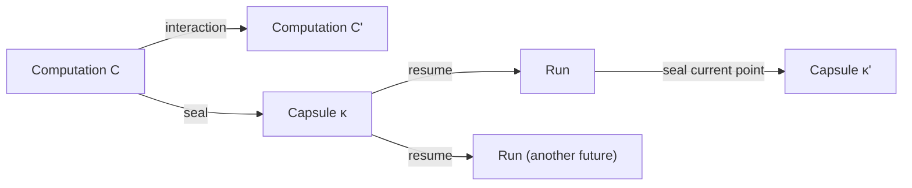
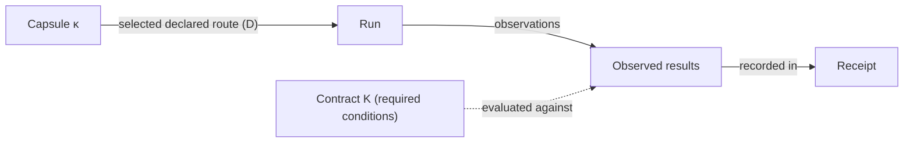

# Ato

Software changes. The work built on it should not disappear when an implementation
changes, a machine is replaced, or someone else takes over.

It is becoming easier to generate and rewrite software. Carrying forward the
data, state and behavior that made the work usable is still mostly specific to
each application.

Ato is an experimental computing interface for treating diverse applications,
data and work state through one **Computation** model: preserving, sharing,
running and continuing them. The central idea is to separate *what must be
maintained* from *how it is realized*, so that changing an implementation does
not silently change the requirements.

[ato.run](https://ato.run/) · [About Ato](https://ato.run/about/) · [日本語](README.ja.md) · [Technical documentation](docs/README.md)

## Why: rebuilding an environment is not continuing the work

Someone you know made a small tool for their own use. You want to use it with
your data, change one thing about it, and still open it next week, on another
machine, after the original author has moved on. What should be handed over is
not only the source: it is the behavior, the data and work state, the
connections to external services, the history so far, and the ability to
continue from there.

Rebuilding a source tree, image or environment can reproduce a starting point.
It does not guarantee that accumulated data, external connections, in-progress
state, or the required behavior are restored and verified. **Being able to start
the software again is not the same as being able to continue the work.**

## One model for different kinds of software

A text editor saves a document. A development environment manages source and
dependencies. A game has progress. An AI application has models, intermediate
data and external services. Ato does not fix each of these as a separate kind
with its own lifecycle.

A **Computation** is the work that can continue from a point, not a file or a
process. A **Capsule** is a sealed, immutable, addressable continuation point.
Resuming a Capsule starts a **Run**; the Run advances the computation, and its
current point can be sealed again as a new Capsule. Starting several Runs from
the same Capsule lets work branch into different futures without mutating the
Capsule.



This figure describes the continuation lifecycle only. Contract verification is
a separate relation, shown below.

## Concepts

| Concept | Meaning |
|---|---|
| **Computation** | Work that can continue from its current point |
| **Capsule** | A sealed, immutable, addressable continuation point |
| **Run** | An active evaluation started from a Capsule that advances the computation |
| **Contract (K)** | The conditions a realization must satisfy |
| **Derivation (D)** | One declared way to realize a Contract |
| **Receipt** | Recorded observations and the verification result for a Run |
| **Port / Binding** | A typed interaction boundary, and the Run-specific mapping to a physical resource; permissions and admission are separate from that mapping |

See [Computation](docs/concepts/computation.md) and the
[glossary](docs/glossary-reference.md) for the full vocabulary.

## Contracts and derivations: what to reproduce, and how

The conditions that count as reproduction differ by application and by purpose.
One task may need byte-identical output; another may need only the same
behavior. Continuing an editing session needs the data *and* a state that is
still editable. Ato makes those requirements explicit as a Contract instead of
leaving them implicit in the implementation.

- **Contract K** declares what a realization must satisfy. It can hold an HTTP
  response, a data digest, a semantic condition such as "the item list contains
  these entries in this order", or an editable-state requirement.
- **Derivation D** declares one concrete way to realize K: what input is used,
  which runtime and Ports are needed, and how the execution is carried out. A
  bundle can declare several Ds; the caller selects one explicitly.
- A verification **receipt** records the selected D and each observation as
  satisfied, deferred or failed; `fully_satisfied` is true only when every
  required observation was satisfied. Deferred means a named gate decides later.



### What K and D look like

K and D are canonical JSON objects. The examples below are abbreviated from
the supplied static bundle
([`samples/interop-static.capsule`](samples/interop-static.capsule)); keys are in
JCS canonical order (the order the digest covers) and hashes are shortened.

```json
{
  "requirements": [
    {"body_digest": "sha256:5ec8...", "id": "app-proof", "method": "GET",
     "path": "/proof.txt", "port": "app.http", "status": 200,
     "verifier": "ato.contract.http@1"},
    {"digest": "sha256:923c...", "id": "source-identity", "input": "workspace",
     "verifier": "ato.contract.workspace@1"}
  ],
  "schema": "ato.contract/1"
}
```

```json
{
  "effects": "pure",
  "inputs": [{"content_ref": "sha256:923c...", "id": "workspace",
              "protocol": "ato.workspace@1"}],
  "ports": [{"from": "site", "id": "app.http", "protocol": "ato.http@1"}],
  "schema": "ato.derivation/1",
  "state": [],
  "steps": [{"entry": "index.html", "id": "site", "op": "serve",
             "protocol": "ato.browser@1", "source": "workspace",
             "spa_fallback": false}]
}
```

`ContractRef` and `DerivationRef` are the SHA-256 digests of the canonical
bytes of these objects: here `sha256:b565…` (416 bytes) is
`root_contract_ref` and `sha256:87a0…` (397 bytes) is the first entry of
`derivations`. The authoring input (`capsule.toml`), the authoring-to-canonical
field map, a process route and a receipt are in
[Contract and derivation formats](docs/guides/contract-and-derivation-format.md);
decoded examples from committed bundles are in
[Sample K and D objects](docs/guides/contract-derivation-samples.md).

K is a partial specification: it guarantees only the observations it declares.
Equal `ContractRef` values mean equal canonical K bytes, not behavioral
equivalence, and a satisfied K does not make two Runs the same Computation. The
verifier list, the guarantees and the limits of identity assurance are in the
format guide.

The rule that matters is: freeze K, change D, and verify against the same
conditions. That separates changing the realization from changing the
requirements. A realization does not have to be byte-identical to the previous
one, and K does not describe state that was not observed.

Satisfying K is a judgment about observations from a Run. It does not mean the
realization is the same Computation, or that two Capsule references are
identical. The computation-root and portable-application profiles use different
reference roots (`ComputationRef` and `ContractRef`) and must not be read as
each other; the [research tour](docs/guides/research-tour.md) and
[application contracts](docs/concepts/application-contracts.md) cover that
boundary.

## Heterogeneous execution

Ato aims to realize computations on Runners with different capabilities. Each
Runner has its own available environments and resources, and checks the
conditions a declared D requires.

Selection is explicit: the caller chooses a declared D, and no general
automatic optimizer or implicit fallback is provided. A Runner is a resource
for realizing a Computation; it does not define the Computation's identity. See
[Runner and Hosting](docs/guides/runner-hosting.md).

## Example: handing off the same work in different ways

Suppose you draw a diagram in a whiteboard application and want to continue
editing it on another computer. There are several candidate ways to reconstruct
the state:

| Realization | How the state is reconstructed |
|---|---|
| Operation replay | Apply the recorded operations to an initial state |
| Loading stored data | Fetch the data at a specific revision — for example from a Git-managed history — and open it |
| Snapshot restore | Restore saved filesystem or execution state |

If the requirement is "the blue rectangle and the red arrow are at these
positions and remain individually editable", any of them can be a candidate
realization. Generating a PNG with the same appearance is not enough: the
shapes could no longer be edited individually. If undo history is required, it
has to be part of the requirement and needs a matching restore and
verification path.

These are concept-level candidates, not a claim that every one is implemented
for every application. See [Materialization](docs/concepts/materialization.md)
for the current status.

## Verified results: a contract-preserving transformation

The archived transformation v0 experiment is the smallest concrete check of the
rule above. It ran in Linux CI with a recorded fixture; it was not re-executed
for this README.

| Check | Recorded result |
|---|---|
| Frozen K, different source and D | PASS: K preserved, new Derivation and source closure, receipt `fully_satisfied` |
| Frozen K, required behavior broken | REJECT: `k_preserved` true, `fully_satisfied` false |
| Continuation of persisted state across a restart | Not tested in this experiment |

What it shows is that the source and the realization changed while K stayed
frozen. It does not show restart persistence, hosted execution or a safe
rollout. Commands, fixtures, receipts, prerequisites and non-claims are in
[Derivation transformation](docs/guides/derivation-transformation.md); the
[archived evidence](docs/archive/2026/ops/contract-preserving-transformation-v0.md)
is the original record.

## Quick start

### Try the CLI locally (no account)

Install the Rust toolchain declared in [rust-toolchain.toml](rust-toolchain.toml),
then clone the repository, build the CLI, and run the supplied static
application bundle:

```sh
git clone https://github.com/ato-run/ato.git
cd ato
cargo build -p ato-cli --bin ato --locked
mkdir -p .tmp/getting-started
target/debug/ato run samples/interop-static.capsule --no-open \
  --verification-receipt .tmp/getting-started/receipt.json
```

This verifies the supplied bundle's declared route and its captured HTTP
observation on this host, then writes a receipt. Inspect it with Python 3:

```sh
python3 -c 'import json; r=json.load(open(".tmp/getting-started/receipt.json")); print("fully_satisfied:", r["fully_satisfied"]); [print(o["id"] + ":", o["outcome"]) for o in r["observations"]]'
```

```text
fully_satisfied: True
app-proof: satisfied
source-identity: satisfied
```

`fully_satisfied` covers the observations declared by this Contract for this
Run. It does not demonstrate general cross-host portability, restoration of
process memory, or continuity of user data. See
[Getting started](docs/guides/getting-started.md) for the expected output,
other routes and failure boundaries. Published CLI artifacts are listed in
[GitHub Releases](https://github.com/ato-run/ato/releases).

### Try ato.run (optional)

Explore public software on [ato.run](https://ato.run/) or
[try 2048](https://ato.run/?view=discover&detail=discover%3Adiscover-2048) in
your browser. ato.run is a separate product surface; the local example above
does not require it.

## Current status

Ato is experimental. The current tree includes computation and Capsule objects,
lifecycle commands, adapters, portable bundle handling, a limited static
verification path, and explicit selection among declared Derivations.

The following remain research or development work, not finished guarantees:

- general state restoration across different hosts;
- restoration of arbitrary process memory;
- general state continuity across heterogeneous realizations;
- autonomous AI Formation.

Python, OCI, GPU, persistent state and external services need their own
declared routes and host admission. Their presence in the code does not
establish availability on ato.run production. A matching Contract alone does
not guarantee state continuity or safe side effects. See
[compatibility](docs/concepts/compatibility.md) and
[state continuity](docs/concepts/state-continuity.md).

## Research and evidence

- [Research tour](docs/guides/research-tour.md): the problem, model, identity
  profiles, data identity, verified results, independence and open questions.
- [State continuity](docs/guides/research-tour.md#10-state-continuity-recorded-evidence-and-the-next-experiment):
  what the recorded stateful scenario shows, and the restart/export experiment
  that is still unproven.
- Archived experiments: [contract-preserving transformation v0](docs/archive/2026/ops/contract-preserving-transformation-v0.md)
  and [stateful transformation v1](docs/archive/2026/ops/stateful-transformation-v1.md).
  They record Linux-local evidence, with fixtures and limits; they were not
  re-measured for this overview.
- [Specifications](docs/specifications/README.md): accepted computation-root
  RFCs and the portable-application implementation track.

## Documentation

General user documentation is owned by the
[ato.run documentation](https://ato.run/docs/). This repository owns the
technical documentation for the runtime, CLI, specifications and operations
([documentation index](docs/README.md)).

- [Getting started](docs/guides/getting-started.md) and [Formation](docs/guides/formation.md)
- [Application contracts](docs/concepts/application-contracts.md), including the
  profile map, and [state continuity](docs/concepts/state-continuity.md)
- [Runner and hosting](docs/guides/runner-hosting.md) and [operations](docs/operations/README.md)
- [Theory draft](docs/theory/capsule-process-model.md) and [architecture](docs/architecture/README.md)

## Contributing

Work is tracked in [GitHub Issues](https://github.com/ato-run/ato/issues) and
design questions are welcome in
[GitHub Discussions](https://github.com/ato-run/ato/discussions). See
[Contributing](CONTRIBUTING.md) for the branch policy, checks and PR
expectations. There is no Markdown roadmap in this repository; the
[archived roadmap](docs/archive/2026/legacy/OPEN_ISSUES_ROADMAP.md) is
historical evidence.

## License

Project-authored code is licensed under the
[Mozilla Public License 2.0](LICENSE) (`MPL-2.0`). Third-party code,
fixtures, templates and materials with their own notices retain their
respective terms. The code license does not establish a new license for the
theory and specification documents. See [Licensing](docs/licensing.md) for the
per-material index.

<!-- Compatibility anchors from the previous documentation entry. -->
<a id="main-use-cases"></a><a id="design-principle-everything-can-be-a-capsule"></a>
<a id="core-model"></a><a id="capsule--run--replay--continue"></a>
<a id="core--kernel-and-adapter"></a><a id="materialization"></a>
<a id="the-computation-theory-behind-it"></a><a id="basic-lifecycle"></a>
<a id="capsuletoml-example"></a><a id="project-scope"></a><a id="current-implementation-status"></a>
<a id="capsule-run-replay-continue"></a><a id="core-kernel-and-adapter"></a>
<a id="why-ato"></a><a id="try-atorun"></a><a id="license"></a>
