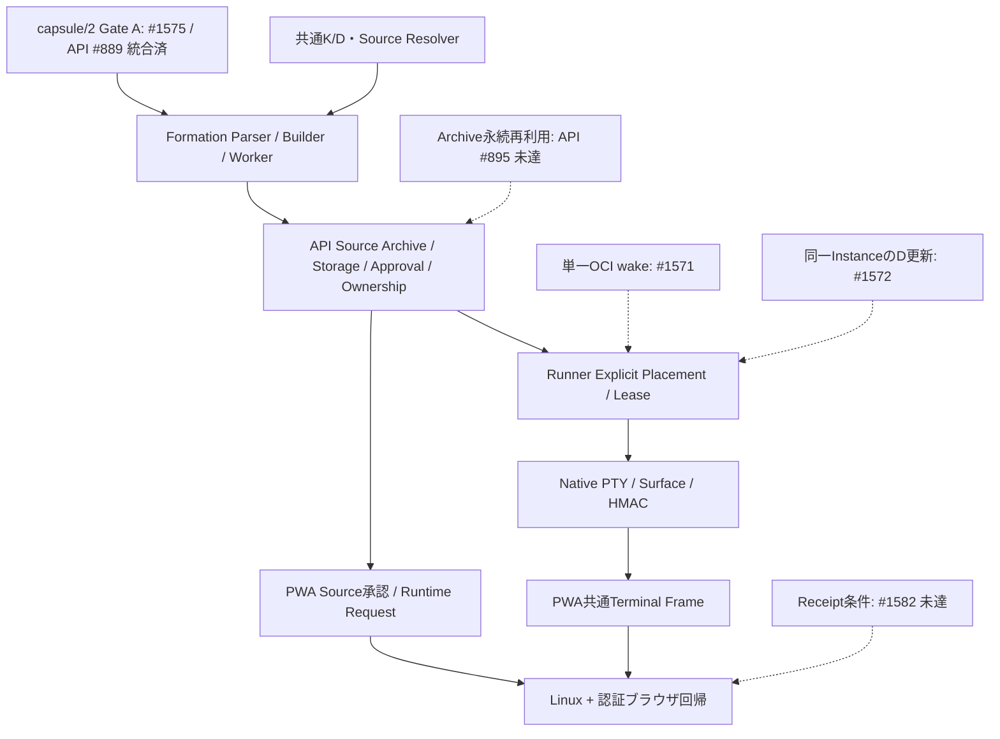

# PR-INVENTORY — dev統合棚卸し（2026-10-26）

更新: 2026-10-26T05:13:12.095895+00:00。GitHubを正本とし、調査時点のOPEN 113件、CLOSED・未マージ223件を記録。最終OPEN 19件。95件を包含証跡付きでClose。機能の未達条件はVALIDATION.mdのIssueへ記録。

Productionへの配備、mainへのpush、admin bypass、branch/worktree削除は実施しない。取り込み済みPRのCloseはdev昇格の整理であり、mainやProductionへの昇格ではない。

## 対象とGitHub HEAD

| Repo | main | dev | 備考 |
|---|---|---|---|
| ato | `585e86c5222836d41e9d8359178d37ac06f712b9` | `4d43ad44d9e565699f9e2e52b1f0e6353b2bee57` | OPEN 40 |
| ato-api | `d05ecbbd5d5574373abcad500ded7aab9970f250` | `6e178c901c0a028b121a4fc18841a4d03e13702d` | OPEN 56 |
| ato-pwa | `83635a90c076d97e635c0ea59d985294aa3ed44c` | `33febac1717bb4c8a5d66e4ea87e5d12ae4d27c1` | OPEN 14 |
| ato-contents | `d13cb5f0d92f3d6e1e834bdb5dc260ecb9c67859` | `なし` | OPEN 0 |
| ato-e2e | `なし` | `なし` | OPEN 0 |
| ato-desktop | `235413721efbdf64290cd7392c1c0afd1768b7e4` | `なし` | OPEN 0 |
| about | `333fc055fc429b7a017c0627847ff43d1500d549` | `なし` | OPEN 0 |
| plaza | `8192a10ddf43d8a2c5db01564ded54f359fb4d78` | `なし` | OPEN 1 |
| ato-capsule-demo | `e830a25fac0b2d35aa4c4fd98653faffabb09cf4` | `なし` | OPEN 0 |

`ato-admin`は現アカウントのGitHub APIで404。管理Workerはato-apiの`wrangler.admin.toml`/`src/admin_worker.ts`が所有。`apps/ato-edge`と`apps/ato-usercontent-static`はいずれもremoteが`ato-run/ato-contents`であり、別GitHub repoとして重複計上しない。ato-contentsの15 branch headは全てmainに包含されていた。

## OPEN PR（調査開始時点）

| Repo / PR | タイトル | head → base | 領域 | 判定 | 依存 | 統合先 / 残課題 | 証跡 |
|---|---|---|---|---|---|---|---|
| [ato #1543](https://github.com/ato-run/ato/pull/1543) | test(native): verify browser controls on real owned Native lifecycle | `feat/native-pixel-browser-fixture` → `integration/native-browser-controls-fixture-base` | Native | ABSORBED | stackのbaseを参照 | devへの包含を確認。OPENは包含証跡付きで整理。実機未完条件の完了を意味しない。 | head `c8db60fd558f`; head c8db60fd558f974274e194a5b593515a5b789f38 is ancestor of dev 287fe65ef3d872f4c296014aaf898b8010639eb9 |
| [ato #1542](https://github.com/ato-run/ato/pull/1542) | Gate Native GUI controls on verified helper ABI and actual Surface readiness | `feat/native-helper-controls` → `feat/native-framebuffer-resize-boundary` | Native | ABSORBED | stackのbaseを参照 | devへの包含を確認。OPENは包含証跡付きで整理。実機未完条件の完了を意味しない。 | head `755fde655010`; head 755fde655010cd4273833ed3ad2d7dc625cd9993 is ancestor of dev 287fe65ef3d872f4c296014aaf898b8010639eb9 |
| [ato #1541](https://github.com/ato-run/ato/pull/1541) | fix(netd): suppress unsupported extended clipboard negotiation | `feat/native-rfb-encoding-compat` → `feat/native-framebuffer-resize-boundary` | Native | ABSORBED | stackのbaseを参照 | devへの包含を確認。OPENは包含証跡付きで整理。実機未完条件の完了を意味しない。 | head `859474a61580`; head 859474a61580917aaa05ef2a500ed2fcebc6a460 is ancestor of dev 287fe65ef3d872f4c296014aaf898b8010639eb9 |
| [ato #1540](https://github.com/ato-run/ato/pull/1540) | feat(netd): authorize bounded isolated framebuffer resizing | `feat/native-framebuffer-resize-boundary` → `feat/native-text-paste-boundary` | Formation/Native | ABSORBED | stackのbaseを参照 | devへの包含を確認。OPENは包含証跡付きで整理。実機未完条件の完了を意味しない。 | head `90746ed9566d`; head 90746ed9566d3640164e480668e4d838d4de5555 is ancestor of dev 287fe65ef3d872f4c296014aaf898b8010639eb9 |
| [ato #1539](https://github.com/ato-run/ato/pull/1539) | feat(netd): guard opt-in Native text paste with scoped assertions | `feat/native-text-paste-boundary` → `integration/native-clipboard-base-876cb` | Formation/Native | ABSORBED | stackのbaseを参照 | devへの包含を確認。OPENは包含証跡付きで整理。実機未完条件の完了を意味しない。 | head `f8f8b8a96df6`; head f8f8b8a96df663c1953ad413d8b3eed3441891f2 is ancestor of dev 287fe65ef3d872f4c296014aaf898b8010639eb9 |
| [ato #1538](https://github.com/ato-run/ato/pull/1538) | feat(requester): preserve accepted Formation source provenance | `feat/source-runtime-provenance-client` → `integration/source-request-base-v1` | Source/Formation | ABSORBED | stackのbaseを参照 | devへの包含を確認。OPENは包含証跡付きで整理。実機未完条件の完了を意味しない。 | head `2d3aeebb7876`; head 2d3aeebb7876d43a47d198bb76c124962dbf32cb is ancestor of dev 287fe65ef3d872f4c296014aaf898b8010639eb9 |
| [ato #1537](https://github.com/ato-run/ato/pull/1537) | feat(runtime): scope OCI group model and asset inputs | `feat/oci-component-inputs` → `feat/portable-oci-model-inputs` | その他 | ABSORBED | stackのbaseを参照 | devへの包含を確認。OPENは包含証跡付きで整理。実機未完条件の完了を意味しない。 | head `9f2a526fc3d4`; head 9f2a526fc3d4ce5aabc7bd95bf2f3a589fdb3b42 is ancestor of dev 287fe65ef3d872f4c296014aaf898b8010639eb9 |
| [ato #1536](https://github.com/ato-run/ato/pull/1536) | fix(runner): HostBoundaryの実行IDでGUIとファイル入出力を接続 | `feat/native-pixel-host-boundary-identity` → `integration/native-files-managed-v1` | Native/State/Runner | ABSORBED | stackのbaseを参照 | devへの包含を確認。OPENは包含証跡付きで整理。実機未完条件の完了を意味しない。 | head `430a4b71b78a`; head 430a4b71b78a8cdbdf41c7659a3d2557b3c876f4 is ancestor of dev 287fe65ef3d872f4c296014aaf898b8010639eb9 |
| [ato #1535](https://github.com/ato-run/ato/pull/1535) | feat(portable): accept ModelSets for single OCI and Native routes | `feat/portable-oci-model-inputs` → `integration/native-files-managed-v1` | Native | ABSORBED | stackのbaseを参照 | devへの包含を確認。OPENは包含証跡付きで整理。実機未完条件の完了を意味しない。 | head `0f80d0017d80`; head 0f80d0017d80973db487d2491ee8d464fcafd701 is ancestor of dev 287fe65ef3d872f4c296014aaf898b8010639eb9 |
| [ato #1534](https://github.com/ato-run/ato/pull/1534) | feat(runtime): connect authorized Instance files to single OCI workloads | `feat/oci-instance-file-bindings` → `feat/managed-embedding-hosted-acceptance` | その他 | ABSORBED | stackのbaseを参照 | devへの包含を確認。OPENは包含証跡付きで整理。実機未完条件の完了を意味しない。 | head `54de3dfd8070`; head 54de3dfd807030440a01baf3d970247b8830f76b is ancestor of dev 287fe65ef3d872f4c296014aaf898b8010639eb9 |
| [ato #1533](https://github.com/ato-run/ato/pull/1533) | feat(runner): dispatch owned Pixel leases behind verified local opt-in | `feat/native-pixel-lease-dispatch` → `feat/native-pixel-owned-producer` | Native/State/Runner | ABSORBED | stackのbaseを参照 | devへの包含を確認。OPENは包含証跡付きで整理。実機未完条件の完了を意味しない。 | head `eec2821de4fe`; head eec2821de4fe698d8163e96d1e59a550de40cbb1 is ancestor of dev 287fe65ef3d872f4c296014aaf898b8010639eb9 |
| [ato #1532](https://github.com/ato-run/ato/pull/1532) | test(runner): verify managed embedding claimed-lease lifecycle | `feat/managed-embedding-hosted-acceptance` → `integration/managed-embedding-hosted-v1` | State/Runner | ABSORBED | stackのbaseを参照 | devへの包含を確認。OPENは包含証跡付きで整理。実機未完条件の完了を意味しない。 | head `033c494a14aa`; head 033c494a14aa519e09ce1ca296d50ce8e59f302c is ancestor of dev 287fe65ef3d872f4c296014aaf898b8010639eb9 |
| [ato #1531](https://github.com/ato-run/ato/pull/1531) | fix(formation): exclude credentials from local source snapshots with shared capture policy | `fix/formation-local-capture-policy` → `fix/formation-build-parent-environment` | Source/Formation | ABSORBED | stackのbaseを参照 | capture保護コードはdevに包含済み。残る文書5756ba4をf3b0328baへ抽出し#1576でdevへ統合。git cherryはpatch同等を確認。包含証跡付きでClose済み。 | head `5756ba4ba3c7`; unique patches require semantic review; not safe to infer from SHA alone |
| [ato #1530](https://github.com/ato-run/ato/pull/1530) | feat(runner): own isolated GUI producer and Native probe lifecycle | `feat/native-pixel-owned-producer` → `feat/native-pixel-probe-settling` | Native/State/Runner | ABSORBED | stackのbaseを参照 | devへの包含を確認。OPENは包含証跡付きで整理。実機未完条件の完了を意味しない。 | head `352bb0533553`; head 352bb0533553b613de7639dae77ab22947a717af is ancestor of dev 287fe65ef3d872f4c296014aaf898b8010639eb9 |
| [ato #1529](https://github.com/ato-run/ato/pull/1529) | fix(formation): clear controller environment before sandbox startup | `fix/formation-build-parent-environment` → `feat/formation-approved-source-search` | Source/Formation | ABSORBED | stackのbaseを参照 | devへの包含を確認。OPENは包含証跡付きで整理。実機未完条件の完了を意味しない。 | head `919e53eed639`; head 919e53eed63983fbf432fd94a0c15a6051d00f65 is ancestor of dev 287fe65ef3d872f4c296014aaf898b8010639eb9 |
| [ato #1528](https://github.com/ato-run/ato/pull/1528) | feat(native): bind host Pixel ports and bounded render settling | `feat/native-pixel-probe-settling` → `feat/native-terminal-lease-dispatch` | Formation/Native | ABSORBED | stackのbaseを参照 | devへの包含を確認。OPENは包含証跡付きで整理。実機未完条件の完了を意味しない。 | head `0fffe60a08dc`; head 0fffe60a08dc5699987ffba6861fa43a46f61142 is ancestor of dev 287fe65ef3d872f4c296014aaf898b8010639eb9 |
| [ato #1527](https://github.com/ato-run/ato/pull/1527) | feat(formation): preserve verified archive bytes in explicit Search preparation | `feat/formation-approved-source-search` → `feat/managed-embedding-private-relay` | Source/Formation | ABSORBED | stackのbaseを参照 | devへの包含を確認。OPENは包含証跡付きで整理。実機未完条件の完了を意味しない。 | head `78b19a4dd0ce`; head 78b19a4dd0ce1034343c3de7971b97ba541ed73a is ancestor of dev 287fe65ef3d872f4c296014aaf898b8010639eb9 |
| [ato #1526](https://github.com/ato-run/ato/pull/1526) | feat(runner): isolate fixed embedding HTTP relays per authorized service | `feat/managed-embedding-private-relay` → `feat/managed-embedding-binding-projection` | State/Runner | ABSORBED | stackのbaseを参照 | devへの包含を確認。OPENは包含証跡付きで整理。実機未完条件の完了を意味しない。 | head `3008013488bb`; head 3008013488bb430c8b916953bf5349a2b1d86985 is ancestor of dev 287fe65ef3d872f4c296014aaf898b8010639eb9 |
| [ato #1525](https://github.com/ato-run/ato/pull/1525) | feat(runner): dispatch scoped Native Terminal leases with receipt-gated ingress | `feat/native-terminal-lease-dispatch` → `feat/native-terminal-owned-lifecycle` | Native/State/Runner | ABSORBED | stackのbaseを参照 | devへの包含を確認。OPENは包含証跡付きで整理。実機未完条件の完了を意味しない。 | head `5b7cc54624e9`; head 5b7cc54624e9273097ebb29593339a11333fee2e is ancestor of dev 287fe65ef3d872f4c296014aaf898b8010639eb9 |
| [ato #1524](https://github.com/ato-run/ato/pull/1524) | feat(portable): project explicit fixed embedding SDK Bindings | `feat/managed-embedding-binding-projection` → `feat/source-only-archive-materialization` | その他 | ABSORBED | stackのbaseを参照 | devへの包含を確認。OPENは包含証跡付きで整理。実機未完条件の完了を意味しない。 | head `de86cb2e7b5e`; head de86cb2e7b5ee42ec022dc6cc74ec72779165282 is ancestor of dev 287fe65ef3d872f4c296014aaf898b8010639eb9 |
| [ato #1523](https://github.com/ato-run/ato/pull/1523) | feat(runner): own OCI Terminal workload, probe and scoped Surface lifecycle | `feat/native-terminal-owned-lifecycle` → `feat/native-route-session-descriptor` | Native/State/Runner | ABSORBED | stackのbaseを参照 | devへの包含を確認。OPENは包含証跡付きで整理。実機未完条件の完了を意味しない。 | head `1a931ab0531a`; head 1a931ab0531ac57eb2035cfbaff5f58e5de935fc is ancestor of dev 287fe65ef3d872f4c296014aaf898b8010639eb9 |
| [ato #1522](https://github.com/ato-run/ato/pull/1522) | feat(native): project selected per-route session descriptors from Rust | `feat/native-route-session-descriptor` → `feat/native-host-port-bindings` | Native | ABSORBED | stackのbaseを参照 | devへの包含を確認。OPENは包含証跡付きで整理。実機未完条件の完了を意味しない。 | head `72bbef0243cc`; head 72bbef0243cc768d0d0b472bfd7176de1cb5bbc9 is ancestor of dev 287fe65ef3d872f4c296014aaf898b8010639eb9 |
| [ato #1521](https://github.com/ato-run/ato/pull/1521) | feat(native): preserve selected host Port facts in launch wire | `feat/native-host-port-bindings` → `feat/native-runtime-launch-wire` | Source/Formation/Native | ABSORBED | stackのbaseを参照 | devへの包含を確認。OPENは包含証跡付きで整理。実機未完条件の完了を意味しない。 | head `d438e659e9cf`; head d438e659e9cfbb0046c937262d8555af89a3c290 is ancestor of dev 287fe65ef3d872f4c296014aaf898b8010639eb9 |
| [ato #1520](https://github.com/ato-run/ato/pull/1520) | feat(formation): store verified source archives before application execution | `feat/source-only-archive-materialization` → `feat/formation-source-measured-receipt` | Source/Formation | ABSORBED | stackのbaseを参照 | devへの包含を確認。OPENは包含証跡付きで整理。実機未完条件の完了を意味しない。 | head `14309daa02cf`; head 14309daa02cfba146ced41f4b9e4c24b9bb4af5f is ancestor of dev 287fe65ef3d872f4c296014aaf898b8010639eb9 |
| [ato #1519](https://github.com/ato-run/ato/pull/1519) | feat(formation): emit actual verified source measurements | `feat/formation-source-measured-receipt` → `feat/bounded-github-source-fetch` | Source/Formation | ABSORBED | stackのbaseを参照 | devへの包含を確認。OPENは包含証跡付きで整理。実機未完条件の完了を意味しない。 | head `f6c247a998d2`; head f6c247a998d2295b35c5fc4556a1099f04c24119 is ancestor of dev 287fe65ef3d872f4c296014aaf898b8010639eb9 |
| [ato #1518](https://github.com/ato-run/ato/pull/1518) | feat(native-launch): 選択DとNative宣言をLaunch Specのdigestへ結び付ける | `feat/native-runtime-launch-wire` → `feat/native-adapter-operation-probes` | Source/Native/State/Runner | ABSORBED | stackのbaseを参照 | devへの包含を確認。OPENは包含証跡付きで整理。実機未完条件の完了を意味しない。 | head `081260ebfde8`; head 081260ebfde80001eff21632b7b389c4646bfdc0 is ancestor of dev 287fe65ef3d872f4c296014aaf898b8010639eb9 |
| [ato #1517](https://github.com/ato-run/ato/pull/1517) | fix(formation): bound pinned GitHub source archive acquisition | `feat/bounded-github-source-fetch` → `feat/formation-repository-automation` | Source/Formation | ABSORBED | stackのbaseを参照 | devへの包含を確認。OPENは包含証跡付きで整理。実機未完条件の完了を意味しない。 | head `e22664254419`; head e226642544195d59e4b1f391bd4b7a8c96783d86 is ancestor of dev 287fe65ef3d872f4c296014aaf898b8010639eb9 |
| [ato #1516](https://github.com/ato-run/ato/pull/1516) | feat(surface): freeze native operation evidence for existing HTTP K | `feat/native-adapter-operation-probes` → `feat/native-rfb-frame-capture` | Formation/Native | ABSORBED | stackのbaseを参照 | devへの包含を確認。OPENは包含証跡付きで整理。実機未完条件の完了を意味しない。 | head `58011f832cee`; head 58011f832cee21e8d6323c1fa7b4ff3efa9832f8 is ancestor of dev 287fe65ef3d872f4c296014aaf898b8010639eb9 |
| [ato #1515](https://github.com/ato-run/ato/pull/1515) | feat(surface): capture bounded native RFB operation frames | `feat/native-rfb-frame-capture` → `feat/portable-native-surface-admission` | Native | ABSORBED | stackのbaseを参照 | devへの包含を確認。OPENは包含証跡付きで整理。実機未完条件の完了を意味しない。 | head `a600bd448d0f`; head a600bd448d0fa82dd999d735e725ec53fbf388bc is ancestor of dev 287fe65ef3d872f4c296014aaf898b8010639eb9 |
| [ato #1514](https://github.com/ato-run/ato/pull/1514) | feat(formation): admit native surfaces with independent private HTTP K probes | `feat/portable-native-surface-admission` → `integration/formation-generalization-v2` | Formation/Native/State/Runner | ABSORBED | stackのbaseを参照 | devへの包含を確認。OPENは包含証跡付きで整理。実機未完条件の完了を意味しない。 | head `36480e80a744`; head 36480e80a744313233100f8444a2bad7c8e99318 is ancestor of dev 287fe65ef3d872f4c296014aaf898b8010639eb9 |
| [ato #1513](https://github.com/ato-run/ato/pull/1513) | test(surface): accept real scoped GUI and PTY through common gateway | `feat/native-surface-transport-acceptance` → `feat/native-terminal-unix-producer` | Native | ABSORBED | stackのbaseを参照 | devへの包含を確認。OPENは包含証跡付きで整理。実機未完条件の完了を意味しない。 | head `e4088ecea1a3`; head e4088ecea1a3e7b67f099d523b356f263d40a090 is ancestor of dev 287fe65ef3d872f4c296014aaf898b8010639eb9 |
| [ato #1512](https://github.com/ato-run/ato/pull/1512) | feat(native): connect the supervised PTY over a private Unix transport | `feat/native-terminal-unix-producer` → `feat/native-surface-execution-scope` | Native | ABSORBED | stackのbaseを参照 | devへの包含を確認。OPENは包含証跡付きで整理。実機未完条件の完了を意味しない。 | head `b108dd23ae1d`; head b108dd23ae1df7641f777561439d573ca1b78577 is ancestor of dev 287fe65ef3d872f4c296014aaf898b8010639eb9 |
| [ato #1511](https://github.com/ato-run/ato/pull/1511) | feat(netd): scope native Surface assertions to Runner executions | `feat/native-surface-execution-scope` → `feat/native-surface-gateway` | Formation/Native/State/Runner | ABSORBED | stackのbaseを参照 | devへの包含を確認。OPENは包含証跡付きで整理。実機未完条件の完了を意味しない。 | head `dacb984c737e`; head dacb984c737e2cb58338cf8d5642378c1f12f2a0 is ancestor of dev 287fe65ef3d872f4c296014aaf898b8010639eb9 |
| [ato #1510](https://github.com/ato-run/ato/pull/1510) | feat(formation): feed bounded repository evidence into automatic proposals | `feat/formation-repository-automation` → `feat/formation-requirements-generalization` | Source/Formation | ABSORBED | stackのbaseを参照 | devへの包含を確認。OPENは包含証跡付きで整理。実機未完条件の完了を意味しない。 | head `2f6ad830bdd9`; head 2f6ad830bdd950773526ae589e054c314ad618cb is ancestor of dev 287fe65ef3d872f4c296014aaf898b8010639eb9 |
| [ato #1509](https://github.com/ato-run/ato/pull/1509) | feat(guest-image): generate native surface producer profiles | `feat/native-surface-image-profile` → `feat/native-surface-gateway` | Native | ABSORBED | stackのbaseを参照 | devへの包含を確認。OPENは包含証跡付きで整理。実機未完条件の完了を意味しない。 | head `a43cd5d21abc`; head a43cd5d21abc821278257241f083216f60382886 is ancestor of dev 287fe65ef3d872f4c296014aaf898b8010639eb9 |
| [ato #1508](https://github.com/ato-run/ato/pull/1508) | feat(formation): verify composite K through private logical Ports | `feat/formation-component-contracts` → `feat/formation-component-dependencies` | Formation/State/Runner | ABSORBED | stackのbaseを参照 | devへの包含を確認。OPENは包含証跡付きで整理。実機未完条件の完了を意味しない。 | head `ce95b78fedea`; all PR-range commit patches have equivalents on dev |
| [ato #1507](https://github.com/ato-run/ato/pull/1507) | feat(netd): share authenticated native surface lifecycle | `feat/native-surface-gateway` → `feat/native-surface-producer` | Native | ABSORBED | stackのbaseを参照 | devへの包含を確認。OPENは包含証跡付きで整理。実機未完条件の完了を意味しない。 | head `76191c57e93d`; head 76191c57e93d34ca1b1121f9cfeca779a8f3989f is ancestor of dev 287fe65ef3d872f4c296014aaf898b8010639eb9 |
| [ato #1503](https://github.com/ato-run/ato/pull/1503) | test(formation): Harper実Chrome受入とOSS 7件の基盤制約を記録 | `feat/oss-seven-acceptance-20261023` → `main` | Source/Formation | BLOCKED | stackのbaseを参照 | Harper fixtureと実測記録が未統合。Static Web browser Contract admissionとPrivacyの受入条件が残るDraft。#1570と別に扱い、未検証の完成を主張しない。 | head `0dc97e3a4895`; unique patches require semantic review; not safe to infer from SHA alone |
| [ato #1501](https://github.com/ato-run/ato/pull/1501) | feat(samples): Wan AnimateのAnimation/Replaceモードを追加 | `feat/wan-112-replace-20261020` → `main` | その他 | BLOCKED | stackのbaseを参照 | Wan Animation/Replaceのfixture。API #817 / PWA #492との一組で、実GPU検証未完。今回のTerminal/Source統合とは独立。Draft維持。 | head `4952c81d0e20`; unique patches require semantic review; not safe to infer from SHA alone |
| [ato #1500](https://github.com/ato-run/ato/pull/1500) | feat(runner): host-boundaryにseccomp profileを追加 | `feat/wan-115-seccomp-20261020` → `main` | State/Runner | BLOCKED | https://github.com/ato-run/ato-api/pull/819 | HostBoundary seccomp hardening。API #819に依存。Native Terminalとは別の実GPU/HostBoundary受入条件が残るDraft。 | head `5c8646d86346`; unique patches require semantic review; not safe to infer from SHA alone |
| [ato-api #882](https://github.com/ato-run/ato-api/pull/882) | feat(ato-api): record derivation re-formations and compare old/new Contract refs | `feat/derivation-reformation` → `main` | Formation | ABSORBED | stackのbaseを参照 | devへの包含を確認。OPENは包含証跡付きで整理。実機未完条件の完了を意味しない。 | head `c7ec12782fb8`; head c7ec12782fb87fc392b05a14d0b8da3ee2861725 is ancestor of dev a5b41ad498c2193dbd16423389b7671ce3fbfa58 |
| [ato-api #881](https://github.com/ato-run/ato-api/pull/881) | feat(ato-api): index verified runtime images by digest with their receipts | `feat/runtime-image-index` → `main` | Formation | ABSORBED | stackのbaseを参照 | devへの包含を確認。OPENは包含証跡付きで整理。実機未完条件の完了を意味しない。 | head `4d68e6ce7a9f`; head 4d68e6ce7a9fedaf1b0d14a7c54653b93eb4c047 is ancestor of dev a5b41ad498c2193dbd16423389b7671ce3fbfa58 |
| [ato-api #880](https://github.com/ato-run/ato-api/pull/880) | fix(ato-api): gate hosted starts on CVE-affected Node runtimes | `fix/hosted-runtime-policy-gate` → `main` | Formation/State/Runner | ABSORBED | stackのbaseを参照 | devへの包含を確認。OPENは包含証跡付きで整理。実機未完条件の完了を意味しない。 | head `1b850cf65218`; head 1b850cf6521827bd15b71603e2f018421665a75f is ancestor of dev a5b41ad498c2193dbd16423389b7671ce3fbfa58 |
| [ato-api #879](https://github.com/ato-run/ato-api/pull/879) | feat(ato-api): control Formation worker drain and update lifecycle | `feat/formation-worker-update-control` → `main` | Formation/State/Runner | ABSORBED | stackのbaseを参照 | devへの包含を確認。OPENは包含証跡付きで整理。実機未完条件の完了を意味しない。 | head `219a14af89a5`; head 219a14af89a5627321c49e1902bf4f1f8f675a79 is ancestor of dev a5b41ad498c2193dbd16423389b7671ce3fbfa58 |
| [ato-api #878](https://github.com/ato-run/ato-api/pull/878) | feat(runners): enforce explicit runtime placement at dispatch and claim | `feat/explicit-runtime-placement` → `integration/explicit-runtime-placement-base` | Native/State/Runner | ABSORBED | https://github.com/ato-run/ato/pull/1544 | devへの包含を確認。OPENは包含証跡付きで整理。実機未完条件の完了を意味しない。 | head `a655afbf7a49`; head a655afbf7a497adfa68f56641e4cfe54da1018dd is ancestor of dev a5b41ad498c2193dbd16423389b7671ce3fbfa58 |
| [ato-api #877](https://github.com/ato-run/ato-api/pull/877) | feat(surface): authorize explicit native owner interaction requests | `feat/native-owner-interaction-access` → `integration/native-operational-controls-base-v1` | Native/State/Runner | ABSORBED | stackのbaseを参照 | devへの包含を確認。OPENは包含証跡付きで整理。実機未完条件の完了を意味しない。 | head `c30b47f54d91`; head c30b47f54d91f65505a17579c47f3920a8a0fa7b is ancestor of dev a5b41ad498c2193dbd16423389b7671ce3fbfa58 |
| [ato-api #876](https://github.com/ato-run/ato-api/pull/876) | feat(surface): retain physical controls outside verification receipts | `feat/native-operational-controls` → `integration/native-interaction-scope-base-v1` | Native/State/Runner | ABSORBED | stackのbaseを参照 | devへの包含を確認。OPENは包含証跡付きで整理。実機未完条件の完了を意味しない。 | head `fbb968554578`; head fbb968554578aba724812357f66fcd78935684ba is ancestor of dev a5b41ad498c2193dbd16423389b7671ce3fbfa58 |
| [ato-api #875](https://github.com/ato-run/ato-api/pull/875) | feat(surface): validate execution-scoped paste and resize claims | `feat/native-interaction-assertion-scope` → `integration/native-interaction-api-base-v1` | Native/State/Runner | ABSORBED | stackのbaseを参照 | devへの包含を確認。OPENは包含証跡付きで整理。実機未完条件の完了を意味しない。 | head `ae8532ad323e`; head ae8532ad323ed100f6549a75dc28045e6821534f is ancestor of dev a5b41ad498c2193dbd16423389b7671ce3fbfa58 |
| [ato-api #874](https://github.com/ato-run/ato-api/pull/874) | feat(launch): admit explicitly scoped OCI component data | `feat/oci-component-data-admission` → `fix/oci-model-data-admission` | Native | ABSORBED | stackのbaseを参照 | devへの包含を確認。OPENは包含証跡付きで整理。実機未完条件の完了を意味しない。 | head `4ecba73f6385`; head 4ecba73f63853a28ec7df11256922d875c1921fb is ancestor of dev a5b41ad498c2193dbd16423389b7671ce3fbfa58 |
| [ato-api #873](https://github.com/ato-run/ato-api/pull/873) | fix(launch): require authorized OCI ModelSet delivery | `fix/oci-model-data-admission` → `fix/native-data-plane-capability-fence` | Native | ABSORBED | stackのbaseを参照 | devへの包含を確認。OPENは包含証跡付きで整理。実機未完条件の完了を意味しない。 | head `1919813c94aa`; head 1919813c94aab8d308903baf94713a10f90851e0 is ancestor of dev a5b41ad498c2193dbd16423389b7671ce3fbfa58 |
| [ato-api #872](https://github.com/ato-run/ato-api/pull/872) | fix(native): refuse required data after Runner capability loss | `fix/native-data-plane-capability-fence` → `feat/instance-files-document` | Native/State/Runner | ABSORBED | stackのbaseを参照 | devへの包含を確認。OPENは包含証跡付きで整理。実機未完条件の完了を意味しない。 | head `741b972d8cb2`; head 741b972d8cb246e526b7bd357a7c4fb2b1c86d35 is ancestor of dev a5b41ad498c2193dbd16423389b7671ce3fbfa58 |
| [ato-api #871](https://github.com/ato-run/ato-api/pull/871) | fix(curation): fence terminal Ready against accepted evidence changes | `fix/curation-ready-completion-cas` → `fix/curation-ready-principal-evidence` | Native | ABSORBED | stackのbaseを参照 | devへの包含を確認。OPENは包含証跡付きで整理。実機未完条件の完了を意味しない。 | head `a47c7f009045`; head a47c7f0090457ec49ae16a9a090101285eb4ebab is ancestor of dev a5b41ad498c2193dbd16423389b7671ce3fbfa58 |
| [ato-api #870](https://github.com/ato-run/ato-api/pull/870) | feat(files): add an authenticated app-host file manager | `feat/instance-files-document` → `feat/native-instance-assets` | Native | ABSORBED | stackのbaseを参照 | devへの包含を確認。OPENは包含証跡付きで整理。実機未完条件の完了を意味しない。 | head `32dc0e508af3`; head 32dc0e508af364c505e7fc24a617f12860bcff75 is ancestor of dev a5b41ad498c2193dbd16423389b7671ce3fbfa58 |
| [ato-api #869](https://github.com/ato-run/ato-api/pull/869) | feat(native): bind Instance Assets to launch-scoped Data Grants | `feat/native-instance-assets` → `feat/native-display-rust-receipt` | Native | ABSORBED | stackのbaseを参照 | devへの包含を確認。OPENは包含証跡付きで整理。実機未完条件の完了を意味しない。 | head `9cedcfec7a4a`; head 9cedcfec7a4a6fc2be1ccdfc156bc5d68c37fc2f is ancestor of dev a5b41ad498c2193dbd16423389b7671ce3fbfa58 |
| [ato-api #868](https://github.com/ato-run/ato-api/pull/868) | fix(curation): bind nonroot admission to accepted Ready evidence | `fix/curation-ready-principal-evidence` → `feat/native-display-rust-receipt` | その他 | ABSORBED | stackのbaseを参照 | devへの包含を確認。OPENは包含証跡付きで整理。実機未完条件の完了を意味しない。 | head `e55574565e42`; head e55574565e4201b402b42e0c3def76472a727655 is ancestor of dev a5b41ad498c2193dbd16423389b7671ce3fbfa58 |
| [ato-api #867](https://github.com/ato-run/ato-api/pull/867) | fix(native): bind Rust display receipts to saved Ready evidence | `feat/native-display-rust-receipt` → `feat/native-display-execution-evidence` | Native | ABSORBED | stackのbaseを参照 | devへの包含を確認。OPENは包含証跡付きで整理。実機未完条件の完了を意味しない。 | head `3620c3257524`; head 3620c3257524408368b3ad69eb9a6a729dbbfb24 is ancestor of dev a5b41ad498c2193dbd16423389b7671ce3fbfa58 |
| [ato-api #866](https://github.com/ato-run/ato-api/pull/866) | feat: retain scoped Native display execution evidence | `feat/native-display-execution-evidence` → `feat/native-pixel-lease-dispatch` | Native/State/Runner | ABSORBED | stackのbaseを参照 | devへの包含を確認。OPENは包含証跡付きで整理。実機未完条件の完了を意味しない。 | head `6f81bffb9d1e`; head 6f81bffb9d1e59169c6189889eb278667505ce9f is ancestor of dev a5b41ad498c2193dbd16423389b7671ce3fbfa58 |
| [ato-api #865](https://github.com/ato-run/ato-api/pull/865) | docs: record unpaid GPU readiness and existing historical budget barrier | `docs/gpu-paid-acceptance-readiness` → `feat/formation-gpu-lifecycle` | その他 | ABSORBED | stackのbaseを参照 | devへの包含を確認。OPENは包含証跡付きで整理。実機未完条件の完了を意味しない。 | head `6a879fc73c78`; head 6a879fc73c78734d025e9c87600b997ae46c2399 is ancestor of dev a5b41ad498c2193dbd16423389b7671ce3fbfa58 |
| [ato-api #864](https://github.com/ato-run/ato-api/pull/864) | feat: expose shared source archive intake through Management MCP | `feat/source-archive-mcp-intake` → `feat/source-archive-runtime-satisfy` | Source | ABSORBED | stackのbaseを参照 | devへの包含を確認。OPENは包含証跡付きで整理。実機未完条件の完了を意味しない。 | head `33ca06791b1c`; head 33ca06791b1ccc97ff04566f1415caa7c082e1ae is ancestor of dev a5b41ad498c2193dbd16423389b7671ce3fbfa58 |
| [ato-api #863](https://github.com/ato-run/ato-api/pull/863) | fix: stop Formation wait polling after terminal cancellation | `fix/formation-cancelled-outcome` → `feat/source-archive-runtime-satisfy` | Formation/Native | ABSORBED | stackのbaseを参照 | devへの包含を確認。OPENは包含証跡付きで整理。実機未完条件の完了を意味しない。 | head `a6d33453637b`; head a6d33453637ba963bec1bb6dafba79e97ee6ec78 is ancestor of dev a5b41ad498c2193dbd16423389b7671ce3fbfa58 |
| [ato-api #862](https://github.com/ato-run/ato-api/pull/862) | feat: dispatch Native Pixel through the common lease receiver | `feat/native-pixel-lease-dispatch` → `feat/native-owner-frame-projection` | Native/State/Runner | ABSORBED | stackのbaseを参照 | devへの包含を確認。OPENは包含証跡付きで整理。実機未完条件の完了を意味しない。 | head `ee6e73116caa`; head ee6e73116caa7bd8e3c6285ad06ab8ddccca4d84 is ancestor of dev a5b41ad498c2193dbd16423389b7671ce3fbfa58 |
| [ato-api #861](https://github.com/ato-run/ato-api/pull/861) | feat: bind owned Formation source archives to explicit Runtime Network satisfy | `feat/source-archive-runtime-satisfy` → `feat/public-source-archive-bridge` | Source/Formation | ABSORBED | stackのbaseを参照 | devへの包含を確認。OPENは包含証跡付きで整理。実機未完条件の完了を意味しない。 | head `12a9e5420fdd`; head 12a9e5420fdd39e9e42b70f9aa2e191c9e210ee1 is ancestor of dev a5b41ad498c2193dbd16423389b7671ce3fbfa58 |
| [ato-api #860](https://github.com/ato-run/ato-api/pull/860) | feat: project Native owner sessions into the common app frame | `feat/native-owner-frame-projection` → `feat/native-terminal-lease-dispatch` | Native | ABSORBED | stackのbaseを参照 | devへの包含を確認。OPENは包含証跡付きで整理。実機未完条件の完了を意味しない。 | head `8b0391e1ca7d`; head 8b0391e1ca7de13aa5cc1c85ca28ce6ef14abe34 is ancestor of dev a5b41ad498c2193dbd16423389b7671ce3fbfa58 |
| [ato-api #859](https://github.com/ato-run/ato-api/pull/859) | feat(network): issue scoped embedding relay authority for declared service Bindings | `feat/managed-embedding-relay-authority` → `feat/managed-embedding-sdk-projection` | その他 | ABSORBED | stackのbaseを参照 | devへの包含を確認。OPENは包含証跡付きで整理。実機未完条件の完了を意味しない。 | head `9de9274b0c97`; head 9de9274b0c97d995a05009794c07ebd311278325 is ancestor of dev a5b41ad498c2193dbd16423389b7671ce3fbfa58 |
| [ato-api #858](https://github.com/ato-run/ato-api/pull/858) | feat: connect public GitHub source archives to explicit Formation approval | `feat/public-source-archive-bridge` → `feat/formation-source-archive` | Source/Formation | ABSORBED | stackのbaseを参照 | devへの包含を確認。OPENは包含証跡付きで整理。実機未完条件の完了を意味しない。 | head `51d839df47c7`; head 51d839df47c7f735ccc222a0a03ff49720dbc41a is ancestor of dev a5b41ad498c2193dbd16423389b7671ce3fbfa58 |
| [ato-api #857](https://github.com/ato-run/ato-api/pull/857) | feat: dispatch receipt-gated Native Terminal leases | `feat/native-terminal-lease-dispatch` → `integration/native-terminal-dispatch-v1` | Native/State/Runner | ABSORBED | stackのbaseを参照 | devへの包含を確認。OPENは包含証跡付きで整理。実機未完条件の完了を意味しない。 | head `a888f5588434`; head a888f55884344a546421eb19524be12f64ef544b is ancestor of dev a5b41ad498c2193dbd16423389b7671ce3fbfa58 |
| [ato-api #856](https://github.com/ato-run/ato-api/pull/856) | feat(bindings): support explicit fixed embedding SDK capabilities | `feat/managed-embedding-sdk-projection` → `integration/formation-source-archive-v1` | State/Runner | ABSORBED | stackのbaseを参照 | devへの包含を確認。OPENは包含証跡付きで整理。実機未完条件の完了を意味しない。 | head `0e6cb4196dc2`; head 0e6cb4196dc2eda02766620a7d552c8e132e9940 is ancestor of dev a5b41ad498c2193dbd16423389b7671ce3fbfa58 |
| [ato-api #855](https://github.com/ato-run/ato-api/pull/855) | feat(deploy): staging source archive R2 binding を明示監査 | `feat/safe-staging-source-r2` → `feat/formation-source-archive` | Source | ABSORBED | stackのbaseを参照 | devへの包含を確認。OPENは包含証跡付きで整理。実機未完条件の完了を意味しない。 | head `e7b6d6f6c656`; head e7b6d6f6c656c30711bb92011e8430e20dc80624 is ancestor of dev a5b41ad498c2193dbd16423389b7671ce3fbfa58 |
| [ato-api #854](https://github.com/ato-run/ato-api/pull/854) | feat(formation): current Runner に source-only archive intake を追加 | `feat/formation-source-archive` → `integration/formation-source-archive-v1` | Source/Formation/State/Runner | ABSORBED | stackのbaseを参照 | devへの包含を確認。OPENは包含証跡付きで整理。実機未完条件の完了を意味しない。 | head `2561b65f8a2a`; head 2561b65f8a2a16269759a30c61d77391c96630da is ancestor of dev a5b41ad498c2193dbd16423389b7671ce3fbfa58 |
| [ato-api #853](https://github.com/ato-run/ato-api/pull/853) | feat(api): retain Rust-authored Native presentation per selected route | `feat/native-presentation-projection` → `feat/native-host-port-projection` | Native | ABSORBED | stackのbaseを参照 | devへの包含を確認。OPENは包含証跡付きで整理。実機未完条件の完了を意味しない。 | head `45fb071158b8`; head 45fb071158b893cd47ade4347696acb2047fc3b1 is ancestor of dev a5b41ad498c2193dbd16423389b7671ce3fbfa58 |
| [ato-api #852](https://github.com/ato-run/ato-api/pull/852) | feat(api): preserve Native host Port facts in launch projection | `feat/native-host-port-projection` → `feat/portable-native-launch-projection` | Native | ABSORBED | stackのbaseを参照 | devへの包含を確認。OPENは包含証跡付きで整理。実機未完条件の完了を意味しない。 | head `be6c670d7694`; head be6c670d769423e9d4fdcca33d0290f39bb990bf is ancestor of dev a5b41ad498c2193dbd16423389b7671ce3fbfa58 |
| [ato-api #851](https://github.com/ato-run/ato-api/pull/851) | feat(formation): receive current verified archive measurements | `feat/formation-source-measurements` → `feat/github-archive-approval` | Source/Formation | ABSORBED | https://github.com/ato-run/ato/pull/1519 | devへの包含を確認。OPENは包含証跡付きで整理。実機未完条件の完了を意味しない。 | head `aae164bdd95a`; head aae164bdd95a6e6e659e06a71d60ace599e7e3cf is ancestor of dev a5b41ad498c2193dbd16423389b7671ce3fbfa58 |
| [ato-api #850](https://github.com/ato-run/ato-api/pull/850) | feat(formation): bind GitHub materialization evidence to archive approval | `feat/github-archive-approval` → `feat/github-formation-source` | Source/Formation | ABSORBED | stackのbaseを参照 | devへの包含を確認。OPENは包含証跡付きで整理。実機未完条件の完了を意味しない。 | head `e92bfc900fb9`; head e92bfc900fb98b9871e0fc12e87d22a485ce022e is ancestor of dev a5b41ad498c2193dbd16423389b7671ce3fbfa58 |
| [ato-api #849](https://github.com/ato-run/ato-api/pull/849) | fix(formation): bound existing claim and reclaim admission | `feat/formation-claim-budget` → `feat/formation-failure-evidence` | Formation | ABSORBED | stackのbaseを参照 | devへの包含を確認。OPENは包含証跡付きで整理。実機未完条件の完了を意味しない。 | head `38e05ac56174`; head 38e05ac5617463b28527ef8ef303bb91c3ecddb9 is ancestor of dev a5b41ad498c2193dbd16423389b7671ce3fbfa58 |
| [ato-api #848](https://github.com/ato-run/ato-api/pull/848) | feat(api): bind validated Native declarations into launch digests | `feat/portable-native-launch-projection` → `feat/native-runner-surface-assertions` | Native | ABSORBED | stackのbaseを参照 | devへの包含を確認。OPENは包含証跡付きで整理。実機未完条件の完了を意味しない。 | head `d99aff36b4aa`; head d99aff36b4aa581883ef33f3684a098f16522a05 is ancestor of dev a5b41ad498c2193dbd16423389b7671ce3fbfa58 |
| [ato-api #847](https://github.com/ato-run/ato-api/pull/847) | feat(formation): accept pinned public GitHub sources through source creation | `feat/github-formation-source` → `main` | Source/Formation | ABSORBED | stackのbaseを参照 | devへの包含を確認。OPENは包含証跡付きで整理。実機未完条件の完了を意味しない。 | head `db4c02f8e22f`; head db4c02f8e22f2d954697c0efbd5c60fd162e4a9d is ancestor of dev a5b41ad498c2193dbd16423389b7671ce3fbfa58 |
| [ato-api #846](https://github.com/ato-run/ato-api/pull/846) | fix: Managed Secrets専用の管理許可をAPIのglobal権限から分離 | `feat/managed-secret-admin-scope-policy` → `feat/managed-secret-admin-bridge` | その他 | ABSORBED | stackのbaseを参照 | devへの包含を確認。OPENは包含証跡付きで整理。実機未完条件の完了を意味しない。 | head `1cc42d388c8b`; all PR-range commit patches have equivalents on dev |
| [ato-api #845](https://github.com/ato-run/ato-api/pull/845) | feat(formation): 既存Search予算で失敗分類と再試行情報を共通表示 | `feat/formation-failure-evidence` → `feat/formation-generalization` | Formation | ABSORBED | stackのbaseを参照 | devへの包含を確認。OPENは包含証跡付きで整理。実機未完条件の完了を意味しない。 | head `79dd9dcb9cd3`; head 79dd9dcb9cd3dc724fa610a3be02203d6ca77c3d is ancestor of dev a5b41ad498c2193dbd16423389b7671ce3fbfa58 |
| [ato-api #844](https://github.com/ato-run/ato-api/pull/844) | feat: audit explicit staging binding additions before safe activation | `feat/safe-staging-additive-bindings` → `feat/managed-secret-admin-bridge` | その他 | ABSORBED | stackのbaseを参照 | devへの包含を確認。OPENは包含証跡付きで整理。実機未完条件の完了を意味しない。 | head `029d553920a5`; all PR-range commit patches have equivalents on dev |
| [ato-api #843](https://github.com/ato-run/ato-api/pull/843) | feat: deliver Managed Secrets admin operations through private API binding | `feat/managed-secret-admin-bridge` → `feat/formation-managed-secret-binding` | Formation | ABSORBED | stackのbaseを参照 | devへの包含を確認。OPENは包含証跡付きで整理。実機未完条件の完了を意味しない。 | head `af944eba11b1`; all PR-range commit patches have equivalents on dev |
| [ato-api #842](https://github.com/ato-run/ato-api/pull/842) | feat: authorize native Surfaces with live Runner execution scope | `feat/native-runner-surface-assertions` → `main` | Native/State/Runner | ABSORBED | stackのbaseを参照 | devへの包含を確認。OPENは包含証跡付きで整理。実機未完条件の完了を意味しない。 | head `6241154993fe`; head 6241154993fee5103319876e57e5f7b617018145 is ancestor of dev a5b41ad498c2193dbd16423389b7671ce3fbfa58 |
| [ato-api #841](https://github.com/ato-run/ato-api/pull/841) | feat: connect fixed-purpose Managed Secrets to runtime Bindings | `feat/formation-managed-secret-binding` → `feat/formation-managed-secrets` | Formation/State/Runner | ABSORBED | stackのbaseを参照 | devへの包含を確認。OPENは包含証跡付きで整理。実機未完条件の完了を意味しない。 | head `ee2334485db8`; head ee2334485db8d1a0b6fbc122f4a81d9541d18a7d is ancestor of dev a5b41ad498c2193dbd16423389b7671ce3fbfa58 |
| [ato-api #840](https://github.com/ato-run/ato-api/pull/840) | feat: share GPU admission budgets and recovery across Providers | `feat/formation-gpu-lifecycle` → `feat/vast-gpu-provider-adapter` | State/Runner | ABSORBED | stackのbaseを参照 | devへの包含を確認。OPENは包含証跡付きで整理。実機未完条件の完了を意味しない。 | head `b811a7658f2c`; head b811a7658f2c543b14d16fc560dd5c68ac921e56 is ancestor of dev a5b41ad498c2193dbd16423389b7671ce3fbfa58 |
| [ato-api #839](https://github.com/ato-run/ato-api/pull/839) | feat: add bounded Vast GPU discovery and provider adapter | `feat/vast-gpu-provider-adapter` → `feat/formation-gpu-providers-budget` | その他 | ABSORBED | stackのbaseを参照 | devへの包含を確認。OPENは包含証跡付きで整理。実機未完条件の完了を意味しない。 | head `b70092e0fd63`; head b70092e0fd63e0436b307fe18b770bebbbe01528 is ancestor of dev a5b41ad498c2193dbd16423389b7671ce3fbfa58 |
| [ato-api #838](https://github.com/ato-run/ato-api/pull/838) | feat: authorize private component Contract observations | `feat/formation-component-observations` → `main` | Formation | ABSORBED | stackのbaseを参照 | devへの包含を確認。OPENは包含証跡付きで整理。実機未完条件の完了を意味しない。 | head `833bdecb1b77`; head 833bdecb1b778fd760ccdc8885f81769ca945544 is ancestor of dev a5b41ad498c2193dbd16423389b7671ce3fbfa58 |
| [ato-api #837](https://github.com/ato-run/ato-api/pull/837) | feat(secrets): constrain Public Preview credentials to an embedding broker | `feat/formation-managed-secrets` → `main` | その他 | ABSORBED | stackのbaseを参照 | devへの包含を確認。OPENは包含証跡付きで整理。実機未完条件の完了を意味しない。 | head `814e2274a7c1`; head 814e2274a7c195315a3b90bee4cc45a84ad0bc85 is ancestor of dev a5b41ad498c2193dbd16423389b7671ce3fbfa58 |
| [ato-api #836](https://github.com/ato-run/ato-api/pull/836) | feat: reserve shared GPU budgets atomically across providers | `feat/formation-gpu-providers-budget` → `main` | State/Runner | ABSORBED | stackのbaseを参照 | devへの包含を確認。OPENは包含証跡付きで整理。実機未完条件の完了を意味しない。 | head `2aacaca3d095`; head 2aacaca3d09508c137090aa31a6099a021146c0a is ancestor of dev a5b41ad498c2193dbd16423389b7671ce3fbfa58 |
| [ato-api #831](https://github.com/ato-run/ato-api/pull/831) | feat(formation): pollとwaitで失敗分類・再試行可否を共通表示 | `feat/formation-generalization` → `main` | Formation | ABSORBED | stackのbaseを参照 | devへの包含を確認。OPENは包含証跡付きで整理。実機未完条件の完了を意味しない。 | head `da219df889b2`; head da219df889b25a444d1b805c5179d3626955ffd6 is ancestor of dev a5b41ad498c2193dbd16423389b7671ce3fbfa58 |
| [ato-api #819](https://github.com/ato-run/ato-api/pull/819) | fix(runner-leases): host-boundaryのisolation/seccomp evidenceを受理 | `fix/wan-seccomp-evidence-schema-20261020` → `main` | State/Runner | BLOCKED | stackのbaseを参照 | ato #1500向け追加wire evidence。seccomp実装と対で統合する必要がある。Draftの検証条件を維持。 | head `06f81e852075`; unique patches require semantic review; not safe to infer from SHA alone |
| [ato-api #818](https://github.com/ato-run/ato-api/pull/818) | docs(ops): Wan P0/P1 production Go/No-Go | `docs/wan-production-go-no-go-20261020` → `main` | その他 | BLOCKED | stackのbaseを参照 | Wan本番Go/No-Go記録。今回の本番禁止を変更しない。関連GPU Draftと一緒に所有者確認対象。 | head `bd73118e4427`; unique patches require semantic review; not safe to infer from SHA alone |
| [ato-api #817](https://github.com/ato-run/ato-api/pull/817) | feat(preparation): 選択workflowの出力だけを履歴に表示 | `feat/wan-112-replace-api-20261020` → `main` | その他 | BLOCKED | stackのbaseを参照 | Wan output-key / mode変更。ato #1501 / PWA #492に依存し、実Chrome/GPU検証未完。 | head `43fde4ca6bf1`; unique patches require semantic review; not safe to infer from SHA alone |
| [ato-api #816](https://github.com/ato-run/ato-api/pull/816) | feat(compute): Pod予算にstorageを含め、実費と推計を分離 | `feat/wan-118-cost-control-20261020` → `main` | State/Runner | BLOCKED | stackのbaseを参照 | GPU+disk予算変更。PWA #491と対。Provider実費/削除待ちreconciliationの実機検証が未完。 | head `fcb8d4cd40e4`; unique patches require semantic review; not safe to infer from SHA alone |
| [ato-api #799](https://github.com/ato-run/ato-api/pull/799) | staging OSS: 固定ソース・共通検証経路と3アプリ追加 | `fix/oss-pending-790` → `review/oss-790-curation-input` | Source/State/Runner | BLOCKED | stackのbaseを参照 | OSS curation/source操作計画の巨大stack。固定source・公開判断・native operationの未達条件が残り、個別アプリを一括で成功扱いにできない。 | head `52e5d569e6e6`; unique patches require semantic review; not safe to infer from SHA alone |
| [ato-api #767](https://github.com/ato-run/ato-api/pull/767) | Validate current Plaza poses and shared object experiments | `feat/plaza-open-air-review-100` → `main` | Source | BLOCKED | https://github.com/ato-run/plaza/pull/20 | Plaza #20と対の固有アプリ変更。共通Native/Formation/Source contractとは独立。作業状況確認対象。 | head `90c074ea948f`; unique patches require semantic review; not safe to infer from SHA alone |
| [ato-api #763](https://github.com/ato-run/ato-api/pull/763) | docs(runpod): 小型LLMの試験計画と実機結果を記録 | `docs/runpod-llm-trial2-plan-20261009` → `main` | Formation/State/Runner | BLOCKED | stackのbaseを参照 | 有料RunPod試験計画/実測記録。今回の共通基盤統合とは独立。作業状況確認対象。 | head `61578b56d95d`; unique patches require semantic review; not safe to infer from SHA alone |
| [ato-api #755](https://github.com/ato-run/ato-api/pull/755) | feat: track Formation curation, media completion, and staging archive approval | `feat/community-curation-loop` → `main` | Source/Formation | BLOCKED | stackのbaseを参照 | 継続中のcuration stack。worktreeに既存未コミットのroute-holdsもあり、他セッションの掲載/検証記録を一括上書きしない。 | head `f7b8ca96f059`; unique patches require semantic review; not safe to infer from SHA alone |
| [ato-pwa #519](https://github.com/ato-run/ato-pwa/pull/519) | test(pwa): verify real PTY through the shared Terminal frame | `test/native-terminal-browser-acceptance` → `integration/native-terminal-browser-pwa-base` | Formation/Native | ABSORBED | https://github.com/ato-run/ato/pull/1545 | devへの包含を確認。OPENは包含証跡付きで整理。実機未完条件の完了を意味しない。 | head `2759af2c526d`; head 2759af2c526dd326ffef3fc55eba0ad22fe6d5d3 is ancestor of dev 6f1759f75ad52c2ffa4210b4955867fb1ad4c411 |
| [ato-pwa #518](https://github.com/ato-run/ato-pwa/pull/518) | test(pwa): verify Native controls with actual Chrome and Runtime | `test/native-pixel-browser-acceptance` → `feat/native-pixel-interaction-controls` | Formation/Native | ABSORBED | https://github.com/ato-run/ato/pull/1543 | devへの包含を確認。OPENは包含証跡付きで整理。実機未完条件の完了を意味しない。 | head `b0bf0e1f0fd2`; head b0bf0e1f0fd26a99270e1a6b7b07ea090adb099f is ancestor of dev 6f1759f75ad52c2ffa4210b4955867fb1ad4c411 |
| [ato-pwa #517](https://github.com/ato-run/ato-pwa/pull/517) | feat: add scoped Native text paste and framebuffer controls | `feat/native-pixel-interaction-controls` → `integration/pwa-native-controls-v1` | Native | ABSORBED | stackのbaseを参照 | devへの包含を確認。OPENは包含証跡付きで整理。実機未完条件の完了を意味しない。 | head `f9f2788f7e71`; head f9f2788f7e7118cbfce6c6c37c89b01ab83bc593 is ancestor of dev 6f1759f75ad52c2ffa4210b4955867fb1ad4c411 |
| [ato-pwa #515](https://github.com/ato-run/ato-pwa/pull/515) | feat: submit explicit owner runtime requests from staged source | `feat/source-runtime-owner-request` → `feat/source-archive-admission` | Source | ABSORBED | stackのbaseを参照 | devへの包含を確認。OPENは包含証跡付きで整理。実機未完条件の完了を意味しない。 | head `b242b44e7638`; head b242b44e7638391456d8ca6ba46923fcfe195415 is ancestor of dev 6f1759f75ad52c2ffa4210b4955867fb1ad4c411 |
| [ato-pwa #513](https://github.com/ato-run/ato-pwa/pull/513) | feat(native): connect private Instance files to shared frames | `feat/native-instance-files-frame` → `feat/native-owner-app-frame` | Native | ABSORBED | stackのbaseを参照 | devへの包含を確認。OPENは包含証跡付きで整理。実機未完条件の完了を意味しない。 | head `e438bc8fd260`; head e438bc8fd260fac7cddc5c7aceb799b480eacf78 is ancestor of dev 6f1759f75ad52c2ffa4210b4955867fb1ad4c411 |
| [ato-pwa #512](https://github.com/ato-run/ato-pwa/pull/512) | feat: reuse the common app frame for saved Native sessions | `feat/native-owner-app-frame` → `feat/portable-surface-capabilities` | Native | ABSORBED | stackのbaseを参照 | devへの包含を確認。OPENは包含証跡付きで整理。実機未完条件の完了を意味しない。 | head `6992379be0d8`; head 6992379be0d815adef7f75497af8e5a2a9882e6f is ancestor of dev 6f1759f75ad52c2ffa4210b4955867fb1ad4c411 |
| [ato-pwa #511](https://github.com/ato-run/ato-pwa/pull/511) | feat: add explicit staging source archive approval and Formation controls | `feat/source-archive-admission` → `feat/portable-surface-capabilities` | Source/Formation | ABSORBED | stackのbaseを参照 | devへの包含を確認。OPENは包含証跡付きで整理。実機未完条件の完了を意味しない。 | head `a176a71a0a37`; head a176a71a0a37138f5ae1861ef002881505856592 is ancestor of dev 6f1759f75ad52c2ffa4210b4955867fb1ad4c411 |
| [ato-pwa #510](https://github.com/ato-run/ato-pwa/pull/510) | feat: negotiate client surfaces for portable imports | `feat/portable-surface-capabilities` → `feat/native-terminal-presentation` | Native | ABSORBED | stackのbaseを参照 | devへの包含を確認。OPENは包含証跡付きで整理。実機未完条件の完了を意味しない。 | head `a18914569b17`; head a18914569b178ebdec2633279a1decbe8bc2c82d is ancestor of dev 6f1759f75ad52c2ffa4210b4955867fb1ad4c411 |
| [ato-pwa #509](https://github.com/ato-run/ato-pwa/pull/509) | feat: initialize shared Terminal from its declared presentation size | `feat/native-terminal-presentation` → `fix/formation-terminal-outcome` | Native | ABSORBED | stackのbaseを参照 | devへの包含を確認。OPENは包含証跡付きで整理。実機未完条件の完了を意味しない。 | head `4f28a85f7e5b`; head 4f28a85f7e5b89a2be0e6d278150fae890f335f4 is ancestor of dev 6f1759f75ad52c2ffa4210b4955867fb1ad4c411 |
| [ato-pwa #508](https://github.com/ato-run/ato-pwa/pull/508) | fix: reject failed Formation results with stale schema IDs | `fix/formation-terminal-outcome` → `main` | Formation | ABSORBED | stackのbaseを参照 | devへの包含を確認。OPENは包含証跡付きで整理。実機未完条件の完了を意味しない。 | head `6b60088a7e64`; head 6b60088a7e641f785a2a84b8b51da06bce4bcdd6 is ancestor of dev 6f1759f75ad52c2ffa4210b4955867fb1ad4c411 |
| [ato-pwa #492](https://github.com/ato-run/ato-pwa/pull/492) | feat(preparation): WanのAnimation/Replaceを明示選択 | `feat/wan-112-replace-ui-20261020` → `main` | その他 | BLOCKED | stackのbaseを参照 | Wan UI。ato #1501 / API #817と対。実Chrome/GPU受入未完。 | head `87d274212842`; unique patches require semantic review; not safe to infer from SHA alone |
| [ato-pwa #491](https://github.com/ato-run/ato-pwa/pull/491) | feat(settings): GPU+diskのPod総額上限と推計を表示 | `feat/wan-118-cost-ui-20261020` → `main` | その他 | BLOCKED | stackのbaseを参照 | GPU+disk予算UI。API #816と対。実Provider請求/停止確認を未実施。 | head `645f7564e782`; unique patches require semantic review; not safe to infer from SHA alone |
| [ato-pwa #463](https://github.com/ato-run/ato-pwa/pull/463) | Add a flagged Pro Stripe TEST checkout on staging | `feat/pro-billing-preview` → `main` | その他 | BLOCKED | https://github.com/ato-run/ato-api/pull/777 | Stripe TEST checkoutの独立Draft。課金の有効化は今回の対象外。 | head `86d7853747ed`; unique patches require semantic review; not safe to infer from SHA alone |
| [ato-pwa #436](https://github.com/ato-run/ato-pwa/pull/436) | feat(compute): add Runner setup and confirmed RunPod stop status | `feat/self-host-gpu-protocol` → `main` | Source/State/Runner | BLOCKED | https://github.com/ato-run/ato-api/pull/760、https://github.com/ato-run/ato/pull/1493 | 旧self-host GPU protocolのDraft。現行Runner setup/stop contractとの差分と所有者の作業状況を確認する必要がある。 | head `3f1b15a8d284`; unique patches require semantic review; not safe to infer from SHA alone |
| [plaza #20](https://github.com/ato-run/plaza/pull/20) | Connect Plaza open-air exploration and shared physical experiments | `feat/plaza-open-air-review-100` → `main` | その他 | BLOCKED | stackのbaseを参照 | 作成者/他セッションの作業状況が未確定。今回の共通基盤統合ではCloseしない。 | head `a6146d9d0946`; GitHub metadata確認。独立fixture/旧Runner/アプリで、重点基盤への依存を確認できない。 |
| [ato-activity-generic-dom-fixture #1](https://github.com/ato-run/ato-activity-generic-dom-fixture/pull/1) | Add Public Launch Browser archetypes | `feat/public-launch-archetypes` → `main` | その他 | BLOCKED | stackのbaseを参照 | 作成者/他セッションの作業状況が未確定。今回の共通基盤統合ではCloseしない。 | head `e4dcf838e161`; GitHub metadata確認。独立fixture/旧Runner/アプリで、重点基盤への依存を確認できない。 |
| [gumball #4](https://github.com/ato-run/gumball/pull/4) | P0: Runner – Harden /boot (nonce CSP, targetOrigin, sha256 ETag, CSP reporting) | `feat/run-boot-csp-nonce-etag` → `main` | State/Runner | BLOCKED | stackのbaseを参照 | 作成者/他セッションの作業状況が未確定。今回の共通基盤統合ではCloseしない。 | head `355a044f06cb`; GitHub metadata確認。独立fixture/旧Runner/アプリで、重点基盤への依存を確認できない。 |

## 依存グラフ

Source stack: ato #1517→#1519→#1520→#1527→#1529→#1531、API #847→#850→#851→#854→#855→#858→#861→#864、PWA #511→#515。Native stack: ato #1507→#1511→#1512→#1513→#1514→#1518→#1521→#1522→#1523→#1525、API #842→#848→#852→#853→#857→#878、PWA #508→#509→#510→#512→#513→#517→#518→#519。元のstack base/headをsnapshotへ保存し、統合済みheadを再Cherry-pickしない。

## CLOSED・未マージの全件

| Repo / PR | タイトル | 判定 | head | 判断・証跡 |
|---|---|---|---|---|
| [ato #1564](https://github.com/ato-run/ato/pull/1564) | probe: dev merge policy | ABSORBED | `9906659c3493dc33f328343209003c5bc523ff8c` | all PR-range commit patches have equivalents on dev / devへの包含を確認。OPENは包含証跡付きで整理。実機未完条件の完了を意味しない。 |
| [ato #1555](https://github.com/ato-run/ato/pull/1555) | fix(worker): accept the Runner's own ingress origin for Native Surface handshakes | ABSORBED | `3f504c6b23f4e80327d0f2d8e877ad44cb0a5df7` | head 3f504c6b23f4e80327d0f2d8e877ad44cb0a5df7 is ancestor of dev 287fe65ef3d872f4c296014aaf898b8010639eb9 / devへの包含を確認。OPENは包含証跡付きで整理。実機未完条件の完了を意味しない。 |
| [ato #1552](https://github.com/ato-run/ato/pull/1552) | feat(formation): author and emit a Terminal native_surface for runtime_launch | ABSORBED | `c880aaaeda0f7299ec4ece5c0bd0d85c214735c7` | head c880aaaeda0f7299ec4ece5c0bd0d85c214735c7 is ancestor of dev 287fe65ef3d872f4c296014aaf898b8010639eb9 / devへの包含を確認。OPENは包含証跡付きで整理。実機未完条件の完了を意味しない。 |
| [ato #1545](https://github.com/ato-run/ato/pull/1545) | test(worker): verify owned Terminal input, resize and reconnect with real browser | ABSORBED | `0cec71cd52a107382d2931340a240a1de9eff14d` | head 0cec71cd52a107382d2931340a240a1de9eff14d is ancestor of dev 287fe65ef3d872f4c296014aaf898b8010639eb9 / devへの包含を確認。OPENは包含証跡付きで整理。実機未完条件の完了を意味しない。 |
| [ato #1544](https://github.com/ato-run/ato/pull/1544) | feat(worker): restrict opt-in Runners to explicit runtime placement | ABSORBED | `6e0ad7acea83d8656c5873d48cc5d3151adf854f` | head 6e0ad7acea83d8656c5873d48cc5d3151adf854f is ancestor of dev 287fe65ef3d872f4c296014aaf898b8010639eb9 / devへの包含を確認。OPENは包含証跡付きで整理。実機未完条件の完了を意味しない。 |
| [ato #1494](https://github.com/ato-run/ato/pull/1494) | Avoid duplicate idle delay after Runner long polling | BLOCKED | `b1029022f80e8a5f3d8512dd29119611a7a97e81` | unique patches require semantic review; not safe to infer from SHA alone / 既にCLOSED。devへの未包含SHAがあるが、古い設計/置換/中止を含むため再導入しない。raw commit/file一覧を保存。直近重点領域の未吸収CLOSED PRは0件。 |
| [ato #1492](https://github.com/ato-run/ato/pull/1492) | samples(discover-oss): FreshRSS 1.30.0(Runner OCI sandbox 用 image と capsule.toml) | BLOCKED | `fecc40593b1092786a3a82dd99072e361dcfb6fb` | unique patches require semantic review; not safe to infer from SHA alone / 既にCLOSED。devへの未包含SHAがあるが、古い設計/置換/中止を含むため再導入しない。raw commit/file一覧を保存。直近重点領域の未吸収CLOSED PRは0件。 |
| [ato #1377](https://github.com/ato-run/ato/pull/1377) | feat(formation): P0 unblock 1 — bounded build output + contained symlink sources | BLOCKED | `6835e97f27983f9abe5220a19e6d5fb679007ed7` | unique patches require semantic review; not safe to infer from SHA alone / 既にCLOSED。devへの未包含SHAがあるが、古い設計/置換/中止を含むため再導入しない。raw commit/file一覧を保存。直近重点領域の未吸収CLOSED PRは0件。 |
| [ato #1366](https://github.com/ato-run/ato/pull/1366) | feat(samples): add private mail and Gmail Support Desk fixtures | ABSORBED | `cae36799e98c9734bf2fc28ffb8472e542db3d57` | all changed files byte-identical to dev / devへの包含を確認。OPENは包含証跡付きで整理。実機未完条件の完了を意味しない。 |
| [ato #1364](https://github.com/ato-run/ato/pull/1364) | feat(runner): checkpoint, restore and delete Runner-local volumes | ABSORBED | `c6abdb398d2f8ed6d3d523bfd699eca037d34fa2` | head c6abdb398d2f8ed6d3d523bfd699eca037d34fa2 is ancestor of dev 287fe65ef3d872f4c296014aaf898b8010639eb9 / devへの包含を確認。OPENは包含証跡付きで整理。実機未完条件の完了を意味しない。 |
| [ato #1363](https://github.com/ato-run/ato/pull/1363) | feat(runner): Runner-local persistent volumes for Instance state (launch spec v3) | ABSORBED | `28b92caa6b68633dfa55dc59712f719daef4c7ea` | head 28b92caa6b68633dfa55dc59712f719daef4c7ea is ancestor of dev 287fe65ef3d872f4c296014aaf898b8010639eb9 / devへの包含を確認。OPENは包含証跡付きで整理。実機未完条件の完了を意味しない。 |
| [ato #1362](https://github.com/ato-run/ato/pull/1362) | feat(runner): recover Runner-owned runs and release writers only after a confirmed stop | ABSORBED | `a32f3c9fadb31d1ad65151b36c8e0bd786d5cde4` | head a32f3c9fadb31d1ad65151b36c8e0bd786d5cde4 is ancestor of dev 287fe65ef3d872f4c296014aaf898b8010639eb9 / devへの包含を確認。OPENは包含証跡付きで整理。実機未完条件の完了を意味しない。 |
| [ato #1361](https://github.com/ato-run/ato/pull/1361) | feat(runner): realize OCI service groups via launch spec v2 (Mail Step ① PR2) | ABSORBED | `5132aca63298a48265aa958b5c54adb3e6a5903f` | head 5132aca63298a48265aa958b5c54adb3e6a5903f is ancestor of dev 287fe65ef3d872f4c296014aaf898b8010639eb9 / devへの包含を確認。OPENは包含証跡付きで整理。実機未完条件の完了を意味しない。 |
| [ato #1360](https://github.com/ato-run/ato/pull/1360) | feat(portable): author and validate OCI service groups (Mail Step ① PR1) | ABSORBED | `95f3849d7559c0cdbc81792bedd586e09645f896` | head 95f3849d7559c0cdbc81792bedd586e09645f896 is ancestor of dev 287fe65ef3d872f4c296014aaf898b8010639eb9 / devへの包含を確認。OPENは包含証跡付きで整理。実機未完条件の完了を意味しない。 |
| [ato #1358](https://github.com/ato-run/ato/pull/1358) | Portable: build Hosted Instance exports | ABSORBED | `739c0ef77891d5638fb821f7616276af76a5b208` | head 739c0ef77891d5638fb821f7616276af76a5b208 is ancestor of dev 287fe65ef3d872f4c296014aaf898b8010639eb9 / devへの包含を確認。OPENは包含証跡付きで整理。実機未完条件の完了を意味しない。 |
| [ato #1357](https://github.com/ato-run/ato/pull/1357) | feat: add portable Instance snapshots and local Asset restore | ABSORBED | `3015bda5b8cbe6329b0d1607c09433919160ec14` | head 3015bda5b8cbe6329b0d1607c09433919160ec14 is ancestor of dev 287fe65ef3d872f4c296014aaf898b8010639eb9 / devへの包含を確認。OPENは包含証跡付きで整理。実機未完条件の完了を意味しない。 |
| [ato #1356](https://github.com/ato-run/ato/pull/1356) | feat: add durable local portable instances | ABSORBED | `1a07ea20369725c2ac15b791175ce0a8b77f0d9c` | head 1a07ea20369725c2ac15b791175ce0a8b77f0d9c is ancestor of dev 287fe65ef3d872f4c296014aaf898b8010639eb9 / devへの包含を確認。OPENは包含証跡付きで整理。実機未完条件の完了を意味しない。 |
| [ato #1355](https://github.com/ato-run/ato/pull/1355) | feat: validate and re-export portable v4 bundles | ABSORBED | `e3de78b9fe39f052491930e2493fd2cfe22b02e6` | head e3de78b9fe39f052491930e2493fd2cfe22b02e6 is ancestor of dev 287fe65ef3d872f4c296014aaf898b8010639eb9 / devへの包含を確認。OPENは包含証跡付きで整理。実機未完条件の完了を意味しない。 |
| [ato #1354](https://github.com/ato-run/ato/pull/1354) | Portable v0 PR1: trace Hosted OCI port mapping | ABSORBED | `fe1723d0aeb7d2819bef6d1a827671dfd7489b46` | head fe1723d0aeb7d2819bef6d1a827671dfd7489b46 is ancestor of dev 287fe65ef3d872f4c296014aaf898b8010639eb9 / devへの包含を確認。OPENは包含証跡付きで整理。実機未完条件の完了を意味しない。 |
| [ato #1346](https://github.com/ato-run/ato/pull/1346) | feat(formation): compile one .jsx with a platform compiler, offline | ABSORBED | `7ac9a2d32900ccba00ac31df3d4072a193d56e4c` | head 7ac9a2d32900ccba00ac31df3d4072a193d56e4c is ancestor of dev 287fe65ef3d872f4c296014aaf898b8010639eb9 / devへの包含を確認。OPENは包含証跡付きで整理。実機未完条件の完了を意味しない。 |
| [ato #1344](https://github.com/ato-run/ato/pull/1344) | feat(formation): register operation source from verified closures | BLOCKED | `259a071f7538fe04c72679879e30bb29598d49fd` | unique patches require semantic review; not safe to infer from SHA alone / 既にCLOSED。devへの未包含SHAがあるが、古い設計/置換/中止を含むため再導入しない。raw commit/file一覧を保存。直近重点領域の未吸収CLOSED PRは0件。 |
| [ato #1343](https://github.com/ato-run/ato/pull/1343) | Fix guest image construction on Alpine during artifact reproduction | ABSORBED | `400cafc3704b64002956cf92b39b5cfef965c9d3` | all PR-range commit patches have equivalents on dev / devへの包含を確認。OPENは包含証跡付きで整理。実機未完条件の完了を意味しない。 |
| [ato #1342](https://github.com/ato-run/ato/pull/1342) | Release candidate: isolate worker settings and preserve failed state | BLOCKED | `b1c0239b3260928b47dd0c86103a5485bb5bf712` | unique patches require semantic review; not safe to infer from SHA alone / 既にCLOSED。devへの未包含SHAがあるが、古い設計/置換/中止を含むため再導入しない。raw commit/file一覧を保存。直近重点領域の未吸収CLOSED PRは0件。 |
| [ato #1340](https://github.com/ato-run/ato/pull/1340) | feat(formation): capsule.toml and Presets are two frontends for one Contract + Derivation pipeline | BLOCKED | `d1515ce5ecb399861c3e0246973b1ed10e989b30` | unique patches require semantic review; not safe to infer from SHA alone / 既にCLOSED。devへの未包含SHAがあるが、古い設計/置換/中止を含むため再導入しない。raw commit/file一覧を保存。直近重点領域の未吸収CLOSED PRは0件。 |
| [ato #1328](https://github.com/ato-run/ato/pull/1328) | feat(builder): artifact-native static state instrumentation (P0) | BLOCKED | `d3a08bc767de1c20fc0d5c4388b4b6c434975630` | unique patches require semantic review; not safe to infer from SHA alone / 既にCLOSED。devへの未包含SHAがあるが、古い設計/置換/中止を含むため再導入しない。raw commit/file一覧を保存。直近重点領域の未吸収CLOSED PRは0件。 |
| [ato #1327](https://github.com/ato-run/ato/pull/1327) | feat(static-web): add the Browser Instance State lane | BLOCKED | `1cf6020b9c1b9298f88a3148f18634b899c2f049` | unique patches require semantic review; not safe to infer from SHA alone / 既にCLOSED。devへの未包含SHAがあるが、古い設計/置換/中止を含むため再導入しない。raw commit/file一覧を保存。直近重点領域の未吸収CLOSED PRは0件。 |
| [ato #1325](https://github.com/ato-run/ato/pull/1325) | feat: trace Runner and Agent Coop readiness | BLOCKED | `dc5206949eff17dc5166fa40a6c33bdd3b7c9f6a` | unique patches require semantic review; not safe to infer from SHA alone / 既にCLOSED。devへの未包含SHAがあるが、古い設計/置換/中止を含むため再導入しない。raw commit/file一覧を保存。直近重点領域の未吸収CLOSED PRは0件。 |
| [ato #1318](https://github.com/ato-run/ato/pull/1318) | fix(runner): scope Firecracker configuration to the VM-snapshot path | BLOCKED | `d8f3196e38b67a97964cb0da9a371443e1eecbef` | unique patches require semantic review; not safe to infer from SHA alone / 既にCLOSED。devへの未包含SHAがあるが、古い設計/置換/中止を含むため再導入しない。raw commit/file一覧を保存。直近重点領域の未吸収CLOSED PRは0件。 |
| [ato #1314](https://github.com/ato-run/ato/pull/1314) | feat(builder): inject browser runner into static materialization | PARTIAL | `aab3f19ecfd4129af2a00da6d8264f53a937b6bc` | unique patches require semantic review; not safe to infer from SHA alone / 既にCLOSED。devへの未包含SHAがあるが、古い設計/置換/中止を含むため再導入しない。raw commit/file一覧を保存。直近重点領域の未吸収CLOSED PRは0件。 |
| [ato #1290](https://github.com/ato-run/ato/pull/1290) | feat(runner): execute shared Browser Capsule Activities | BLOCKED | `263bdb08c1e0bbe069eb91d7358d76ed2c8c5d36` | unique patches require semantic review; not safe to infer from SHA alone / 既にCLOSED。devへの未包含SHAがあるが、古い設計/置換/中止を含むため再導入しない。raw commit/file一覧を保存。直近重点領域の未吸収CLOSED PRは0件。 |
| [ato #1289](https://github.com/ato-run/ato/pull/1289) | fix(snapshot-builder): bind local receipts to archive digests | BLOCKED | `aadb7fad3270faf0c9d012bc0b4bd15a66a61477` | unique patches require semantic review; not safe to infer from SHA alone / 既にCLOSED。devへの未包含SHAがあるが、古い設計/置換/中止を含むため再導入しない。raw commit/file一覧を保存。直近重点領域の未吸収CLOSED PRは0件。 |
| [ato #1283](https://github.com/ato-run/ato/pull/1283) | feat: capture private presentation and Structure projections | BLOCKED | `3e9ed5f30c1c4bd86473cd837b8024e82300e253` | unique patches require semantic review; not safe to infer from SHA alone / 既にCLOSED。devへの未包含SHAがあるが、古い設計/置換/中止を含むため再導入しない。raw commit/file一覧を保存。直近重点領域の未吸収CLOSED PRは0件。 |
| [ato #1282](https://github.com/ato-run/ato/pull/1282) | feat(ato): integrate hosted Replay and stabilize Browser Host | BLOCKED | `aee466cccbcfd9b0c6541396bf788c3a0e047c4e` | unique patches require semantic review; not safe to infer from SHA alone / 既にCLOSED。devへの未包含SHAがあるが、古い設計/置換/中止を含むため再導入しない。raw commit/file一覧を保存。直近重点領域の未吸収CLOSED PRは0件。 |
| [ato #1281](https://github.com/ato-run/ato/pull/1281) | feat(ato): add host-private browser delivery | BLOCKED | `b83bb53035decb32b4958a65a28c66be8c139183` | unique patches require semantic review; not safe to infer from SHA alone / 既にCLOSED。devへの未包含SHAがあるが、古い設計/置換/中止を含むため再導入しない。raw commit/file一覧を保存。直近重点領域の未吸収CLOSED PRは0件。 |
| [ato #1280](https://github.com/ato-run/ato/pull/1280) | feat(ato): add generic Browser interaction Adapter | BLOCKED | `6e34e737172d357fe186124f87076e0a8fc72768` | unique patches require semantic review; not safe to infer from SHA alone / 既にCLOSED。devへの未包含SHAがあるが、古い設計/置換/中止を含むため再導入しない。raw commit/file一覧を保存。直近重点領域の未吸収CLOSED PRは0件。 |
| [ato #1272](https://github.com/ato-run/ato/pull/1272) | feat: add observable incremental Replay sessions | BLOCKED | `81b026d6fc48773d55d16a53874cc73262cc7664` | unique patches require semantic review; not safe to infer from SHA alone / 既にCLOSED。devへの未包含SHAがあるが、古い設計/置換/中止を含むため再導入しない。raw commit/file一覧を保存。直近重点領域の未吸収CLOSED PRは0件。 |
| [ato #1271](https://github.com/ato-run/ato/pull/1271) | feat: host portable Capsule network sessions | BLOCKED | `6b1683fe8d8cb7bd978e7257f2cc7707f5f01ae1` | unique patches require semantic review; not safe to infer from SHA alone / 既にCLOSED。devへの未包含SHAがあるが、古い設計/置換/中止を含むため再導入しない。raw commit/file一覧を保存。直近重点領域の未吸収CLOSED PRは0件。 |
| [ato #1270](https://github.com/ato-run/ato/pull/1270) | feat: add Capsule Network portable runtime substrate | BLOCKED | `523cab8a56777a43c35cd020775ad570a29fe72f` | unique patches require semantic review; not safe to infer from SHA alone / 既にCLOSED。devへの未包含SHAがあるが、古い設計/置換/中止を含むため再導入しない。raw commit/file一覧を保存。直近重点領域の未吸収CLOSED PRは0件。 |
| [ato #1267](https://github.com/ato-run/ato/pull/1267) | refactor: remove legacy execution ontology and finalize layout | ABSORBED | `4a5df3bc787278ee0f24bc75d310598cf2966801` | all PR-range commit patches have equivalents on dev / devへの包含を確認。OPENは包含証跡付きで整理。実機未完条件の完了を意味しない。 |
| [ato #1266](https://github.com/ato-run/ato/pull/1266) | refactor: migrate providers objects IPC and repository inference | ABSORBED | `a245ffff6a07c0c9db91a5cc6b4150d820742b0d` | all PR-range commit patches have equivalents on dev / devへの包含を確認。OPENは包含証跡付きで整理。実機未完条件の完了を意味しない。 |
| [ato #1265](https://github.com/ato-run/ato/pull/1265) | feat: introduce addressable computation architecture | ABSORBED | `aac7c52b3be7072c99211f43b9b556f8c1aa1f01` | all PR-range commit patches have equivalents on dev / devへの包含を確認。OPENは包含証跡付きで整理。実機未完条件の完了を意味しない。 |
| [ato #1261](https://github.com/ato-run/ato/pull/1261) | closed: feat(ato): add computation compatibility layer | ABSORBED | `f3bf14944b1a9139b036b66031ec3e6fa33733aa` | head f3bf14944b1a9139b036b66031ec3e6fa33733aa is ancestor of dev 287fe65ef3d872f4c296014aaf898b8010639eb9 / devへの包含を確認。OPENは包含証跡付きで整理。実機未完条件の完了を意味しない。 |
| [ato #1259](https://github.com/ato-run/ato/pull/1259) | feat(capsule): restore Ready-State under Capsule Session supervisor | ABSORBED | `717bad1db0387532d48218bf9a45d30086e22884` | all PR-range commit patches have equivalents on dev / devへの包含を確認。OPENは包含証跡付きで整理。実機未完条件の完了を意味しない。 |
| [ato #1253](https://github.com/ato-run/ato/pull/1253) | feat: infer static web delivery outputs | BLOCKED | `975f592de9658b3643b7e872235abf284dc42d4f` | unique patches require semantic review; not safe to infer from SHA alone / 既にCLOSED。devへの未包含SHAがあるが、古い設計/置換/中止を含むため再導入しない。raw commit/file一覧を保存。直近重点領域の未吸収CLOSED PRは0件。 |
| [ato #1252](https://github.com/ato-run/ato/pull/1252) | Wire the Static Web Bundle producer into the authoring build lane | BLOCKED | `107b36f122115ce7a931081a367729fb810a5a76` | unique patches require semantic review; not safe to infer from SHA alone / 既にCLOSED。devへの未包含SHAがあるが、古い設計/置換/中止を含むため再導入しない。raw commit/file一覧を保存。直近重点領域の未吸収CLOSED PRは0件。 |
| [ato #1249](https://github.com/ato-run/ato/pull/1249) | sync: converge nightly into dev (share-flow removal + accumulated 0.7/0.8 commits) | BLOCKED | `6c446dfaf75a69f4e2e4e4a93d0b03a9df6cfa3b` | unique patches require semantic review; not safe to infer from SHA alone / 既にCLOSED。devへの未包含SHAがあるが、古い設計/置換/中止を含むため再導入しない。raw commit/file一覧を保存。直近重点領域の未吸収CLOSED PRは0件。 |
| [ato #1230](https://github.com/ato-run/ato/pull/1230) | fix(snapshot): use Git shell for Windows builder-script tests | BLOCKED | `34bbfc121424f8e137156b3557a645f84167f0f4` | unique patches require semantic review; not safe to infer from SHA alone / 既にCLOSED。devへの未包含SHAがあるが、古い設計/置換/中止を含むため再導入しない。raw commit/file一覧を保存。直近重点領域の未吸収CLOSED PRは0件。 |
| [ato #1229](https://github.com/ato-run/ato/pull/1229) | fix(builder): build Vite production assets during image assembly | ABSORBED | `25ac831baf9af3cb1b7641ed2755a11b1b07d926` | all PR-range commit patches have equivalents on dev / devへの包含を確認。OPENは包含証跡付きで整理。実機未完条件の完了を意味しない。 |
| [ato #1224](https://github.com/ato-run/ato/pull/1224) | feat(desktop): complete Tauri migration through phase 6 | BLOCKED | `1748df28f77b623abfdcfcf681bc162efe1ad399` | unique patches require semantic review; not safe to infer from SHA alone / 既にCLOSED。devへの未包含SHAがあるが、古い設計/置換/中止を含むため再導入しない。raw commit/file一覧を保存。直近重点領域の未吸収CLOSED PRは0件。 |
| [ato #1197](https://github.com/ato-run/ato/pull/1197) | fix(snapshot): make v1 rootfs timestamps portable | BLOCKED | `43b00446b597ae2eab85c66fbcf8e146b7916165` | unique patches require semantic review; not safe to infer from SHA alone / 既にCLOSED。devへの未包含SHAがあるが、古い設計/置換/中止を含むため再導入しない。raw commit/file一覧を保存。直近重点領域の未吸収CLOSED PRは0件。 |
| [ato #1118](https://github.com/ato-run/ato/pull/1118) | fix(snapshot): cage the build-time screenshot browser (fail-closed egress + non-root uid) | BLOCKED | `cf9b2f0905e3016cf705085ebef4cc57b7e8b5e5` | unique patches require semantic review; not safe to infer from SHA alone / 既にCLOSED。devへの未包含SHAがあるが、古い設計/置換/中止を含むため再導入しない。raw commit/file一覧を保存。直近重点領域の未吸収CLOSED PRは0件。 |
| [ato #1097](https://github.com/ato-run/ato/pull/1097) | feat(snapshot): best-effort build-time screenshot capture for store thumbnails | BLOCKED | `405dd3e4a9f55f300b326bdcbf34a4d433aad1cf` | unique patches require semantic review; not safe to infer from SHA alone / 既にCLOSED。devへの未包含SHAがあるが、古い設計/置換/中止を含むため再導入しない。raw commit/file一覧を保存。直近重点領域の未吸収CLOSED PRは0件。 |
| [ato #1094](https://github.com/ato-run/ato/pull/1094) | feat(ato): define Capsule v1 execution identity model | BLOCKED | `bbc4f33e9c11d0a2bf1a67e76ae5bc958bda3f57` | unique patches require semantic review; not safe to infer from SHA alone / 既にCLOSED。devへの未包含SHAがあるが、古い設計/置換/中止を含むため再導入しない。raw commit/file一覧を保存。直近重点領域の未吸収CLOSED PRは0件。 |
| [ato #1085](https://github.com/ato-run/ato/pull/1085) | feat(snapshot): gate UFFD preview on memory-image locality (File when local) | BLOCKED | `992826ee736b7597e65dd908a0f846691f20c11f` | unique patches require semantic review; not safe to infer from SHA alone / 既にCLOSED。devへの未包含SHAがあるが、古い設計/置換/中止を含むため再導入しない。raw commit/file一覧を保存。直近重点領域の未吸収CLOSED PRは0件。 |
| [ato #1084](https://github.com/ato-run/ato/pull/1084) | docs(ready-state): warmup snapshots authoring + build runbook (ato#1082) | BLOCKED | `37e61ed531491e1526b323eebd530b9796318142` | unique patches require semantic review; not safe to infer from SHA alone / 既にCLOSED。devへの未包含SHAがあるが、古い設計/置換/中止を含むため再導入しない。raw commit/file一覧を保存。直近重点領域の未吸収CLOSED PRは0件。 |
| [ato #1083](https://github.com/ato-run/ato/pull/1083) | service@1 DB migration capability (Team Deployments Phase 2A) [draft] | BLOCKED | `89b0f30f5775238e826c2243896b9c977014670f` | unique patches require semantic review; not safe to infer from SHA alone / 既にCLOSED。devへの未包含SHAがあるが、古い設計/置換/中止を含むため再導入しない。raw commit/file一覧を保存。直近重点領域の未吸収CLOSED PRは0件。 |
| [ato #1080](https://github.com/ato-run/ato/pull/1080) | desktop: finish ato#1077 — remnant cleanup + Store Login via the shared external-browser flow | BLOCKED | `8cf3d916aa9558656cd73d0c97c1998fe826afbe` | unique patches require semantic review; not safe to infer from SHA alone / 既にCLOSED。devへの未包含SHAがあるが、古い設計/置換/中止を含むため再導入しない。raw commit/file一覧を保存。直近重点領域の未吸収CLOSED PRは0件。 |
| [ato #1070](https://github.com/ato-run/ato/pull/1070) | fix: make OCI staging capsules reproducible and fail-closed | BLOCKED | `74a04fe159da5241c271a8a044ce33428a04ad08` | unique patches require semantic review; not safe to infer from SHA alone / 既にCLOSED。devへの未包含SHAがあるが、古い設計/置換/中止を含むため再導入しない。raw commit/file一覧を保存。直近重点領域の未吸収CLOSED PRは0件。 |
| [ato #1069](https://github.com/ato-run/ato/pull/1069) | fix(runner): three pixel-surface restore fixes found by the live staging E2E | BLOCKED | `005ebfbddbd584f42088ff3d5c63acef351054d9` | unique patches require semantic review; not safe to infer from SHA alone / 既にCLOSED。devへの未包含SHAがあるが、古い設計/置換/中止を含むため再導入しない。raw commit/file一覧を保存。直近重点領域の未吸収CLOSED PRは0件。 |
| [ato #1061](https://github.com/ato-run/ato/pull/1061) | feat(snapshot): source_materialize builder job (pinned checkout → A1v2 archive) | BLOCKED | `12739e84d52b51f9a7c4d2e123d6c477b8c262f5` | unique patches require semantic review; not safe to infer from SHA alone / 既にCLOSED。devへの未包含SHAがあるが、古い設計/置換/中止を含むため再導入しない。raw commit/file一覧を保存。直近重点領域の未吸収CLOSED PRは0件。 |
| [ato #1051](https://github.com/ato-run/ato/pull/1051) | feat(snapshot-builder): per-job rootfs_size_mib override (capped 8192) | BLOCKED | `1668851537ba951511a0ab15ab5c5c14008f66ee` | unique patches require semantic review; not safe to infer from SHA alone / 既にCLOSED。devへの未包含SHAがあるが、古い設計/置換/中止を含むため再導入しない。raw commit/file一覧を保存。直近重点領域の未吸収CLOSED PRは0件。 |
| [ato #1044](https://github.com/ato-run/ato/pull/1044) | fixtures: store-wrapper recipes — login-bypass preview builds (FileBrowser Quantum noauth) | BLOCKED | `d578311c74ca3ee2e7abb3edb57a01bf863e2a0f` | unique patches require semantic review; not safe to infer from SHA alone / 既にCLOSED。devへの未包含SHAがあるが、古い設計/置換/中止を含むため再導入しない。raw commit/file一覧を保存。直近重点領域の未吸収CLOSED PRは0件。 |
| [ato #1022](https://github.com/ato-run/ato/pull/1022) | docs(ops): runbook for the ubuntu-sugamo staging snapshot builder | BLOCKED | `5a2ef1131643218681cf3fb644d5c5648cdd4946` | unique patches require semantic review; not safe to infer from SHA alone / 既にCLOSED。devへの未包含SHAがあるが、古い設計/置換/中止を含むため再導入しない。raw commit/file一覧を保存。直近重点領域の未吸収CLOSED PRは0件。 |
| [ato #996](https://github.com/ato-run/ato/pull/996) | snapshot: docker import build-tool probe + Dockerfile build execution (ato#994 PR 3) | BLOCKED | `b8905c6fe5d783670a3375cb0607015ec202d517` | unique patches require semantic review; not safe to infer from SHA alone / 既にCLOSED。devへの未包含SHAがあるが、古い設計/置換/中止を含むため再導入しない。raw commit/file一覧を保存。直近重点領域の未吸収CLOSED PRは0件。 |
| [ato #986](https://github.com/ato-run/ato/pull/986) | snapshot-builder: multi-service composition fixture test (ato#984) | BLOCKED | `7bf1ff2909e1b939aa9b233e4ff1f24975b56680` | unique patches require semantic review; not safe to infer from SHA alone / 既にCLOSED。devへの未包含SHAがあるが、古い設計/置換/中止を含むため再導入しない。raw commit/file一覧を保存。直近重点領域の未吸収CLOSED PRは0件。 |
| [ato #950](https://github.com/ato-run/ato/pull/950) | feat(desktop): ato://run spawns ato run on the Desktop Runner | BLOCKED | `1799a29af9d9c6a956af0546255d047b1591e0ae` | unique patches require semantic review; not safe to infer from SHA alone / 既にCLOSED。devへの未包含SHAがあるが、古い設計/置換/中止を含むため再導入しない。raw commit/file一覧を保存。直近重点領域の未吸収CLOSED PRは0件。 |
| [ato #911](https://github.com/ato-run/ato/pull/911) | docs(api): reconcile snapshot-run with existing ato-api run infra (#896) | BLOCKED | `7e472b35b131cb02323133698a0c0db9f726f288` | unique patches require semantic review; not safe to infer from SHA alone / 既にCLOSED。devへの未包含SHAがあるが、古い設計/置換/中止を含むため再導入しない。raw commit/file一覧を保存。直近重点領域の未吸収CLOSED PRは0件。 |
| [ato #829](https://github.com/ato-run/ato/pull/829) | feat(0.7): Ready-State ato build/run engine (E/F) + RuntimeMetadata::MicroVm | ABSORBED | `b8f21f6717010c1361c4298b79802c32af7d13d9` | all PR-range commit patches have equivalents on dev / devへの包含を確認。OPENは包含証跡付きで整理。実機未完条件の完了を意味しない。 |
| [ato #799](https://github.com/ato-run/ato/pull/799) | feat(desktop): embed PWA Home + ato:// intent bridge + Connected Runner registration | BLOCKED | `69ad43587f435b664830043870000f90807e120e` | unique patches require semantic review; not safe to infer from SHA alone / 既にCLOSED。devへの未包含SHAがあるが、古い設計/置換/中止を含むため再導入しない。raw commit/file一覧を保存。直近重点領域の未吸収CLOSED PRは0件。 |
| [ato #793](https://github.com/ato-run/ato/pull/793) | Desktop: validate embedded PWA runtime intents at WebView boundary | BLOCKED | `d3a0e5050fb75ded4dbfa684eb0b346c4041b838` | unique patches require semantic review; not safe to infer from SHA alone / 既にCLOSED。devへの未包含SHAがあるが、古い設計/置換/中止を含むため再導入しない。raw commit/file一覧を保存。直近重点領域の未吸収CLOSED PRは0件。 |
| [ato #792](https://github.com/ato-run/ato/pull/792) | Desktop: hand off Runtime API endpoint and token to embedded PWA Home | BLOCKED | `dbfff154cfac8581174698ad4ba25a6ae26b7596` | unique patches require semantic review; not safe to infer from SHA alone / 既にCLOSED。devへの未包含SHAがあるが、古い設計/置換/中止を含むため再導入しない。raw commit/file一覧を保存。直近重点領域の未吸収CLOSED PRは0件。 |
| [ato #791](https://github.com/ato-run/ato/pull/791) | Runtime API: require token for embedded PWA privileged actions | BLOCKED | `27f436f5a0280c44a8e45b3d48ee3ea0438a0f98` | unique patches require semantic review; not safe to infer from SHA alone / 既にCLOSED。devへの未包含SHAがあるが、古い設計/置換/中止を含むため再導入しない。raw commit/file一覧を保存。直近重点領域の未吸収CLOSED PRは0件。 |
| [ato #774](https://github.com/ato-run/ato/pull/774) | fix(runner): terminate native-inference host engine on Connected Runner lease stop (#769) | BLOCKED | `1c5fb7e6073517877e7286744725a385cbb19cd2` | unique patches require semantic review; not safe to infer from SHA alone / 既にCLOSED。devへの未包含SHAがあるが、古い設計/置換/中止を含むため再導入しない。raw commit/file一覧を保存。直近重点領域の未吸収CLOSED PRは0件。 |
| [ato #765](https://github.com/ato-run/ato/pull/765) | docs(ops): native-inference production rollout plan (#754 unblock) | BLOCKED | `a0878b9cdecc0d779606852d09b1e3402d04e69a` | unique patches require semantic review; not safe to infer from SHA alone / 既にCLOSED。devへの未包含SHAがあるが、古い設計/置換/中止を含むため再導入しない。raw commit/file一覧を保存。直近重点領域の未吸収CLOSED PRは0件。 |
| [ato #730](https://github.com/ato-run/ato/pull/730) | fix(cli): spawn agent shadow commands through a shell on Windows | BLOCKED | `a8fefaca810d6a58cb93a4de20da348002344fc0` | unique patches require semantic review; not safe to infer from SHA alone / 既にCLOSED。devへの未包含SHAがあるが、古い設計/置換/中止を含むため再導入しない。raw commit/file一覧を保存。直近重点領域の未吸収CLOSED PRは0件。 |
| [ato #716](https://github.com/ato-run/ato/pull/716) | fix(ci): normalize affected-crates pkgs.txt to LF (#708) | BLOCKED | `fb458998ec4d4c30f7bda9dc6b955793e3f9415a` | unique patches require semantic review; not safe to infer from SHA alone / 既にCLOSED。devへの未包含SHAがあるが、古い設計/置換/中止を含むため再導入しない。raw commit/file一覧を保存。直近重点領域の未吸収CLOSED PRは0件。 |
| [ato #601](https://github.com/ato-run/ato/pull/601) | ci: add manual nightly-release pipeline (workflow_dispatch → nightly-v* prerelease) | BLOCKED | `559390b7ffa5ff87b345ac68a4c2ee5c8749e9a1` | unique patches require semantic review; not safe to infer from SHA alone / 既にCLOSED。devへの未包含SHAがあるが、古い設計/置換/中止を含むため再導入しない。raw commit/file一覧を保存。直近重点領域の未吸収CLOSED PRは0件。 |
| [ato #576](https://github.com/ato-run/ato/pull/576) | docs(first-run): clean-VM acceptance gate (no Homebrew, no git) | ABSORBED | `6e51c460e41af33e866cfe7594ca978d6d1bc354` | head 6e51c460e41af33e866cfe7594ca978d6d1bc354 is ancestor of dev 287fe65ef3d872f4c296014aaf898b8010639eb9 / devへの包含を確認。OPENは包含証跡付きで整理。実機未完条件の完了を意味しない。 |
| [ato #575](https://github.com/ato-run/ato/pull/575) | fix(install): lock gitless GitHub source install + typed error for app git-URL deps | ABSORBED | `b7e3128c020989f757d31fd21608db59a353412b` | head b7e3128c020989f757d31fd21608db59a353412b is ancestor of dev 287fe65ef3d872f4c296014aaf898b8010639eb9 / devへの包含を確認。OPENは包含証跡付きで整理。実機未完条件の完了を意味しない。 |
| [ato #574](https://github.com/ato-run/ato/pull/574) | feat(runtime): bootstrap Podman without Homebrew on macOS | ABSORBED | `e62dfeeccdbb669aab69ffdcb940f807be801343` | head e62dfeeccdbb669aab69ffdcb940f807be801343 is ancestor of dev 287fe65ef3d872f4c296014aaf898b8010639eb9 / devへの包含を確認。OPENは包含証跡付きで整理。実機未完条件の完了を意味しない。 |
| [ato #562](https://github.com/ato-run/ato/pull/562) | docs(installed-state): desktop launch-condition completion audit + close-out | ABSORBED | `8afd9645d7ac2cfd28bdaf638e6feab688dd3403` | head 8afd9645d7ac2cfd28bdaf638e6feab688dd3403 is ancestor of dev 287fe65ef3d872f4c296014aaf898b8010639eb9 / devへの包含を確認。OPENは包含証跡付きで整理。実機未完条件の完了を意味しない。 |
| [ato #560](https://github.com/ato-run/ato/pull/560) | feat(installed-state): state-binding resolve seam + preflight requirement (#404 backend) | ABSORBED | `2086e1b45fb01c17a3886e626ca03f8e6df3dc98` | head 2086e1b45fb01c17a3886e626ca03f8e6df3dc98 is ancestor of dev 287fe65ef3d872f4c296014aaf898b8010639eb9 / devへの包含を確認。OPENは包含証跡付きで整理。実機未完条件の完了を意味しない。 |
| [ato #558](https://github.com/ato-run/ato/pull/558) | feat(installed-state): env.*=grant injection via receipt-excluded channel (#549) | ABSORBED | `d8df1dd27a98319c5761d340e12d89f4fa140250` | head d8df1dd27a98319c5761d340e12d89f4fa140250 is ancestor of dev 287fe65ef3d872f4c296014aaf898b8010639eb9 / devへの包含を確認。OPENは包含証跡付きで整理。実機未完条件の完了を意味しない。 |
| [ato #556](https://github.com/ato-run/ato/pull/556) | feat(installed-state): capsule port query → launch-time PortClaim preferred port (#548) | ABSORBED | `da70abc5fd93deac2a5041441ae875eaaf624157` | head da70abc5fd93deac2a5041441ae875eaaf624157 is ancestor of dev 287fe65ef3d872f4c296014aaf898b8010639eb9 / devへの包含を確認。OPENは包含証跡付きで整理。実機未完条件の完了を意味しない。 |
| [ato #497](https://github.com/ato-run/ato/pull/497) | docs(execution-graph): land Execution Graph Model RFC + fix stale graph comments (#491) | BLOCKED | `0a5dea58ea1b6327a869fe57ec981255ba70357b` | unique patches require semantic review; not safe to infer from SHA alone / 既にCLOSED。devへの未包含SHAがあるが、古い設計/置換/中止を含むため再導入しない。raw commit/file一覧を保存。直近重点領域の未吸収CLOSED PRは0件。 |
| [ato #452](https://github.com/ato-run/ato/pull/452) | docs(aodd): rerun desktop recipe launch matrix after Windows shell fix | BLOCKED | `f999227977283bfb8e1cf104c3f029b7b87ef7bb` | unique patches require semantic review; not safe to infer from SHA alone / 既にCLOSED。devへの未包含SHAがあるが、古い設計/置換/中止を含むため再導入しない。raw commit/file一覧を保存。直近重点領域の未吸収CLOSED PRは0件。 |
| [ato #442](https://github.com/ato-run/ato/pull/442) | feat(samples): harden OpenList recipe + add data-uploader sample | PARTIAL | `259b8d4e171ad12a4a0debf5bb2a65a2b6fbee46` | unique patches require semantic review; not safe to infer from SHA alone / 既にCLOSED。devへの未包含SHAがあるが、古い設計/置換/中止を含むため再導入しない。raw commit/file一覧を保存。直近重点領域の未吸収CLOSED PRは0件。 |
| [ato #413](https://github.com/ato-run/ato/pull/413) | refactor(desktop): remove legacy DesktopShell and focus_view_enabled flag | ABSORBED | `c39851bf85d1a179db8ec80077d07a0b0f35a152` | head c39851bf85d1a179db8ec80077d07a0b0f35a152 is ancestor of dev 287fe65ef3d872f4c296014aaf898b8010639eb9 / devへの包含を確認。OPENは包含証跡付きで整理。実機未完条件の完了を意味しない。 |
| [ato #309](https://github.com/ato-run/ato/pull/309) | feat(ato-cli): persist import preview sessions in session/process store | ABSORBED | `88e4122725cac220ecf076eeaf79d4b7b76bca08` | all PR-range commit patches have equivalents on dev / devへの包含を確認。OPENは包含証跡付きで整理。実機未完条件の完了を意味しない。 |
| [ato #264](https://github.com/ato-run/ato/pull/264) | docs(aodd): Excalidraw recipe fix — Test Set A reach rate 8 / 8 (recipe-only) | BLOCKED | `6a9a527e18aa3df78ec678ec714e61304fcbdb22` | unique patches require semantic review; not safe to infer from SHA alone / 既にCLOSED。devへの未包含SHAがあるが、古い設計/置換/中止を含むため再導入しない。raw commit/file一覧を保存。直近重点領域の未吸収CLOSED PRは0件。 |
| [ato #263](https://github.com/ato-run/ato/pull/263) | docs(aodd): orchestrator layered start unblocks AFFiNE + Dify; Test Set A reach rate 7/8 | BLOCKED | `aa11dbd1f867c4248abef5f7c8f2d7d3dfc5b733` | unique patches require semantic review; not safe to infer from SHA alone / 既にCLOSED。devへの未包含SHAがあるが、古い設計/置換/中止を含むため再導入しない。raw commit/file一覧を保存。直近重点領域の未吸収CLOSED PRは0件。 |
| [ato #262](https://github.com/ato-run/ato/pull/262) | docs(aodd): multi-leaf fix landed in oci_multi_service.rs but AFFiNE uses orchestrator.rs — same error site, no progress | BLOCKED | `0ba818b87b2b9605b1a6e4742a30b7f7a6f93432` | unique patches require semantic review; not safe to infer from SHA alone / 既にCLOSED。devへの未包含SHAがあるが、古い設計/置換/中止を含むため再導入しない。raw commit/file一覧を保存。直近重点領域の未吸収CLOSED PRは0件。 |
| [ato #260](https://github.com/ato-run/ato/pull/260) | docs(aodd): run_once fix verified (AFFiNE postgres ready); next gap is multi-leaf dep planning | BLOCKED | `fb52aed8a174f13709c66c2c839f1ae30f2dbf63` | unique patches require semantic review; not safe to infer from SHA alone / 既にCLOSED。devへの未包含SHAがあるが、古い設計/置換/中止を含むため再導入しない。raw commit/file一覧を保存。直近重点領域の未吸収CLOSED PRは0件。 |
| [ato #259](https://github.com/ato-run/ato/pull/259) | docs(aodd): exec-probe fix verified — Blinko reaches session-created via CLI + Desktop; 5/8 Test Set A reach rate | BLOCKED | `c888247a91731b4894c3a3951b28aa25f04a6565` | unique patches require semantic review; not safe to infer from SHA alone / 既にCLOSED。devへの未包含SHAがあるが、古い設計/置換/中止を含むため再導入しない。raw commit/file一覧を保存。直近重点領域の未吸収CLOSED PRは0件。 |
| [ato #258](https://github.com/ato-run/ato/pull/258) | docs(aodd): readiness timing verified (60s); 4/5 single-service apps reach session-created; exec-probe gap exposed | BLOCKED | `6ef29bec6843e721c8566230f804151ce9cfc676` | unique patches require semantic review; not safe to infer from SHA alone / 既にCLOSED。devへの未包含SHAがあるが、古い設計/置換/中止を含むため再導入しない。raw commit/file一覧を保存。直近重点領域の未吸収CLOSED PRは0件。 |
| [ato #257](https://github.com/ato-run/ato/pull/257) | docs(aodd): Memos reaches session-created via Desktop; Blinko cleanup verified | BLOCKED | `cfbade7c07190b0ddb0356b1035d521fcb52f1e7` | unique patches require semantic review; not safe to infer from SHA alone / 既にCLOSED。devへの未包含SHAがあるが、古い設計/置換/中止を含むため再導入しない。raw commit/file一覧を保存。直近重点領域の未吸収CLOSED PRは0件。 |
| [ato #256](https://github.com/ato-run/ato/pull/256) | docs(aodd): state-binding fix verified — containers boot, but session-created still blocked at readiness_probe layer | BLOCKED | `fd7f41b420b2cc1979f1300a6aa8144d0a586aee` | unique patches require semantic review; not safe to infer from SHA alone / 既にCLOSED。devへの未包含SHAがあるが、古い設計/置換/中止を含むため再導入しない。raw commit/file一覧を保存。直近重点領域の未吸収CLOSED PRは0件。 |
| [ato #255](https://github.com/ato-run/ato/pull/255) | docs(aodd): post-fix verification — routing slice complete; state-binding now blocks session-created | BLOCKED | `53a2361250cbc6a1bb146dc6d5a8963ec04c095a` | unique patches require semantic review; not safe to infer from SHA alone / 既にCLOSED。devへの未包含SHAがあるが、古い設計/置換/中止を含むため再導入しない。raw commit/file一覧を保存。直近重点領域の未吸収CLOSED PRは0件。 |
| [ato #254](https://github.com/ato-run/ato/pull/254) | docs(aodd): Phase 1 baseline — sample-recipe routing still BLOCKED; Blinko/AFFiNE/Dify add Class B/C work beyond PR #253 | BLOCKED | `cb7e95dec015364f1e8de09c6ede2090ea7f39ec` | unique patches require semantic review; not safe to infer from SHA alone / 既にCLOSED。devへの未包含SHAがあるが、古い設計/置換/中止を含むため再導入しない。raw commit/file一覧を保存。直近重点領域の未吸収CLOSED PRは0件。 |
| [ato #253](https://github.com/ato-run/ato/pull/253) | docs(aodd): desktop launch routing AODD — preflight still misses sample recipe catalog (0/5 reach session-created) | BLOCKED | `83e708ec349772fa42b45bcd0cbff10f849e6599` | unique patches require semantic review; not safe to infer from SHA alone / 既にCLOSED。devへの未包含SHAがあるが、古い設計/置換/中止を含むため再導入しない。raw commit/file一覧を保存。直近重点領域の未吸収CLOSED PRは0件。 |
| [ato #249](https://github.com/ato-run/ato/pull/249) | test(desktop): validate researched apps with real Desktop binary | BLOCKED | `62d9e1228f913a986c39f544278b3b2b44ccaa72` | unique patches require semantic review; not safe to infer from SHA alone / 既にCLOSED。devへの未包含SHAがあるが、古い設計/置換/中止を含むため再導入しない。raw commit/file一覧を保存。直近重点領域の未吸収CLOSED PRは0件。 |
| [ato #208](https://github.com/ato-run/ato/pull/208) | feat(ato-cli): phase build materialization MVP | PARTIAL | `a843896024add341503c85567258e24c0d0a8f4d` | unique patches require semantic review; not safe to infer from SHA alone / 既にCLOSED。devへの未包含SHAがあるが、古い設計/置換/中止を含むため再導入しない。raw commit/file一覧を保存。直近重点領域の未吸収CLOSED PRは0件。 |
| [ato #200](https://github.com/ato-run/ato/pull/200) | refactor(ato-desktop): remove bundled Vite frontend, rebase onto dev | ABSORBED | `2c005d24a8a83770c859c57ce4c58d7313d9ab6b` | all PR-range commit patches have equivalents on dev / devへの包含を確認。OPENは包含証跡付きで整理。実機未完条件の完了を意味しない。 |
| [ato #198](https://github.com/ato-run/ato/pull/198) | fix(desktop): persist control bar pins and polish info popup | ABSORBED | `2ca11a21d0291f2ecc03ffa0cb3ebb14f0abdf07` | head 2ca11a21d0291f2ecc03ffa0cb3ebb14f0abdf07 is ancestor of dev 287fe65ef3d872f4c296014aaf898b8010639eb9 / devへの包含を確認。OPENは包含証跡付きで整理。実機未完条件の完了を意味しない。 |
| [ato #166](https://github.com/ato-run/ato/pull/166) | feat(ato-desktop): sidebar B5 — expanded-mode tab labels (gpui-html / AODD) | BLOCKED | `f9e671de89e4923715d9622d16a52b8adc0d59b2` | unique patches require semantic review; not safe to infer from SHA alone / 既にCLOSED。devへの未包含SHAがあるが、古い設計/置換/中止を含むため再導入しない。raw commit/file一覧を保存。直近重点領域の未吸収CLOSED PRは0件。 |
| [ato #165](https://github.com/ato-run/ato/pull/165) | feat(ato-desktop): sidebar B4 — expandable state + cmd-b toggle (gpui-html / AODD) | BLOCKED | `b2c2381438b9846de00537a9aee415c0d2545999` | unique patches require semantic review; not safe to infer from SHA alone / 既にCLOSED。devへの未包含SHAがあるが、古い設計/置換/中止を含むため再導入しない。raw commit/file一覧を保存。直近重点領域の未吸収CLOSED PRは0件。 |
| [ato #164](https://github.com/ato-run/ato/pull/164) | feat(ato-desktop): sidebar B3 — footer Settings + border-t (gpui-html / AODD) | BLOCKED | `5fdf65d482978a38434f1c9f1f1b8158a7ccdd0b` | unique patches require semantic review; not safe to infer from SHA alone / 既にCLOSED。devへの未包含SHAがあるが、古い設計/置換/中止を含むため再導入しない。raw commit/file一覧を保存。直近重点領域の未吸収CLOSED PRは0件。 |
| [ato #162](https://github.com/ato-run/ato/pull/162) | feat(ato-desktop): sidebar B1 — widen rail to 72px + Arc bg/border (gpui-html / AODD) | BLOCKED | `1b036c0e632051ec5f863c919f993c09daf385ac` | unique patches require semantic review; not safe to infer from SHA alone / 既にCLOSED。devへの未包含SHAがあるが、古い設計/置換/中止を含むため再導入しない。raw commit/file一覧を保存。直近重点領域の未吸収CLOSED PRは0件。 |
| [ato #159](https://github.com/ato-run/ato/pull/159) | feat(ato-desktop): port chrome container styling (gpui-html / AODD iter2) | BLOCKED | `6ef33544e511d3ae7bf90779a56f5bada572ae3d` | unique patches require semantic review; not safe to infer from SHA alone / 既にCLOSED。devへの未包含SHAがあるが、古い設計/置換/中止を含むため再導入しない。raw commit/file一覧を保存。直近重点領域の未吸収CLOSED PRは0件。 |
| [ato #134](https://github.com/ato-run/ato/pull/134) | fix(ato-cli): emit ATO_INTERACTIVE_REQUIREMENT envelope on non-TTY E302 | BLOCKED | `27a05e67f0cf98dcbd023c53615a706afea1dd82` | unique patches require semantic review; not safe to infer from SHA alone / 既にCLOSED。devへの未包含SHAがあるが、古い設計/置換/中止を含むため再導入しない。raw commit/file一覧を保存。直近重点領域の未吸収CLOSED PRは0件。 |
| [ato #86](https://github.com/ato-run/ato/pull/86) | v0.5.0: persist [services] graph subset in SessionRecord (PR-D) | BLOCKED | `194d851bd6a17078425a1fdc49c617750356b6da` | unique patches require semantic review; not safe to infer from SHA alone / 既にCLOSED。devへの未包含SHAがあるが、古い設計/置換/中止を含むため再導入しない。raw commit/file一覧を保存。直近重点領域の未吸収CLOSED PRは0件。 |
| [ato #16](https://github.com/ato-run/ato/pull/16) | feat(ato-desktop): startup banner and dual file/stderr logging | ABSORBED | `db350f0f44a01b342e0dad1909f1c411b3ca4b1d` | all PR-range commit patches have equivalents on dev / devへの包含を確認。OPENは包含証跡付きで整理。実機未完条件の完了を意味しない。 |
| [ato #12](https://github.com/ato-run/ato/pull/12) | ci(release-plz): rewrite previous-tag worktree to satisfy cargo package | PARTIAL | `075305b49ec870ba13b1c12f71d21d65823027c9` | unique patches require semantic review; not safe to infer from SHA alone / 既にCLOSED。devへの未包含SHAがあるが、古い設計/置換/中止を含むため再導入しない。raw commit/file一覧を保存。直近重点領域の未吸収CLOSED PRは0件。 |
| [ato #11](https://github.com/ato-run/ato/pull/11) | chore: cargo fmt sweep over residual files | BLOCKED | `a83fee9e2e65d8890b6a102117bc18bdd4bedee1` | unique patches require semantic review; not safe to infer from SHA alone / 既にCLOSED。devへの未包含SHAがあるが、古い設計/置換/中止を含むため再導入しない。raw commit/file一覧を保存。直近重点領域の未吸収CLOSED PRは0件。 |
| [ato-api #781](https://github.com/ato-run/ato-api/pull/781) | Support review tenths and a stricter staging AI score scale | BLOCKED | `f59e9f05e04655be077d9beb590ebdb89068e9a0` | unique patches require semantic review; not safe to infer from SHA alone / 既にCLOSED。devへの未包含SHAがあるが、古い設計/置換/中止を含むため再導入しない。raw commit/file一覧を保存。直近重点領域の未吸収CLOSED PRは0件。 |
| [ato-api #777](https://github.com/ato-run/ato-api/pull/777) | Prepare staging-only Pro Stripe TEST checkout | PARTIAL | `42e308b0ed726368f21853eafced6d9d2d9a5454` | unique patches require semantic review; not safe to infer from SHA alone / 既にCLOSED。devへの未包含SHAがあるが、古い設計/置換/中止を含むため再導入しない。raw commit/file一覧を保存。直近重点領域の未吸収CLOSED PRは0件。 |
| [ato-api #666](https://github.com/ato-run/ato-api/pull/666) | feat(runtime): continuous runtime_mode opts out of idle sleep | BLOCKED | `f9df541541a0b429ee419bd15dadf4e99d805b21` | unique patches require semantic review; not safe to infer from SHA alone / 既にCLOSED。devへの未包含SHAがあるが、古い設計/置換/中止を含むため再導入しない。raw commit/file一覧を保存。直近重点領域の未吸収CLOSED PRは0件。 |
| [ato-api #664](https://github.com/ato-run/ato-api/pull/664) | feat(runtime): preserve and refresh durable service bindings | BLOCKED | `60e72f4d706ef8eebdb3b7678e925f0e71ca1ca3` | unique patches require semantic review; not safe to infer from SHA alone / 既にCLOSED。devへの未包含SHAがあるが、古い設計/置換/中止を含むため再導入しない。raw commit/file一覧を保存。直近重点領域の未吸収CLOSED PRは0件。 |
| [ato-api #662](https://github.com/ato-run/ato-api/pull/662) | feat(state): checkpoint, restore and delete Runner-local volumes | ABSORBED | `060f51e4c25a21e4c9d800a17576b58453bae97b` | head 060f51e4c25a21e4c9d800a17576b58453bae97b is ancestor of dev a5b41ad498c2193dbd16423389b7671ce3fbfa58 / devへの包含を確認。OPENは包含証跡付きで整理。実機未完条件の完了を意味しない。 |
| [ato-api #661](https://github.com/ato-run/ato-api/pull/661) | feat(portable): launch volume-backed service groups on their resident Runner | ABSORBED | `69fc79953a74b67ab337808de2c467cd310937b9` | head 69fc79953a74b67ab337808de2c467cd310937b9 is ancestor of dev a5b41ad498c2193dbd16423389b7671ce3fbfa58 / devへの包含を確認。OPENは包含証跡付きで整理。実機未完条件の完了を意味しない。 |
| [ato-api #660](https://github.com/ato-run/ato-api/pull/660) | feat(state): persistent state volume identity, residency and grants | ABSORBED | `cccaf838a6c7b5e862c480b232022d700256fbe7` | head cccaf838a6c7b5e862c480b232022d700256fbe7 is ancestor of dev a5b41ad498c2193dbd16423389b7671ce3fbfa58 / devへの包含を確認。OPENは包含証跡付きで整理。実機未完条件の完了を意味しない。 |
| [ato-api #659](https://github.com/ato-run/ato-api/pull/659) | feat(state): quarantine writers without a confirmed stop; Runner recovery reports | ABSORBED | `3d8519afbb8c5084d3db1fa3ce75f82dd81a88dd` | head 3d8519afbb8c5084d3db1fa3ce75f82dd81a88dd is ancestor of dev a5b41ad498c2193dbd16423389b7671ce3fbfa58 / devへの包含を確認。OPENは包含証跡付きで整理。実機未完条件の完了を意味しない。 |
| [ato-api #658](https://github.com/ato-run/ato-api/pull/658) | feat(portable): launch OCI service groups with launch spec v2 (Mail Step ① PR3) | ABSORBED | `2d0f55d45f238d56b75dba8b0c5e33f21ae4cd7d` | head 2d0f55d45f238d56b75dba8b0c5e33f21ae4cd7d is ancestor of dev a5b41ad498c2193dbd16423389b7671ce3fbfa58 / devへの包含を確認。OPENは包含証跡付きで整理。実機未完条件の完了を意味しない。 |
| [ato-api #656](https://github.com/ato-run/ato-api/pull/656) | COOP PR1: 既存App Roomへ権限付きController Actorを接続 | BLOCKED | `f59e6ee3094a7be0daf23afd56a81dd526f69f67` | unique patches require semantic review; not safe to infer from SHA alone / 既にCLOSED。devへの未包含SHAがあるが、古い設計/置換/中止を含むため再導入しない。raw commit/file一覧を保存。直近重点領域の未吸収CLOSED PRは0件。 |
| [ato-api #655](https://github.com/ato-run/ato-api/pull/655) | Portable: export Hosted Instance state | ABSORBED | `b7eefefff25b27ef8233de8931b7112e04259a35` | head b7eefefff25b27ef8233de8931b7112e04259a35 is ancestor of dev a5b41ad498c2193dbd16423389b7671ce3fbfa58 / devへの包含を確認。OPENは包含証跡付きで整理。実機未完条件の完了を意味しない。 |
| [ato-api #653](https://github.com/ato-run/ato-api/pull/653) | Make portable App imports operation-idempotent | ABSORBED | `fd77918ef42eab310b5ac68c6781b295e32ee515` | head fd77918ef42eab310b5ac68c6781b295e32ee515 is ancestor of dev a5b41ad498c2193dbd16423389b7671ce3fbfa58 / devへの包含を確認。OPENは包含証跡付きで整理。実機未完条件の完了を意味しない。 |
| [ato-api #652](https://github.com/ato-run/ato-api/pull/652) | Restore portable Instance snapshots before launch | ABSORBED | `da33b23b18479fdcbc8619aa1807f732c6867ebd` | head da33b23b18479fdcbc8619aa1807f732c6867ebd is ancestor of dev a5b41ad498c2193dbd16423389b7671ce3fbfa58 / devへの包含を確認。OPENは包含証跡付きで整理。実機未完条件の完了を意味しない。 |
| [ato-api #651](https://github.com/ato-run/ato-api/pull/651) | feat: accept portable v4 direct uploads | ABSORBED | `31f12a0f3d0321be4aa6dc618022a84810a82818` | head 31f12a0f3d0321be4aa6dc618022a84810a82818 is ancestor of dev a5b41ad498c2193dbd16423389b7671ce3fbfa58 / devへの包含を確認。OPENは包含証跡付きで整理。実機未完条件の完了を意味しない。 |
| [ato-api #650](https://github.com/ato-run/ato-api/pull/650) | Portable v0 PR1: separate Hosted Surface readiness from K | ABSORBED | `02f01c07700190e9c7147d1cb55151c13ab447ae` | head 02f01c07700190e9c7147d1cb55151c13ab447ae is ancestor of dev a5b41ad498c2193dbd16423389b7671ce3fbfa58 / devへの包含を確認。OPENは包含証跡付きで整理。実機未完条件の完了を意味しない。 |
| [ato-api #640](https://github.com/ato-run/ato-api/pull/640) | test: inline passkey crypto dependencies in the workers test pool | ABSORBED | `970d2ff4b1f1773719dc90fb147b0e3384a472a0` | all PR-range commit patches have equivalents on dev / devへの包含を確認。OPENは包含証跡付きで整理。実機未完条件の完了を意味しない。 |
| [ato-api #638](https://github.com/ato-run/ato-api/pull/638) | feat(apps): Dynamic Apps M1 — approved process admission, confirmed placement, Discover | PARTIAL | `52a0034a09ca53bf804b0e427f2150656617fd55` | unique patches require semantic review; not safe to infer from SHA alone / 既にCLOSED。devへの未包含SHAがあるが、古い設計/置換/中止を含むため再導入しない。raw commit/file一覧を保存。直近重点領域の未吸収CLOSED PRは0件。 |
| [ato-api #594](https://github.com/ato-run/ato-api/pull/594) | docs: add Edit Existing App high-level Skill | BLOCKED | `92d5dd179a95dd380e2a3553ba5c634ea8597d57` | unique patches require semantic review; not safe to infer from SHA alone / 既にCLOSED。devへの未包含SHAがあるが、古い設計/置換/中止を含むため再導入しない。raw commit/file一覧を保存。直近重点領域の未吸収CLOSED PRは0件。 |
| [ato-api #578](https://github.com/ato-run/ato-api/pull/578) | feat(personal-apps): source export API + owner-only authorization (PR C) | BLOCKED | `8912c20fc4be61b6fb71102e4ef5b31290942fd8` | unique patches require semantic review; not safe to infer from SHA alone / 既にCLOSED。devへの未包含SHAがあるが、古い設計/置換/中止を含むため再導入しない。raw commit/file一覧を保存。直近重点領域の未吸収CLOSED PRは0件。 |
| [ato-api #577](https://github.com/ato-run/ato-api/pull/577) | feat(personal-apps): record the source a Formation built from (PR B) | BLOCKED | `949b0d1d95fc4dff98b070647ba82ad18bc35a92` | unique patches require semantic review; not safe to infer from SHA alone / 既にCLOSED。devへの未包含SHAがあるが、古い設計/置換/中止を含むため再導入しない。raw commit/file一覧を保存。直近重点領域の未吸収CLOSED PRは0件。 |
| [ato-api #576](https://github.com/ato-run/ato-api/pull/576) | feat(personal-apps): PR A — current schema → exact source lineage resolver | BLOCKED | `1440d16c30045609fdfda64b6be3c25a400be5c6` | unique patches require semantic review; not safe to infer from SHA alone / 既にCLOSED。devへの未包含SHAがあるが、古い設計/置換/中止を含むため再導入しない。raw commit/file一覧を保存。直近重点領域の未吸収CLOSED PRは0件。 |
| [ato-api #573](https://github.com/ato-run/ato-api/pull/573) | feat(playground): Playground v0 - one shared Lobby (staging-only) | ABSORBED | `1ee1dae73e5b2dc026bf3c0b3270153ab1c12569` | all PR-range commit patches have equivalents on dev / devへの包含を確認。OPENは包含証跡付きで整理。実機未完条件の完了を意味しない。 |
| [ato-api #569](https://github.com/ato-run/ato-api/pull/569) | feat(personal-apps): add instance-scoped window.storage | BLOCKED | `35dca0d18bc164218a2a1f68fd67266f6e8dd6da` | unique patches require semantic review; not safe to infer from SHA alone / 既にCLOSED。devへの未包含SHAがあるが、古い設計/置換/中止を含むため再導入しない。raw commit/file一覧を保存。直近重点領域の未吸収CLOSED PRは0件。 |
| [ato-api #563](https://github.com/ato-run/ato-api/pull/563) | feat(personal-apps): requested_outputs is an admission contract, not a lane selector | BLOCKED | `96168f9ef366371efcbcf4a0558b243e5f6dee2c` | unique patches require semantic review; not safe to infer from SHA alone / 既にCLOSED。devへの未包含SHAがあるが、古い設計/置換/中止を含むため再導入しない。raw commit/file一覧を保存。直近重点領域の未吸収CLOSED PRは0件。 |
| [ato-api #556](https://github.com/ato-run/ato-api/pull/556) | feat(personal-apps,coop): sharing fork + Presence v0 (PR1-PR5) | ABSORBED | `1b7a93550c3e835420f1e3eaf51142eda9ca231d` | all PR-range commit patches have equivalents on dev / devへの包含を確認。OPENは包含証跡付きで整理。実機未完条件の完了を意味しない。 |
| [ato-api #555](https://github.com/ato-run/ato-api/pull/555) | feat(account): display name editing + Stripe Customer Portal | BLOCKED | `95bf75c70f16b4648518755f81d57cfd4097f3d7` | unique patches require semantic review; not safe to infer from SHA alone / 既にCLOSED。devへの未包含SHAがあるが、古い設計/置換/中止を含むため再導入しない。raw commit/file一覧を保存。直近重点領域の未吸収CLOSED PRは0件。 |
| [ato-api #544](https://github.com/ato-run/ato-api/pull/544) | feat: trace Coop readiness through Activity control | BLOCKED | `bfaca39f0d2d0f7a10afa00e48878a825df15b65` | unique patches require semantic review; not safe to infer from SHA alone / 既にCLOSED。devへの未包含SHAがあるが、古い設計/置換/中止を含むため再導入しない。raw commit/file一覧を保存。直近重点領域の未吸収CLOSED PRは0件。 |
| [ato-api #543](https://github.com/ato-run/ato-api/pull/543) | feat(db): add generated schema fast bootstrap | BLOCKED | `52bb79a6936169f86e3e162c6fd06a009fac3c57` | unique patches require semantic review; not safe to infer from SHA alone / 既にCLOSED。devへの未包含SHAがあるが、古い設計/置換/中止を含むため再導入しない。raw commit/file一覧を保存。直近重点領域の未吸収CLOSED PRは0件。 |
| [ato-api #518](https://github.com/ato-run/ato-api/pull/518) | feat(api): migrate legacy VM Capsules through current Library contracts | PARTIAL | `b457e2db9b311ec5d28a9f3ed9d5f95a30ec66f1` | unique patches require semantic review; not safe to infer from SHA alone / 既にCLOSED。devへの未包含SHAがあるが、古い設計/置換/中止を含むため再導入しない。raw commit/file一覧を保存。直近重点領域の未吸収CLOSED PRは0件。 |
| [ato-api #514](https://github.com/ato-run/ato-api/pull/514) | Capsule Post preview metadata, media upload, and seed tooling | BLOCKED | `cddd91d1839b762152e995680c004952cda37a8e` | unique patches require semantic review; not safe to infer from SHA alone / 既にCLOSED。devへの未包含SHAがあるが、古い設計/置換/中止を含むため再導入しない。raw commit/file一覧を保存。直近重点領域の未吸収CLOSED PRは0件。 |
| [ato-api #509](https://github.com/ato-run/ato-api/pull/509) | feat: validate static web output intent | BLOCKED | `bc43dc464b5db1b85f376389918fa800171a4733` | unique patches require semantic review; not safe to infer from SHA alone / 既にCLOSED。devへの未包含SHAがあるが、古い設計/置換/中止を含むため再導入しない。raw commit/file一覧を保存。直近重点領域の未吸収CLOSED PRは0件。 |
| [ato-api #503](https://github.com/ato-run/ato-api/pull/503) | Reconcile Build Attempts orphaned by a builder restart | BLOCKED | `20aa1715382825f8d39e9e9aefadaa473f11ea20` | unique patches require semantic review; not safe to infer from SHA alone / 既にCLOSED。devへの未包含SHAがあるが、古い設計/置換/中止を含むため再導入しない。raw commit/file一覧を保存。直近重点領域の未吸収CLOSED PRは0件。 |
| [ato-api #502](https://github.com/ato-run/ato-api/pull/502) | Publication Lane contract v1 — delivery mode, resolved lane, publish gating | BLOCKED | `b604ea243e17ffb14be8f1263f63add7e1ef9e79` | unique patches require semantic review; not safe to infer from SHA alone / 既にCLOSED。devへの未包含SHAがあるが、古い設計/置換/中止を含むため再導入しない。raw commit/file一覧を保存。直近重点領域の未吸収CLOSED PRは0件。 |
| [ato-api #477](https://github.com/ato-run/ato-api/pull/477) | feat(runs): activate session surfaces after public readiness verification | BLOCKED | `40619c2336d7723392b7fde9fc727df6c873b682` | unique patches require semantic review; not safe to infer from SHA alone / 既にCLOSED。devへの未包含SHAがあるが、古い設計/置換/中止を含むため再導入しない。raw commit/file一覧を保存。直近重点領域の未吸収CLOSED PRは0件。 |
| [ato-api #474](https://github.com/ato-run/ato-api/pull/474) | feat(api): expose comments_count + add DELETE vouches (un-vouch) | BLOCKED | `02c367909b62cfd68d179ab445081f2033afb68b` | unique patches require semantic review; not safe to infer from SHA alone / 既にCLOSED。devへの未包含SHAがあるが、古い設計/置換/中止を含むため再導入しない。raw commit/file一覧を保存。直近重点領域の未吸収CLOSED PRは0件。 |
| [ato-api #470](https://github.com/ato-run/ato-api/pull/470) | Fix Build Plan preview digest mismatch | ABSORBED | `9dc6bef8d86c5a364a408bd7dd1c1b2b650f84f3` | all PR-range commit patches have equivalents on dev / devへの包含を確認。OPENは包含証跡付きで整理。実機未完条件の完了を意味しない。 |
| [ato-api #453](https://github.com/ato-run/ato-api/pull/453) | feat(api): ship surface activation v2 and canonical identity foundation | BLOCKED | `65b52ad6e5b463912ac43d600ba8d4098ba17cac` | unique patches require semantic review; not safe to infer from SHA alone / 既にCLOSED。devへの未包含SHAがあるが、古い設計/置換/中止を含むため再導入しない。raw commit/file一覧を保存。直近重点領域の未吸収CLOSED PRは0件。 |
| [ato-api #450](https://github.com/ato-run/ato-api/pull/450) | feat(api-v2): PR2A — Run read/control application layer | BLOCKED | `2e4022bf0325de7bc44aea46e5bed39035e75849` | unique patches require semantic review; not safe to infer from SHA alone / 既にCLOSED。devへの未包含SHAがあるが、古い設計/置換/中止を含むため再導入しない。raw commit/file一覧を保存。直近重点領域の未吸収CLOSED PRは0件。 |
| [ato-api #446](https://github.com/ato-run/ato-api/pull/446) | feat(api-v2): PR1 — common API contract foundation | BLOCKED | `59d8e7083e8f8c5dd61b9e9733437966f3df0635` | unique patches require semantic review; not safe to infer from SHA alone / 既にCLOSED。devへの未包含SHAがあるが、古い設計/置換/中止を含むため再導入しない。raw commit/file一覧を保存。直近重点領域の未吸収CLOSED PRは0件。 |
| [ato-api #439](https://github.com/ato-run/ato-api/pull/439) | feat(launches): dispatch ato_cloud launches through canonical Runner Control Plane | BLOCKED | `ca0bd66793b47df5f7ee93e9b388f2d086124693` | unique patches require semantic review; not safe to infer from SHA alone / 既にCLOSED。devへの未包含SHAがあるが、古い設計/置換/中止を含むため再導入しない。raw commit/file一覧を保存。直近重点領域の未吸収CLOSED PRは0件。 |
| [ato-api #426](https://github.com/ato-run/ato-api/pull/426) | fix(managed-cloud): recognize v1 manifests + support python driver (fail-closed dialect gate) | BLOCKED | `418cbfdc91f62c4050a4e76f9e9d95ac1a1eae69` | unique patches require semantic review; not safe to infer from SHA alone / 既にCLOSED。devへの未包含SHAがあるが、古い設計/置換/中止を含むため再導入しない。raw commit/file一覧を保存。直近重点領域の未吸収CLOSED PRは0件。 |
| [ato-api #345](https://github.com/ato-run/ato-api/pull/345) | feat(admin): server-rendered analytics dashboard with inline SVG (PR4/4) | ABSORBED | `8a2f99d966e02ad7c3ba494a60cb5b2c799e3e55` | all PR-range commit patches have equivalents on dev / devへの包含を確認。OPENは包含証跡付きで整理。実機未完条件の完了を意味しない。 |
| [ato-api #344](https://github.com/ato-run/ato-api/pull/344) | feat(admin): KPI analytics aggregation + admin dashboard API (PR3/4) | ABSORBED | `0d0575114ab4871eb26b41e57819d5f401033d9d` | all PR-range commit patches have equivalents on dev / devへの包含を確認。OPENは包含証跡付きで整理。実機未完条件の完了を意味しない。 |
| [ato-api #343](https://github.com/ato-run/ato-api/pull/343) | feat(telemetry): PWA analytics contract — event vocabulary, buckets, rollups (PR1/4) | ABSORBED | `fbcd186cf6aec5ea811d7fa1ffaeb2c490f0dd10` | all PR-range commit patches have equivalents on dev / devへの包含を確認。OPENは包含証跡付きで整理。実機未完条件の完了を意味しない。 |
| [ato-api #316](https://github.com/ato-run/ato-api/pull/316) | feat: carry Capsule v1 snapshot identity through API | BLOCKED | `95a42db1f776764904f2f551a48e1c7b27ee166c` | unique patches require semantic review; not safe to infer from SHA alone / 既にCLOSED。devへの未包含SHAがあるが、古い設計/置換/中止を含むため再導入しない。raw commit/file一覧を保存。直近重点領域の未吸収CLOSED PRは0件。 |
| [ato-api #315](https://github.com/ato-run/ato-api/pull/315) | Shared Deployment Phase 2A (5/5): Runner-session launch integration [draft] | BLOCKED | `b6188dca8a42dc49efe2fa67e9f4ef3159af9416` | unique patches require semantic review; not safe to infer from SHA alone / 既にCLOSED。devへの未包含SHAがあるが、古い設計/置換/中止を含むため再導入しない。raw commit/file一覧を保存。直近重点領域の未吸収CLOSED PRは0件。 |
| [ato-api #314](https://github.com/ato-run/ato-api/pull/314) | Shared Deployment Phase 2A (4/5): Audit + Purge + Export [draft] | BLOCKED | `aa9f167c4c41dc80b41ff97bef84eb9358113024` | unique patches require semantic review; not safe to infer from SHA alone / 既にCLOSED。devへの未包含SHAがあるが、古い設計/置換/中止を含むため再導入しない。raw commit/file一覧を保存。直近重点領域の未吸収CLOSED PRは0件。 |
| [ato-api #313](https://github.com/ato-run/ato-api/pull/313) | Shared Deployment Phase 2A (3/5): Deployment core + team_shared proxy [draft] | BLOCKED | `f56f0b8d35fba1bac11aa35099581ddc91f83eb7` | unique patches require semantic review; not safe to infer from SHA alone / 既にCLOSED。devへの未包含SHAがあるが、古い設計/置換/中止を含むため再導入しない。raw commit/file一覧を保存。直近重点領域の未吸収CLOSED PRは0件。 |
| [ato-api #312](https://github.com/ato-run/ato-api/pull/312) | Shared Deployment Phase 2A (2/5): ES256 Principal Assertion + JWKS + proxy security [draft] | BLOCKED | `29e7198cd7b7292f3baeb2186ca5569a25f1a018` | unique patches require semantic review; not safe to infer from SHA alone / 既にCLOSED。devへの未包含SHAがあるが、古い設計/置換/中止を含むため再導入しない。raw commit/file一覧を保存。直近重点領域の未吸収CLOSED PRは0件。 |
| [ato-api #311](https://github.com/ato-run/ato-api/pull/311) | Shared Deployment Phase 2A (1/5): RFC + schema [draft] | BLOCKED | `85192986640dd36bc3929244e7cc46447668b4a5` | unique patches require semantic review; not safe to infer from SHA alone / 既にCLOSED。devへの未包含SHAがあるが、古い設計/置換/中止を含むため再導入しない。raw commit/file一覧を保存。直近重点領域の未吸収CLOSED PRは0件。 |
| [ato-api #306](https://github.com/ato-run/ato-api/pull/306) | fix(beta): revoke terminal on publisher/admin PAT paths too (M1 follow-up, #19) | BLOCKED | `e87879e40ab615b21107bd79020e86d2b9ff9e24` | unique patches require semantic review; not safe to infer from SHA alone / 既にCLOSED。devへの未包含SHAがあるが、古い設計/置換/中止を含むため再導入しない。raw commit/file一覧を保存。直近重点領域の未吸収CLOSED PRは0件。 |
| [ato-api #302](https://github.com/ato-run/ato-api/pull/302) | Team Library Phase 1: capsule_org_grants + org_library_entries + /v1/organizations/:org_id/capsules (#292, #293) | BLOCKED | `990b2080e928fe0357538c1a0bf6504e49adc900` | unique patches require semantic review; not safe to infer from SHA alone / 既にCLOSED。devへの未包含SHAがあるが、古い設計/置換/中止を含むため再導入しない。raw commit/file一覧を保存。直近重点領域の未吸収CLOSED PRは0件。 |
| [ato-api #300](https://github.com/ato-run/ato-api/pull/300) | feat(team): Phase 1 authorization + Team Library API (#1072-B/C) | BLOCKED | `b702ef4bc3514e6a946dc7c88c6593439ce35428` | unique patches require semantic review; not safe to infer from SHA alone / 既にCLOSED。devへの未包含SHAがあるが、古い設計/置換/中止を含むため再導入しない。raw commit/file一覧を保存。直近重点領域の未吸収CLOSED PRは0件。 |
| [ato-api #260](https://github.com/ato-run/ato-api/pull/260) | fix(preview): allow anonymous stateful snapshot runs | BLOCKED | `e9acb9438559b532b9f7a9bb44a1abf4ae2e8507` | unique patches require semantic review; not safe to infer from SHA alone / 既にCLOSED。devへの未包含SHAがあるが、古い設計/置換/中止を含むため再導入しない。raw commit/file一覧を保存。直近重点領域の未吸収CLOSED PRは0件。 |
| [ato-api #259](https://github.com/ato-run/ato-api/pull/259) | fix: preserve complete GitHub Source manifests | BLOCKED | `9cd9a0f568550e14977cf5d2902a814b13d522cb` | unique patches require semantic review; not safe to infer from SHA alone / 既にCLOSED。devへの未包含SHAがあるが、古い設計/置換/中止を含むため再導入しない。raw commit/file一覧を保存。直近重点領域の未吸収CLOSED PRは0件。 |
| [ato-api #248](https://github.com/ato-run/ato-api/pull/248) | feat(billing): BYOK — user AI keys make an ai_byok launch free (S3) | ABSORBED | `113b54c943579983fcfffa9489313efc545bda8f` | all PR-range commit patches have equivalents on dev / devへの包含を確認。OPENは包含証跡付きで整理。実機未完条件の完了を意味しない。 |
| [ato-api #242](https://github.com/ato-run/ato-api/pull/242) | feat(billing): P3b control plane — AI-keyless opt-in + app_env injection + revoke | BLOCKED | `fc9f79d88cb9d5ecd7083b1df79146766ef193e9` | unique patches require semantic review; not safe to infer from SHA alone / 既にCLOSED。devへの未包含SHAがあるが、古い設計/置換/中止を含むため再導入しない。raw commit/file一覧を保存。直近重点領域の未吸収CLOSED PRは0件。 |
| [ato-api #234](https://github.com/ato-run/ato-api/pull/234) | feat(snapshot-jobs): accept rootfs_size_mib (per-job ext4 size override) | BLOCKED | `dd6e42d3d766c8623500afdc43b8b4b2ad0399ad` | unique patches require semantic review; not safe to infer from SHA alone / 既にCLOSED。devへの未包含SHAがあるが、古い設計/置換/中止を含むため再導入しない。raw commit/file一覧を保存。直近重点領域の未吸収CLOSED PRは0件。 |
| [ato-api #233](https://github.com/ato-run/ato-api/pull/233) | feat(ai-billing): BYOK-vs-Ato-billed chooser prototype (DRAFT — pricing decision pending) | BLOCKED | `7758fbf57e9563fc09da1da52d1507b821a26464` | unique patches require semantic review; not safe to infer from SHA alone / 既にCLOSED。devへの未包含SHAがあるが、古い設計/置換/中止を含むため再導入しない。raw commit/file一覧を保存。直近重点領域の未吸収CLOSED PRは0件。 |
| [ato-api #231](https://github.com/ato-run/ato-api/pull/231) | feat(snapshot-jobs): route single-image OCI recipes to oci_image_import at enqueue (PR C — HOLD) | BLOCKED | `6ed22e2ddddd56a02585987f9870ca980e27fbf7` | unique patches require semantic review; not safe to infer from SHA alone / 既にCLOSED。devへの未包含SHAがあるが、古い設計/置換/中止を含むため再導入しない。raw commit/file一覧を保存。直近重点領域の未吸収CLOSED PRは0件。 |
| [ato-api #194](https://github.com/ato-run/ato-api/pull/194) | scripts: Dockerfile-import → Snapshot Ready, staging E2E evidence (ato#1002 PR D) | BLOCKED | `404f335b3002028f1902f3164cc66c0ff72ab7ca` | unique patches require semantic review; not safe to infer from SHA alone / 既にCLOSED。devへの未包含SHAがあるが、古い設計/置換/中止を含むため再導入しない。raw commit/file一覧を保存。直近重点領域の未吸収CLOSED PRは0件。 |
| [ato-api #78](https://github.com/ato-run/ato-api/pull/78) | feat(app-proxy): route *.app.ato.run to ato-api (canary) | ABSORBED | `32c937be2aefd34423d3e0b2b0bf253ad65e4256` | all PR-range commit patches have equivalents on dev / devへの包含を確認。OPENは包含証跡付きで整理。実機未完条件の完了を意味しない。 |
| [ato-api #45](https://github.com/ato-run/ato-api/pull/45) | Managed Cloud Phase 1: add Fly provider and reconciler | BLOCKED | `84e702e8248785a4ee4c356ebbb1caf6b9e7243b` | unique patches require semantic review; not safe to infer from SHA alone / 既にCLOSED。devへの未包含SHAがあるが、古い設計/置換/中止を含むため再導入しない。raw commit/file一覧を保存。直近重点領域の未吸収CLOSED PRは0件。 |
| [ato-api #2](https://github.com/ato-run/ato-api/pull/2) | feat(api): GET /v1/entitlements/resolve — capsule access kind lookup (Phase 1 PR A) | BLOCKED | `a02ed926cf45e318671916cb705abac1130d918f` | unique patches require semantic review; not safe to infer from SHA alone / 既にCLOSED。devへの未包含SHAがあるが、古い設計/置換/中止を含むため再導入しない。raw commit/file一覧を保存。直近重点領域の未吸収CLOSED PRは0件。 |
| [ato-pwa #466](https://github.com/ato-run/ato-pwa/pull/466) | Show review tenths and explain staging AI score calibration | BLOCKED | `04e4205827fe8be6dc7e3e85424f23068f8e18b3` | unique patches require semantic review; not safe to infer from SHA alone / 既にCLOSED。devへの未包含SHAがあるが、古い設計/置換/中止を含むため再導入しない。raw commit/file一覧を保存。直近重点領域の未吸収CLOSED PRは0件。 |
| [ato-pwa #438](https://github.com/ato-run/ato-pwa/pull/438) | Discoverカードをプレビュー中心に整理し、版名表示を削除 | BLOCKED | `8f9f619a781a23f3eaaeb0f13694fdb471bf1223` | unique patches require semantic review; not safe to infer from SHA alone / 既にCLOSED。devへの未包含SHAがあるが、古い設計/置換/中止を含むため再導入しない。raw commit/file一覧を保存。直近重点領域の未吸収CLOSED PRは0件。 |
| [ato-pwa #413](https://github.com/ato-run/ato-pwa/pull/413) | MyAppsのタイルを全サイズで横スクロール＋矢印ページングにする | BLOCKED | `6fbd72c46c3e652fb41d98a5c8f05d47306d5c8c` | unique patches require semantic review; not safe to infer from SHA alone / 既にCLOSED。devへの未包含SHAがあるが、古い設計/置換/中止を含むため再導入しない。raw commit/file一覧を保存。直近重点領域の未吸収CLOSED PRは0件。 |
| [ato-pwa #399](https://github.com/ato-run/ato-pwa/pull/399) | feat(apps): checkpoint, restore and delete data kept on the Runner | ABSORBED | `8323e75cb8430b6d4d2e27e9a9f7943ee2238105` | head 8323e75cb8430b6d4d2e27e9a9f7943ee2238105 is ancestor of dev 6f1759f75ad52c2ffa4210b4955867fb1ad4c411 / devへの包含を確認。OPENは包含証跡付きで整理。実機未完条件の完了を意味しない。 |
| [ato-pwa #398](https://github.com/ato-run/ato-pwa/pull/398) | feat(portable): import OCI service group routes (Mail Step ①) | ABSORBED | `a9e81d4707b0a67d4676b08a265fc56e5c24acd2` | head a9e81d4707b0a67d4676b08a265fc56e5c24acd2 is ancestor of dev 6f1759f75ad52c2ffa4210b4955867fb1ad4c411 / devへの包含を確認。OPENは包含証跡付きで整理。実機未完条件の完了を意味しない。 |
| [ato-pwa #396](https://github.com/ato-run/ato-pwa/pull/396) | Personal Apps: export app and saved data | ABSORBED | `fc2f531d737fa4db0c7bc513b48fc29f48813038` | head fc2f531d737fa4db0c7bc513b48fc29f48813038 is ancestor of dev 6f1759f75ad52c2ffa4210b4955867fb1ad4c411 / devへの包含を確認。OPENは包含証跡付きで整理。実機未完条件の完了を意味しない。 |
| [ato-pwa #395](https://github.com/ato-run/ato-pwa/pull/395) | Keep portable import identity across PWA polling | ABSORBED | `aabbfc6acfe0cb8cbd8a00bffa638f7c60fdba6e` | head aabbfc6acfe0cb8cbd8a00bffa638f7c60fdba6e is ancestor of dev 6f1759f75ad52c2ffa4210b4955867fb1ad4c411 / devへの包含を確認。OPENは包含証跡付きで整理。実機未完条件の完了を意味しない。 |
| [ato-pwa #394](https://github.com/ato-run/ato-pwa/pull/394) | Show restored data for portable App imports | ABSORBED | `4a4786532d09d380d8c5c42382dcda51c6f7256d` | head 4a4786532d09d380d8c5c42382dcda51c6f7256d is ancestor of dev 6f1759f75ad52c2ffa4210b4955867fb1ad4c411 / devへの包含を確認。OPENは包含証跡付きで整理。実機未完条件の完了を意味しない。 |
| [ato-pwa #393](https://github.com/ato-run/ato-pwa/pull/393) | feat: upload portable v4 bundles directly | ABSORBED | `3f3cf89d0fca6a61f83516874fc717c51e2c7151` | head 3f3cf89d0fca6a61f83516874fc717c51e2c7151 is ancestor of dev 6f1759f75ad52c2ffa4210b4955867fb1ad4c411 / devへの包含を確認。OPENは包含証跡付きで整理。実機未完条件の完了を意味しない。 |
| [ato-pwa #392](https://github.com/ato-run/ato-pwa/pull/392) | Portable v0 PR1: wait for Hosted Surface readiness | ABSORBED | `17e125758067868b46238467e8729f8e1d377c40` | head 17e125758067868b46238467e8729f8e1d377c40 is ancestor of dev 6f1759f75ad52c2ffa4210b4955867fb1ad4c411 / devへの包含を確認。OPENは包含証跡付きで整理。実機未完条件の完了を意味しない。 |
| [ato-pwa #352](https://github.com/ato-run/ato-pwa/pull/352) | fix: revalidate PWA account sessions across lifecycle | BLOCKED | `47be815359f22b27b20a09e697e9ac8a91f9863f` | unique patches require semantic review; not safe to infer from SHA alone / 既にCLOSED。devへの未包含SHAがあるが、古い設計/置換/中止を含むため再導入しない。raw commit/file一覧を保存。直近重点領域の未吸収CLOSED PRは0件。 |
| [ato-pwa #347](https://github.com/ato-run/ato-pwa/pull/347) | feat(activity): withhold the Public Activity surface where it is not served | BLOCKED | `66a01ba2aa79f583948935504bd0dbbd72585f98` | unique patches require semantic review; not safe to infer from SHA alone / 既にCLOSED。devへの未包含SHAがあるが、古い設計/置換/中止を含むため再導入しない。raw commit/file一覧を保存。直近重点領域の未吸収CLOSED PRは0件。 |
| [ato-pwa #330](https://github.com/ato-run/ato-pwa/pull/330) | feat(personal-apps): accept Claude Artifact JSX uploads | BLOCKED | `a21f0f537a91d2ef7ba65d3286f0b4586a562c8d` | unique patches require semantic review; not safe to infer from SHA alone / 既にCLOSED。devへの未包含SHAがあるが、古い設計/置換/中止を含むため再導入しない。raw commit/file一覧を保存。直近重点領域の未吸収CLOSED PRは0件。 |
| [ato-pwa #327](https://github.com/ato-run/ato-pwa/pull/327) | test(personal-apps): the browser carries the author's document and reads none of it | BLOCKED | `baa782268814551e21e95c6b96411fa0ceb47258` | unique patches require semantic review; not safe to infer from SHA alone / 既にCLOSED。devへの未包含SHAがあるが、古い設計/置換/中止を含むため再導入しない。raw commit/file一覧を保存。直近重点領域の未吸収CLOSED PRは0件。 |
| [ato-pwa #319](https://github.com/ato-run/ato-pwa/pull/319) | feat(personal-apps): PR3 share wording fork semantics | ABSORBED | `6cbc5125764ecb0bd42b5cd052ff0a2b3ae67fc8` | all PR-range commit patches have equivalents on dev / devへの包含を確認。OPENは包含証跡付きで整理。実機未完条件の完了を意味しない。 |
| [ato-pwa #313](https://github.com/ato-run/ato-pwa/pull/313) | feat: trace browser Coop readiness | BLOCKED | `29aacccfa4906ff83f3d4a1e3c00116b9e3b3092` | unique patches require semantic review; not safe to infer from SHA alone / 既にCLOSED。devへの未包含SHAがあるが、古い設計/置換/中止を含むため再導入しない。raw commit/file一覧を保存。直近重点領域の未吸収CLOSED PRは0件。 |
| [ato-pwa #312](https://github.com/ato-run/ato-pwa/pull/312) | feat: replace mock Home with real local and public data | BLOCKED | `a25f7f7476ecd75a4e08ae802e30a2f9321a84bb` | unique patches require semantic review; not safe to infer from SHA alone / 既にCLOSED。devへの未包含SHAがあるが、古い設計/置換/中止を含むため再導入しない。raw commit/file一覧を保存。直近重点領域の未吸収CLOSED PRは0件。 |
| [ato-pwa #303](https://github.com/ato-run/ato-pwa/pull/303) | refactor: consolidate domain modules under their natural homes | BLOCKED | `069ebecb8589d105d3c525bb5e2ae1bf92a803da` | unique patches require semantic review; not safe to infer from SHA alone / 既にCLOSED。devへの未包含SHAがあるが、古い設計/置換/中止を含むため再導入しない。raw commit/file一覧を保存。直近重点領域の未吸収CLOSED PRは0件。 |
| [ato-pwa #297](https://github.com/ato-run/ato-pwa/pull/297) | fix(theme): pin the app to the light theme — drop the system-dark scope | ABSORBED | `69829991cb720638883cfea811d34a9bf8c44e73` | all PR-range commit patches have equivalents on dev / devへの包含を確認。OPENは包含証跡付きで整理。実機未完条件の完了を意味しない。 |
| [ato-pwa #290](https://github.com/ato-run/ato-pwa/pull/290) | Capsule Post preview and continuation presentation UI | BLOCKED | `ae4e5837dca988e19a275fe3ec78ad6a8c06b369` | unique patches require semantic review; not safe to infer from SHA alone / 既にCLOSED。devへの未包含SHAがあるが、古い設計/置換/中止を含むため再導入しない。raw commit/file一覧を保存。直近重点領域の未吸収CLOSED PRは0件。 |
| [ato-pwa #246](https://github.com/ato-run/ato-pwa/pull/246) | feat: add offline Tauri desktop launcher | BLOCKED | `5fab59b263d32497ae17c724eaa0d4c7e5579e62` | unique patches require semantic review; not safe to infer from SHA alone / 既にCLOSED。devへの未包含SHAがあるが、古い設計/置換/中止を含むため再導入しない。raw commit/file一覧を保存。直近重点領域の未吸収CLOSED PRは0件。 |
| [ato-pwa #239](https://github.com/ato-run/ato-pwa/pull/239) | fix: stabilize settings footer layout | BLOCKED | `71021cf09f86be68fb1299d043ca1018fb395a94` | unique patches require semantic review; not safe to infer from SHA alone / 既にCLOSED。devへの未包含SHAがあるが、古い設計/置換/中止を含むため再導入しない。raw commit/file一覧を保存。直近重点領域の未吸収CLOSED PRは0件。 |
| [ato-pwa #229](https://github.com/ato-run/ato-pwa/pull/229) | fix(deploy): preserve staging Showcase gate after waitlist merge | ABSORBED | `d07e1a5e6daeee94b375097f16384a143bcf3c85` | all PR-range commit patches have equivalents on dev / devへの包含を確認。OPENは包含証跡付きで整理。実機未完条件の完了を意味しない。 |
| [ato-pwa #227](https://github.com/ato-run/ato-pwa/pull/227) | Add Capsule-rooted Studio management UI | PARTIAL | `5c4d66fe9653e32ed4235ac89391edd74d01ef77` | unique patches require semantic review; not safe to infer from SHA alone / 既にCLOSED。devへの未包含SHAがあるが、古い設計/置換/中止を含むため再導入しない。raw commit/file一覧を保存。直近重点領域の未吸収CLOSED PRは0件。 |
| [ato-pwa #199](https://github.com/ato-run/ato-pwa/pull/199) | fix(submission): rekey commands after source change | BLOCKED | `f577892288b55fcd973601791a6f90bfd5c4fbd4` | unique patches require semantic review; not safe to infer from SHA alone / 既にCLOSED。devへの未包含SHAがあるが、古い設計/置換/中止を含むため再導入しない。raw commit/file一覧を保存。直近重点領域の未吸収CLOSED PRは0件。 |
| [ato-pwa #192](https://github.com/ato-run/ato-pwa/pull/192) | feat(analytics): enable the client for staging builds (PR5/5) | ABSORBED | `02810c345940de7c4d7fda7265fab71c552c28ef` | head 02810c345940de7c4d7fda7265fab71c552c28ef is ancestor of dev 6f1759f75ad52c2ffa4210b4955867fb1ad4c411 / devへの包含を確認。OPENは包含証跡付きで整理。実機未完条件の完了を意味しない。 |
| [ato-pwa #188](https://github.com/ato-run/ato-pwa/pull/188) | feat(analytics): generic typed analytics client replacing the funnel transport (PR2/5) | ABSORBED | `b9f62b3f67845e17f22860d7676f148aeefbe7ea` | head b9f62b3f67845e17f22860d7676f148aeefbe7ea is ancestor of dev 6f1759f75ad52c2ffa4210b4955867fb1ad4c411 / devへの包含を確認。OPENは包含証跡付きで整理。実機未完条件の完了を意味しない。 |
| [ato-pwa #168](https://github.com/ato-run/ato-pwa/pull/168) | Shared Deployment UI (stacked on #162) [draft] | BLOCKED | `7eea23d3025b2f7fae1059bc9bfa5e7ec0ddf602` | unique patches require semantic review; not safe to infer from SHA alone / 既にCLOSED。devへの未包含SHAがあるが、古い設計/置換/中止を含むため再導入しない。raw commit/file一覧を保存。直近重点領域の未吸収CLOSED PRは0件。 |
| [ato-pwa #167](https://github.com/ato-run/ato-pwa/pull/167) | auth: /activate landing + email-first OTP login (stacked on pwa-foundation) | BLOCKED | `c0482f3725a5247dfd513c16df61865cd1462803` | unique patches require semantic review; not safe to infer from SHA alone / 既にCLOSED。devへの未包含SHAがあるが、古い設計/置換/中止を含むため再導入しない。raw commit/file一覧を保存。直近重点領域の未吸収CLOSED PRは0件。 |
| [ato-pwa #166](https://github.com/ato-run/ato-pwa/pull/166) | Settings: login methods, passkeys, sessions, step-up, recovery email (RFC ato-api#261) | BLOCKED | `cce929fb9287b3bd24863e5958608b04d5159916` | unique patches require semantic review; not safe to infer from SHA alone / 既にCLOSED。devへの未包含SHAがあるが、古い設計/置換/中止を含むため再導入しない。raw commit/file一覧を保存。直近重点領域の未吸収CLOSED PRは0件。 |
| [ato-pwa #165](https://github.com/ato-run/ato-pwa/pull/165) | auth(library): My Apps server-side UI — pin/unpin + explicit one-shot local import (ato-api#276) | BLOCKED | `1b290fc7009bb4d0f05b6542bd2cacb2218ca267` | unique patches require semantic review; not safe to infer from SHA alone / 既にCLOSED。devへの未包含SHAがあるが、古い設計/置換/中止を含むため再導入しない。raw commit/file一覧を保存。直近重点領域の未吸収CLOSED PRは0件。 |
| [ato-pwa #164](https://github.com/ato-run/ato-pwa/pull/164) | auth: Account Settings — methods, passkeys, sessions, My Apps (#263/#265/#276) | BLOCKED | `284202ddf858786bdeafd54152c80c427c368f88` | unique patches require semantic review; not safe to infer from SHA alone / 既にCLOSED。devへの未包含SHAがあるが、古い設計/置換/中止を含むため再導入しない。raw commit/file一覧を保存。直近重点領域の未吸収CLOSED PRは0件。 |
| [ato-pwa #163](https://github.com/ato-run/ato-pwa/pull/163) | auth: step-up UX (purpose-bound challenge, recovery-email change) — #266 | BLOCKED | `358180fc3f41cd5e40a2d9eb212ea5978c097318` | unique patches require semantic review; not safe to infer from SHA alone / 既にCLOSED。devへの未包含SHAがあるが、古い設計/置換/中止を含むため再導入しない。raw commit/file一覧を保存。直近重点領域の未吸収CLOSED PRは0件。 |
| [ato-pwa #162](https://github.com/ato-run/ato-pwa/pull/162) | feat(team): Team Library UI (#1072-D) | BLOCKED | `f8d4a94ebc463c3630cf191381d764947004a219` | unique patches require semantic review; not safe to infer from SHA alone / 既にCLOSED。devへの未包含SHAがあるが、古い設計/置換/中止を含むため再導入しない。raw commit/file一覧を保存。直近重点領域の未吸収CLOSED PRは0件。 |
| [ato-pwa #161](https://github.com/ato-run/ato-pwa/pull/161) | auth: Email OTP + Turnstile + closed-beta Activation UI | BLOCKED | `0f8ffc86595824764da887448caf255d87eab86c` | unique patches require semantic review; not safe to infer from SHA alone / 既にCLOSED。devへの未包含SHAがあるが、古い設計/置換/中止を含むため再導入しない。raw commit/file一覧を保存。直近重点領域の未吸収CLOSED PRは0件。 |
| [ato-pwa #160](https://github.com/ato-run/ato-pwa/pull/160) | PWA Auth Foundation: shared client/error/state/Turnstile/intent plumbing (RFC ato-api#261) | BLOCKED | `9707a2d5375e82299401a32db7c9ddb6c11f6933` | unique patches require semantic review; not safe to infer from SHA alone / 既にCLOSED。devへの未包含SHAがあるが、古い設計/置換/中止を含むため再導入しない。raw commit/file一覧を保存。直近重点領域の未吸収CLOSED PRは0件。 |
| [ato-pwa #140](https://github.com/ato-run/ato-pwa/pull/140) | Home: 'Show all apps' toggle over the snapshot-runnable default | ABSORBED | `9776c82a25e3b940397143572cc63839ef2c9e42` | all PR-range commit patches have equivalents on dev / devへの包含を確認。OPENは包含証跡付きで整理。実機未完条件の完了を意味しない。 |
| [ato-pwa #131](https://github.com/ato-run/ato-pwa/pull/131) | ato.run shell cutover prep: /legal/* pages, CSP + embed fixes, runbook | BLOCKED | `352ada3681e909af101d83c5313323d58d3509d0` | unique patches require semantic review; not safe to infer from SHA alone / 既にCLOSED。devへの未包含SHAがあるが、古い設計/置換/中止を含むため再導入しない。raw commit/file一覧を保存。直近重点領域の未吸収CLOSED PRは0件。 |
| [ato-pwa #113](https://github.com/ato-run/ato-pwa/pull/113) | snapshot run: fast-poll lifecycle + drop pre-run latest refetch + timing marks (Track L PR1) | BLOCKED | `baee1e08ca00bb40a5ed9c96c200beeed9618cfb` | unique patches require semantic review; not safe to infer from SHA alone / 既にCLOSED。devへの未包含SHAがあるが、古い設計/置換/中止を含むため再導入しない。raw commit/file一覧を保存。直近重点領域の未吸収CLOSED PRは0件。 |
| [ato-pwa #110](https://github.com/ato-run/ato-pwa/pull/110) | fix(snapshot): bind default fetch — Prepare click failed with Illegal invocation | BLOCKED | `e5b1f6b7712cd3f245f71feec3157bf081f0e92c` | unique patches require semantic review; not safe to infer from SHA alone / 既にCLOSED。devへの未包含SHAがあるが、古い設計/置換/中止を含むため再導入しない。raw commit/file一覧を保存。直近重点領域の未吸収CLOSED PRは0件。 |
| [ato-pwa #109](https://github.com/ato-run/ato-pwa/pull/109) | repo: remove the committed node_modules symlink | ABSORBED | `a9cc01bfa774764dcf051d5f7d203796e94e2b47` | all changed files byte-identical to dev / devへの包含を確認。OPENは包含証跡付きで整理。実機未完条件の完了を意味しない。 |
| [ato-pwa #100](https://github.com/ato-run/ato-pwa/pull/100) | PWA: show Desktop local running badge from Runtime API session summary | BLOCKED | `59bae17bca527b1293b987569292e854d9fc98b0` | unique patches require semantic review; not safe to infer from SHA alone / 既にCLOSED。devへの未包含SHAがあるが、古い設計/置換/中止を含むため再導入しない。raw commit/file一覧を保存。直近重点領域の未吸収CLOSED PRは0件。 |
| [ato-pwa #41](https://github.com/ato-run/ato-pwa/pull/41) | pwa: pinned Store tile in both app grids (Store tile, part 2/2) | ABSORBED | `2e02e86135e62cf9655e05cffc3beaadbc5196fc` | head 2e02e86135e62cf9655e05cffc3beaadbc5196fc is ancestor of dev 6f1759f75ad52c2ffa4210b4955867fb1ad4c411 / devへの包含を確認。OPENは包含証跡付きで整理。実機未完条件の完了を意味しない。 |
| [ato-desktop #16](https://github.com/ato-run/ato-desktop/pull/16) | feat: instrument shipping Coop end-to-end TTI | BLOCKED | `9e5eda64f30ce0e27c6bed9716023a661ef8aaf0` | 旧独立Desktop repo。GitHub metadata/commit/file一覧を保存。dev branchなし。 / 既にCLOSEDの旧Desktop作業。現Web-first基盤へ依存を確認できず再導入しない。 |
| [ato-desktop #6](https://github.com/ato-run/ato-desktop/pull/6) | docs: D3 Local Coordinator investigation note | BLOCKED | `81e69c1ca752d42e06016553127f9821c38830bd` | 旧独立Desktop repo。GitHub metadata/commit/file一覧を保存。dev branchなし。 / 既にCLOSEDの旧Desktop作業。現Web-first基盤へ依存を確認できず再導入しない。 |

## branch / worktree・包含方法

全branch/refのSHA・更新日・subject、およびunique headごとのdevとの差を保存。local-only refsも対象。ahead commit数だけで未統合機能と判定せず、同一head、ancestor、PR範囲のgit cherry、changed-file同一性、reverse applyを区別する。開始時の`ABSORBED`はancestor 90件＋patch相当4件。#1531の文書残差分を統合したため、最終Closeは95件。非祖先4件はato #1508、API #843/#844/#846。

作業開始時の既存worktree: ato 43、API 57、PWA 17。既存dirty treeと未コミット変更は保持。新規検証checkoutはこの作業専用のdetached headから作成し、他セッションのcheckoutを切り替えない。

| Repo | local/remote refs | unique heads | dev非包含head |
|---|---|---|---|
| ato | 1150 | 728 | 273 |
| ato-api | 1282 | 802 | 300 |
| ato-pwa | 859 | 538 | 165 |

直近（2026-10-19以降）の重点語を含む未包含commitを全refsから検索し、patch比較を実施。Source capture文書5756ba4を抽出。WASI/toolchain `fc4d0a10b/f42f4f450/b159dfbe8`、namespace output `d5710d836`、Desktop Formation `f8975afe8`等はdevの現行実装と直接適用不能の残差分として保持し、必要性/依存を後続の個別Issueへ記録する。`eaa326e73`のscenario修正はreverse applyで包含確認。直近重点領域のCLOSED・未マージPRに未吸収の実質変更は見つからなかった。古いCLOSEDの非包含SHAは復活させない。

## 証跡

`inventory-evidence.json`は全PRのhead/base・包含判断・依存リンク・変更ファイル一覧を保持。完全なPR commit一覧とpatch、GitHub branch snapshot、worktree status、git cherry出力はworkspace `.tmp/dev-consolidation-20261026/evidence/` のrepo別 `pr-N.json`、`*-analysis.json`、`*-branch-audit.json`、`*-local-before.json`に保存。実機結果は`VALIDATION.md`へ集約する。

## 調査中に追加・統合されたPR

| Repo / PR | タイトル | head → base | 状態 | devへの取り込み |
|---|---|---|---|---|
| [ato #1575](https://github.com/ato-run/ato/pull/1575) | feat(formation-worker): form ato.capsule/2 sources in hosted Formation (Gate A) #1570 | `feat/1570-hosted-formation-capsule-v2` → `dev` | MERGED | head `35ca801b1f8b5691769c36ffdd82007a29e1edf7` / merge `dc5c110afb4233c6b76f2f0f040855182dfec76e` |
| [ato #1576](https://github.com/ato-run/ato/pull/1576) | feat(formation): capsule/2の統合と既存PRの包含証跡をdevへ集約 | `integration/dev-consolidation-20261026` → `dev` | MERGED | head `5e4721b0745c0487175b3724179cbeaa23291665` / merge `dc5c110afb4233c6b76f2f0f040855182dfec76e` |
| [ato #1579](https://github.com/ato-run/ato/pull/1579) | fix(formation-worker): name the bundle's K and D on registration (#1570 Gate A) | `fix/1570-portable-bundle-identity-headers` → `dev` | MERGED | head `017879fdc8f21665b1bc21dec2ef1daf0799afc9` / merge `62d72878c1c9ef9a88b4db81c4f1b9923329ae84` |
| [ato #1580](https://github.com/ato-run/ato/pull/1580) | fix(formation): 非同期bundle検証の完了を待って結果を登録する | `integration/dev-consolidation-20261026` → `dev` | MERGED | head `70545bb8e0b597288bf92479305d1c927b644264` / merge `4d43ad44d9e565699f9e2e52b1f0e6353b2bee57` |
| [ato-api #889](https://github.com/ato-run/ato-api/pull/889) | feat(formation): accept portable capsule/2 Formation results and expose K/receipt (#1570 Gate A) | `feat/1570-formation-v2-api` → `dev` | MERGED | head `ce81f4cc797a20995abe21eb13f03e7f664f8b73` / merge `f6bc3f6479246d4812d857681cdee7e615f6398b` |
| [ato-api #890](https://github.com/ato-run/ato-api/pull/890) | feat(formation): devへcapsule/2受理とDigest別Source承認画面を統合 | `integration/dev-source-approval-console-20261026` → `dev` | MERGED | head `bbed8e28790874e9e1d3cceda81ae1f51d73267e` / merge `4dbd770a090a74a8ea560f467fe7a9c1642c36cc` |
| [ato-api #892](https://github.com/ato-run/ato-api/pull/892) | fix(schema): 並行統合されたmigration集合へbootstrapを合わせる | `integration/dev-source-approval-console-20261026` → `dev` | MERGED | head `5a348c1ed2b4eff7cc4b2d7a17a9988388ac9d12` / merge `b52e8874c29ec704e1c7572917d56fcd97cb2460` |
| [ato-api #894](https://github.com/ato-run/ato-api/pull/894) | fix(formation): 同一bundleの異なる保存経路を重複として扱う | `integration/dev-source-approval-console-20261026` → `dev` | MERGED | head `5a8e3eb427193ed001ccb23a6aa713af5c0121e8` / merge `6e178c901c0a028b121a4fc18841a4d03e13702d` |

#1575 / API #889のheadはdevに包含され、GitHub上もMERGEDとなった。#1579は関連セッションの修正で、#1580のdev統合時に包含を確認。本作業の通常マージはato #1576/#1580、API #890/#892/#894。admin bypassは未使用。

## 最終OPEN一覧

| Repo / PR | タイトル | 領域 | 判定 / 次の作業 |
|---|---|---|---|
| [ato-pwa #529](https://github.com/ato-run/ato-pwa/pull/529) | fix(seo): only public introduction pages are indexable (#527 P0-A) | 追加PR | 新規作業として所有者・包含を確認 |
| [ato #1503](https://github.com/ato-run/ato/pull/1503) | test(formation): Harper実Chrome受入とOSS 7件の基盤制約を記録 | Source/Formation | Harper fixtureと実測記録が未統合。Static Web browser Contract admissionとPrivacyの受入条件が残るDraft。#1570と別に扱い、未検証の完成を主張しない。 |
| [ato-api #819](https://github.com/ato-run/ato-api/pull/819) | fix(runner-leases): host-boundaryのisolation/seccomp evidenceを受理 | State/Runner | ato #1500向け追加wire evidence。seccomp実装と対で統合する必要がある。Draftの検証条件を維持。 |
| [ato-api #818](https://github.com/ato-run/ato-api/pull/818) | docs(ops): Wan P0/P1 production Go/No-Go | その他 | Wan本番Go/No-Go記録。今回の本番禁止を変更しない。関連GPU Draftと一緒に所有者確認対象。 |
| [ato-pwa #492](https://github.com/ato-run/ato-pwa/pull/492) | feat(preparation): WanのAnimation/Replaceを明示選択 | その他 | Wan UI。ato #1501 / API #817と対。実Chrome/GPU受入未完。 |
| [ato-api #817](https://github.com/ato-run/ato-api/pull/817) | feat(preparation): 選択workflowの出力だけを履歴に表示 | その他 | Wan output-key / mode変更。ato #1501 / PWA #492に依存し、実Chrome/GPU検証未完。 |
| [ato-pwa #491](https://github.com/ato-run/ato-pwa/pull/491) | feat(settings): GPU+diskのPod総額上限と推計を表示 | その他 | GPU+disk予算UI。API #816と対。実Provider請求/停止確認を未実施。 |
| [ato-api #816](https://github.com/ato-run/ato-api/pull/816) | feat(compute): Pod予算にstorageを含め、実費と推計を分離 | State/Runner | GPU+disk予算変更。PWA #491と対。Provider実費/削除待ちreconciliationの実機検証が未完。 |
| [ato #1501](https://github.com/ato-run/ato/pull/1501) | feat(samples): Wan AnimateのAnimation/Replaceモードを追加 | その他 | Wan Animation/Replaceのfixture。API #817 / PWA #492との一組で、実GPU検証未完。今回のTerminal/Source統合とは独立。Draft維持。 |
| [ato #1500](https://github.com/ato-run/ato/pull/1500) | feat(runner): host-boundaryにseccomp profileを追加 | State/Runner | HostBoundary seccomp hardening。API #819に依存。Native Terminalとは別の実GPU/HostBoundary受入条件が残るDraft。 |
| [ato-api #799](https://github.com/ato-run/ato-api/pull/799) | staging OSS: 固定ソース・共通検証経路と3アプリ追加 | Source/State/Runner | OSS curation/source操作計画の巨大stack。固定source・公開判断・native operationの未達条件が残り、個別アプリを一括で成功扱いにできない。 |
| [ato-pwa #463](https://github.com/ato-run/ato-pwa/pull/463) | Add a flagged Pro Stripe TEST checkout on staging | その他 | Stripe TEST checkoutの独立Draft。課金の有効化は今回の対象外。 |
| [ato-api #767](https://github.com/ato-run/ato-api/pull/767) | Validate current Plaza poses and shared object experiments | Source | Plaza #20と対の固有アプリ変更。共通Native/Formation/Source contractとは独立。作業状況確認対象。 |
| [plaza #20](https://github.com/ato-run/plaza/pull/20) | Connect Plaza open-air exploration and shared physical experiments | その他 | 作成者/他セッションの作業状況が未確定。今回の共通基盤統合ではCloseしない。 |
| [ato-api #763](https://github.com/ato-run/ato-api/pull/763) | docs(runpod): 小型LLMの試験計画と実機結果を記録 | Formation/State/Runner | 有料RunPod試験計画/実測記録。今回の共通基盤統合とは独立。作業状況確認対象。 |
| [ato-pwa #436](https://github.com/ato-run/ato-pwa/pull/436) | feat(compute): add Runner setup and confirmed RunPod stop status | Source/State/Runner | 旧self-host GPU protocolのDraft。現行Runner setup/stop contractとの差分と所有者の作業状況を確認する必要がある。 |
| [ato-api #755](https://github.com/ato-run/ato-api/pull/755) | feat: track Formation curation, media completion, and staging archive approval | Source/Formation | 継続中のcuration stack。worktreeに既存未コミットのroute-holdsもあり、他セッションの掲載/検証記録を一括上書きしない。 |
| [ato-activity-generic-dom-fixture #1](https://github.com/ato-run/ato-activity-generic-dom-fixture/pull/1) | Add Public Launch Browser archetypes | その他 | 作成者/他セッションの作業状況が未確定。今回の共通基盤統合ではCloseしない。 |
| [gumball #4](https://github.com/ato-run/gumball/pull/4) | P0: Runner – Harden /boot (nonce CSP, targetOrigin, sha256 ETag, CSP reporting) | State/Runner | 作成者/他セッションの作業状況が未確定。今回の共通基盤統合ではCloseしない。 |

## 過去報告と実コードの照合

| Repo / PR | GitHub状態 | headのdev祖先判定 | head |
|---|---|---|---|
| ato #1544 | CLOSED | True | `6e0ad7acea83d8656c5873d48cc5d3151adf854f` |
| ato #1545 | CLOSED | True | `0cec71cd52a107382d2931340a240a1de9eff14d` |
| ato #1552 | CLOSED | True | `c880aaaeda0f7299ec4ece5c0bd0d85c214735c7` |
| ato #1555 | CLOSED | True | `3f504c6b23f4e80327d0f2d8e877ad44cb0a5df7` |
| ato #1563 | MERGED | True | `478d29680292067b62cc8d192d7c80e7989486ac` |
| ato #1565 | MERGED | True | `478d29680292067b62cc8d192d7c80e7989486ac` |
| ato #1566 | MERGED | True | `6ddfd4618f82561db8d0556ad399fdc033405d8d` |
| ato #1567 | MERGED | True | `6ddfd4618f82561db8d0556ad399fdc033405d8d` |
| ato #1569 | MERGED | True | `d5847dfbad2d04e450a90e62f295c959deff1f11` |
| ato-api #878 | CLOSED | True | `a655afbf7a497adfa68f56641e4cfe54da1018dd` |
| ato-api #879 | CLOSED | True | `219a14af89a5627321c49e1902bf4f1f8f675a79` |
| ato-api #880 | CLOSED | True | `1b850cf6521827bd15b71603e2f018421665a75f` |
| ato-api #881 | CLOSED | True | `4d68e6ce7a9fedaf1b0d14a7c54653b93eb4c047` |
| ato-api #882 | CLOSED | True | `c7ec12782fb87fc392b05a14d0b8da3ee2861725` |
| ato-api #883 | MERGED | True | `8c9b032483a023cb6f803d70cb3a5382a881ca26` |
| ato-api #884 | MERGED | True | `a4b50a7553f3856ecc851293a815587675a7ee9d` |
| ato-api #885 | MERGED | True | `0b6384f9a8fb94cc9a43fe21099cd41a9e2b0e43` |
| ato-pwa #519 | CLOSED | True | `2759af2c526dd326ffef3fc55eba0ad22fe6d5d3` |

## 指定されたNative統合branch

`fix/native-surface-upstream-origin`はdevの祖先。`mainline/native-terminal-browser`は現refsに存在しないため復元せず、PR #1545/#1555等のheadとNative PTY/Origin/HMACコード・実機回帰を照合した。`mainline/formation-native-models-v1` (`f7fd68667e9e79bca63876747d887c3345000cbf`)は非祖先の統合snapshotでgit cherryにも残る。branchにのみ存在するfileは0件だがtree全体の同一性は主張しない。必要なTerminal機能は現devで実機検証し、namespace/WASI/Desktopの非互換な別系統は#1577へ残した。巨大snapshotの再Cherry-pickはしない。

## PR整理前後と実質差分

OPENは113→19（95件Close、新規1件）。残る19件の理由は上表に記録し、作業状況が不明なDraft・他セッションの差分は保持した。

| 領域 | 必要な未統合差分（調査中の発見を含む、重複除外） | dev統合後に残る同範囲のPR差分 | 未実装・検証課題 |
|---|---|---|---|
| Native Terminal | 既存の必要実装は開始時devに包含。標準Terminalの機能欠落0群 | 0群 | namespace別系統、seccomp Draft ato #1500/API #819は別条件でBLOCKED。#1577 |
| Formation/capsule/2 | Gate A Worker+API、K/D登録・publication、bundle重複、validator待機の4群 | 0群 | 全構文/全Runtime対応の完成は主張しない。Receipt条件#1582、wake/state #1571/#1572 |
| Source Archive | Source承認UI 1群＋#1531の文書残差分 | 0群 | 永続参照からの再FormationはAPI #895のP0。PR差分0を機能完成と扱わない |

上表の「群」は機能上の独立した差分で、PR数や同じpatchを含むstack数ではない。関連する既存DraftのGPU/OSS curation/課金/旧Runner残差分や、local-only branchの非互換拡張は別途BLOCKEDとして保存した。

最終の実装検証SHA、配備version、PASS/FAIL/SKIP、Migration、変更ファイル、Run/Lease/Container回収は[VALIDATION.md](VALIDATION.md)と[CHANGED-FILES.md](CHANGED-FILES.md)を参照。Sourceの永続再利用が未達のため、今回の全完了条件は満たしていない。

## 棚卸し中に追加されたOPEN PR

| Repo / PR | head → base | mergeability | 判定 | 次の作業 |
|---|---|---|---|---|
| [ato-pwa #529](https://github.com/ato-run/ato-pwa/pull/529) | `fix/seo-noindex` (`f8d9efb86b6e5494221339507a8f853fd0f4d6d0`) → `main` | MERGEABLE | BLOCKED | SEOの公開紹介ページに関する別セッションの新規作業。baseはmainで今回の統合先と異なり、mainは対象外。重点3領域への依存はなく、作業中のためCloseせず所有者確認対象 |
