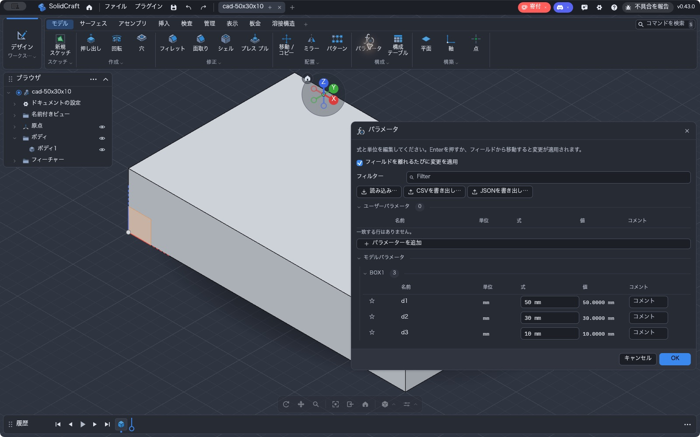
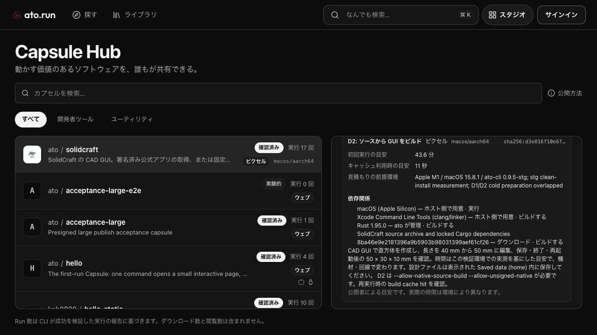

# SolidCraft GUI — 公開 staging CLI 0.9.5-stg 受け入れ（2026-11-18）

Status: Current — **合格**。公開 installer から D1/D2 の GUI 起動、CAD 作成・編集・保存・再起動、D2 cache hit まで実機確認。本番反映なし。

## 実装と配布

従来の terminal route は GUI をインストールする経路ではなかった。今回の GUI カプセルは同じ SolidCraft 0.43.0 に対して、D1 を公式署名済み DMG、D2 を固定ソースからの GUI ビルドとして宣言する。
GUI の Contract は旧 terminal Contract と別で、初回 D1/D2 は同一の GUI Contract を使う。
`ato app install` は永続 Instance を作り、取得・検証・起動する。保存データは表示された `Saved data (home)` 内に置き、`ato app start` で再起動する。`ato run` は一時実行のまま。

- ato [#1898](https://github.com/ato-run/ato/pull/1898) → [#1899](https://github.com/ato-run/ato/pull/1899): local-window Adapter、DMG materializer、永続 GUI lifecycle、ソース GUI の署名付きローカル app wrapper。
- ato-pwa [#1047](https://github.com/ato-run/ato-pwa/pull/1047) → [#1050](https://github.com/ato-run/ato-pwa/pull/1050): staging installer を 0.9.5-stg に固定。
- [v0.9.5-stg](https://github.com/ato-run/ato/releases/tag/v0.9.5-stg) は prerelease / latest=false。macOS arm64 のみ。[公開 workflow](https://github.com/ato-run/ato/actions/runs/44122895749) 成功。
- [staging Hub](https://stg-app.ato.run/capsules/ato/solidcraft) に GUI bundle、各 D の実測に基づく所要時間・依存関係・保存手順を反映。

## 固定した配備

| 対象 | 値 |
| --- | --- |
| CLI source | `8e35343f34eabdc9defbaf94f44e5901b643cf3d` |
| CLI identity | `0.9.5-stg / release / git_dirty=false` |
| PWA source | `933c756740715d48b793ca182df3cc36edc0b54e` |
| API deployed source（変更なし） | `62aeca4e8445769d7d3861697883d18c0eca0ab1` |
| PWA Worker | `d1c99ec8-5fd7-447f-924c-3c439a0ab055` |
| API Worker | `ddaefe5c-86f6-4d45-9a87-4adee10b83df` |
| CLI archive | `sha256:b800eeeb131c0ee6a685b74cbc81954f1593fb237a96ec40cbd34d497964ca45` |
| Installed CLI | `sha256:bc588fb23505357dd4ba4e297e70223bbb126a8de00d38cb4a5b90a0bef78a54` |
| Served installer | `sha256:c4cd9e61f0820eaaf0a6350d4162738109488c1fc38f10c71efbd61532cd7827` |
| GUI bundle | `sha256:bd9ede29c27274ff2dd1d1cd8d5c08b251672cd8f8fffe4fda99b0129e495d47` |
| GUI Contract | `sha256:d4248fefc073c7a81333238d2c8a8e4803ed9bc4128b22ddc8acd11ca89e8fa5` |
| D1 | `sha256:9f66b8b9a95a45f070c6c3fb6148a5b8ccd34eb2cd7a069dc743048c9eb40cfa` |
| D2 | `sha256:d3e816f10e6faddf99e7d151b9e4185fafece30cc6481734f9e9cc1c82d09115` |

共有 staging lease を保持し、clean な統合済み stg から `npm run deploy:staging` で配備。配信 JavaScript の staging API origin と配信 installer の版・hash を確認した。API/PWA の active Worker version は受け入れ前後で一致し、lease 解放を確認した。API deploy、migration、feature flag 変更はない。
GitHub の自動 PWA deploy は billing/spending-limit エラーでステップ開始前に失敗したため、ローカルの通常 package deploy を使用した。

## クリーン環境と CAD の受け入れ

既存 Apple M1 / macOS ホスト上で HOME、ATO_HOME、XDG、Cargo/Rustup home、TMPDIR を新規作成した。PATH は新規 bin と OS 標準に限定。既存 CLI、認証、Rust、Cargo registry、native cache を再利用していない。OS・Xcode Command Line Tools の再インストールではない。D1/D2 は別々の空の ATO_HOME から始めた。初回準備は並行しており、時間は実機受け入れ時の経過時間で、専有環境の性能ベンチマークではない。
公開 `https://stg-app.ato.run/install.sh` を変更せず `--cli-only --no-modify-path` で実行し、7.174 秒・exit 0。公開 archive の hash、GitHub asset digest、実際にインストールした binary を照合した。

両 D で、実際の GUI から直方体を **40 × 30 × 10 mm** で作成し、パラメータを編集して **50 × 30 × 10 mm** に変更した。Instance の保存領域に `.sc` を保存し、通常終了後に `ato app start` で起動。保存した立体と三つの寸法を再確認した。

| Run | 起動までの実測 | source build cache | 署名 / local override | fully_satisfied |
| --- | --- | --- | --- | --- |
| d1 | 270.308 秒 | 対象外 | developer_id / `false` | true |
| d1-restart | 38.658 秒 | 対象外 | developer_id / `false` | true |
| d2 | 2613.751 秒 | miss | adhoc / `true` | true |
| d2-restart | 10.508 秒 | hit | adhoc / `true` | true |
| d2-cache | 17.73 秒 | hit | adhoc / `true` | true |

receipt の `fully_satisfied` は起動 PID の表示ウィンドウを観測した `/ready` の Contract 検証であり、CAD の編集・保存成功を自動判定したものではない。CAD 操作は別の UI 操作記録と保存ファイル hash、再起動後のスクリーンショットで裏付ける。
正常終了時には保存状態を含む successor Contract が作られるため、restart receipt の K は初期 K と異なる。初回 D1、初回 D2、別の空 Instance に入れた D2-cache は元の同一 K/bundle を確認した。

通常の `app install` 3 件の成功報告により、Hub の run_count は 14 → 17。過去の 14 件を GUI の検証実績とは扱わない。各 D の実測時間、依存関係、保存先と明示オプションを公開者の説明欄に反映し、staging の実画面で確認した。

## キャッシュと安全性

D2 初回は新しい managed Rust 1.95.0 と固定ソース・Cargo.lock から GUI をビルドした。初回 `miss`、同じ Instance の restart と別 Instance の D2-cache の両方で `hit` を worker log から確認した。
cache key は `sha256:3f0ac09c9e473a5b30ff6f6371c2c2a6d44f2228385e51041e64a5f39c3e6d20`、元の build output は `sha256:95e5ec0a23b7b322627bfebf014b8e32ddd9e9bd6fcf5a8884e9a9a4b14d9044`（281524392 bytes）。cache hit の各 Run では build profile を作成していない。時間の短縮だけを hit の根拠にしていない。
ソース GUI はローカルの `.app` に格納し、Info.plist を ad-hoc 署名に結合する。これは上流 Developer ID の代わりではなく、D2 の `--allow-native-source-build --allow-unsigned-native` は各起動で必要。元 build output と署名後 wrapper は区別して検証する。
D1 は Developer ID と Gatekeeper を確認。実行時は Seatbelt 必須、artifact は read-only、書き込みは Run と Instance の宣言領域に限定、外向きネットワークは不許可。macOS の表示セッションは共有であり、ウィンドウ隔離を主張しない。

## 検証範囲と証跡

- native desktop 対象 88 テスト、Rust check/fmt/clippy が成功。全 workspace のローカル試験で長い socket path に起因した 12 件は短い隔離 path で個別再実行して成功。
- 統合済み PWA stg の typecheck、unit 2944 件、staging build 成功。self-hosted CI の待機は成功扱いしない。
- CLI CI は macOS/Linux/Windows 成功。Rust CI は Linux/Windows/relay 成功。macOS 全体試験は変更外の TCP reset が 1 件発生し、該当試験のローカル再実行は成功したが、CI の再試行 2 回は hosted runner 容量不足で開始されず cancelled。全体 CI 成功とは扱わない。詳細は機械可読証跡の `ci` に記録。
- 本番 installer は前後で同一 bytes、stable latest は `v0.9.4` のまま。main merge、stable/Homebrew 更新、本番 deploy・データ更新なし。

[機械可読証跡](evidence/solidcraft-gui-staging-095-acceptance-20261118.json) は receipt 元 bytes の hash、path 置換済み投影、保存ファイル・画面の hash、配信 asset、Hub metadata を含む。生データは workspace `.tmp/gui095-e2lerkry/`、配備ログは `apps/ato/.worktrees/m2-terminal/.tmp/solidcraft-gui/release/` に保持する。lease token を含む制御ログは公開しない。

これは macOS arm64 の CLI-local GUI の受け入れであり、Hosted GUI・Windows・全 CAD 機能の受け入れではない。
