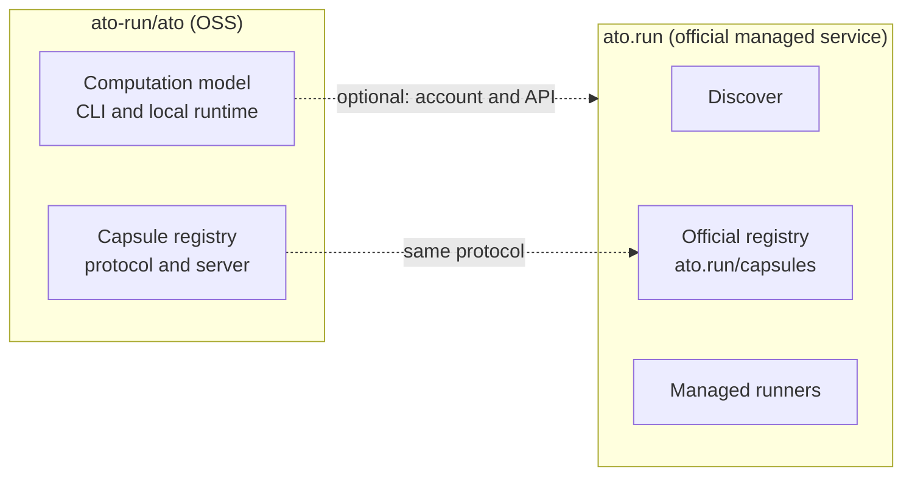

# Ato OSS and ato.run: the service boundary

Status: Draft (non-normative product and architecture boundary).
Date: 2026-11-05.

This draft records how the open-source project and the official managed service
relate. It is not a wire specification, does not change an accepted RFC, and
does not commit to a release date. Work is tracked in GitHub Issues.

## Decision

1. Keep the open-source core in `ato-run/ato`. Do not add a separate
   `ato-runner` or `capsulehub` project at this point.
2. Treat `ato.run` as the official managed service built on the same model:
   discover software, share capsules, and run them on your hardware or ours.
3. Make basic use complete without the service: local runs and durable local
   Instances must work without an ato.run account, API or registry.

If that boundary holds, ato.run can disappear without invalidating existing
capsules, the model or this repository.

## Responsibility matrix

| Capability | Ato (this repository, OSS) | ato.run (official managed service) | Status |
|---|---|---|---|
| Computation model | Defines Computation, Capsule, Contract K and Derivation D | Uses the model | Model is in the tree; service use is separate |
| CLI and runner | Provides the `ato` CLI and local runtime; the Connected Runner worker is the optional bridge | Operates official runners | Implemented in this tree |
| Self-hosting | Supported for local Runs and durable local Instances | Optional connection and management | Implemented; general state continuity is limited |
| Capsule registry | Protocol and server | Official registry surface | **Not implemented in the OSS tree** |
| Capsule distribution | Any `.capsule` file; any registry once a protocol exists | `ato.run/capsules` | File transport works today |
| Application discovery | Not required | Discover | Service-side |
| Execution | User-owned hardware | Managed cloud is also available | Local implemented; managed is service-side |
| Billing | None | Compute, storage and management | Not part of the model |

## Architecture

The dotted edges are optional integrations. They must not become required
inputs of the model. A self-hosted registry, once implemented, is not a
second-class mode of the protocol.

## Boundary principles

- **No service identity in Ato data.** Ato formats and wire documents must not
  require an ato.run account, tenant ID or service URL.
- **Registry location is deployment.** A client must be able to point at any
  registry; the official registry is one deployment, not an authority embedded
  in the model.
- **No service credential for self-hosted work.** A self-hosted runner executes
  local work without ato.run credentials. Connected Runner enrollment is the
  optional bridge for service-mediated work.
- **Service policy stays service-side.** Billing, Discover review and moderation
  are service concerns; do not add them to Contract K, Derivation D or the
  Capsule identity.
- **Failure isolation.** Losing ato.run must not invalidate capsules, local
  Instances or this repository's ability to run them.

## Proposed sequencing and current gaps

This is the planned order, not a release commitment.

1. **Keep local use independent.** Implemented: `ato run`, durable local
   Instances and receipts need no account. Gaps: general cross-host state
   restoration; there is no ato.run-free remote management path.
2. **Add the OSS registry.** Not implemented. Needed: push/pull protocol,
   immutable references and versions, visibility, and bundle validation that
   reuses the existing quarantine/validator authority. No design RFC exists yet.
3. **Host the official registry.** Service-side. `ato.run/capsules` must speak
   the same protocol as a self-hosted registry; whether the current deployment
   does is not asserted here.
4. **Connect self-hosted runners.** Partially present: a Connected Runner can
   enroll and run authorized work. Not verified here: user-directed launch from
   Discover to a chosen self-hosted Runner; account-free remote management.

Non-goals for this boundary: adding new top-level projects, adding a planner or
implicit fallback to normal execution, or making service billing part of the
computation model.

## Security and state caveats

Before an OSS launch, the guarantees need explicit wording:

- Nacelle applies OS-native isolation (Seatbelt on macOS, Bubblewrap with
  Landlock on Linux). Development mode is not a security boundary and is not
  equivalent to a container or VM.
- A matching Contract does not certify security, licence compliance or the
  safety of side effects.
- Saved-data capture is bounded to declared resources. Restart persistence,
  volume transfer and a proven Hosted round-trip are separate claims; see
  [state continuity](../../concepts/state-continuity.md).

## Relationship to other documents

- [Documentation index](../../README.md) and [RFC index](../README.md).
- [Computation](../../concepts/computation.md) and
  [application contracts](../../concepts/application-contracts.md).
- [Runner and hosting](../../guides/runner-hosting.md) and
  [Connect a user-owned Runner](../../guides/connected-runner-self-host.md).
